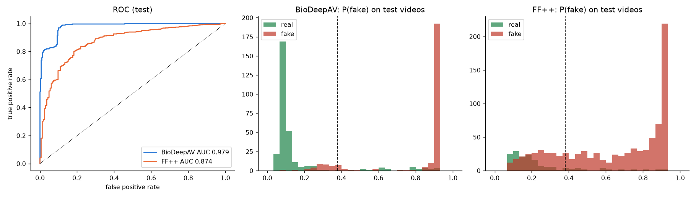
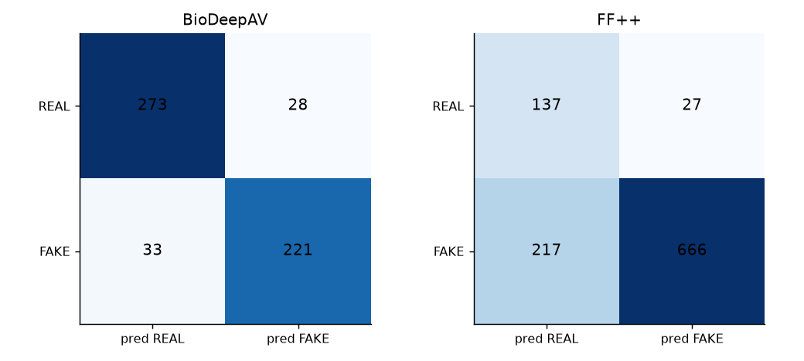

# 151026: Real / fake video detector with explainable AI

_Generated 2026-10-17 00:16:30 | BioDeepAV + FaceForensics++ C23 originals only (no degraded videos) | script 151026.py_

## Model

- EfficientNet-B0 (ImageNet-pretrained) per face frame -> temporal transformer -> attention pooling; 16 frames, face crops 192 px with a 112 px effective-resolution bottleneck (removes the resolution shortcut).
- Chosen seed 42 (validation macro-AUC 0.9455); best epoch 11; temperature 1.45; decision threshold 0.38; ECE on validation 0.156 -> 0.159.
- Split: 1,451 identity/duplicate groups, groups crossing splits 0 (0 = no leakage); exact duplicates merged 170, near-duplicate pairs merged 15516.

## Test results (held-out videos, never seen in training or model selection)

| test_set | n | n_real | n_fake | auc | accuracy | balanced_accuracy | precision | recall | specificity | f1 | tn | fp | fn | tp | accuracy_at_0_5 | ece | uncertain_pct |
|---|---|---|---|---|---|---|---|---|---|---|---|---|---|---|---|---|---|
| ALL (both datasets) | 1602 | 465 | 1137 | 0.927 | 0.810 | 0.831 | 0.942 | 0.780 | 0.882 | 0.853 | 410 | 55 | 250 | 887 | 0.757 | 0.179 | 12.734 |
| BioDeepAV | 555 | 301 | 254 | 0.979 | 0.890 | 0.889 | 0.888 | 0.870 | 0.907 | 0.879 | 273 | 28 | 33 | 221 | 0.877 | 0.120 | 6.306 |
| FF++ | 1047 | 164 | 883 | 0.874 | 0.767 | 0.795 | 0.961 | 0.754 | 0.835 | 0.845 | 137 | 27 | 217 | 666 | 0.693 | 0.271 | 16.141 |





## Per subset (FF++ manipulation methods, real folders)

| dataset | subset | n | true_label | correct_pct | mean_p_fake |
|---|---|---|---|---|---|
| BioDeepAV | fake | 254 | FAKE | 87.008 | 0.815 |
| BioDeepAV | real | 301 | REAL | 90.698 | 0.154 |
| FF++ | DeepFakeDetection | 63 | FAKE | 100.000 | 0.923 |
| FF++ | Deepfakes | 164 | FAKE | 90.244 | 0.756 |
| FF++ | Face2Face | 164 | FAKE | 72.561 | 0.582 |
| FF++ | FaceShifter | 164 | FAKE | 75.000 | 0.628 |
| FF++ | FaceSwap | 164 | FAKE | 77.439 | 0.641 |
| FF++ | NeuralTextures | 164 | FAKE | 52.439 | 0.451 |
| FF++ | original | 164 | REAL | 83.537 | 0.239 |

## Training history

| epoch | train_loss | epoch_time_s | val_auc_BioDeepAV | val_auc_FF++ | val_score |
|---|---|---|---|---|---|
| 1 | 0.690 | 213.986 | 0.968 | 0.598 | 0.783 |
| 2 | 0.567 | 165.854 | 0.984 | 0.710 | 0.847 |
| 3 | 0.527 | 166.113 | 0.987 | 0.773 | 0.880 |
| 4 | 0.492 | 165.981 | 0.986 | 0.831 | 0.909 |
| 5 | 0.473 | 165.959 | 0.979 | 0.856 | 0.918 |
| 6 | 0.458 | 165.594 | 0.985 | 0.870 | 0.928 |
| 7 | 0.431 | 165.811 | 0.991 | 0.877 | 0.934 |
| 8 | 0.422 | 165.696 | 0.983 | 0.894 | 0.938 |
| 9 | 0.404 | 165.712 | 0.985 | 0.900 | 0.943 |
| 10 | 0.392 | 165.878 | 0.989 | 0.899 | 0.944 |
| 11 | 0.383 | 165.321 | 0.988 | 0.903 | 0.945 |
| 12 | 0.374 | 165.424 | 0.990 | 0.897 | 0.944 |

## Explainability

- Grad-CAM++ heat-maps (last EfficientNet block), temporal attention per frame and, in prediction mode, occlusion sensitivity.
- Faithfulness test: blur the top-20 % Grad-CAM pixels vs a random 20 % of pixels; a faithful explanation lowers the confidence of the predicted class more (cam_beats_random_pct well above 50 %).

| dataset | n | mean_drop_top20_cam | mean_drop_random20 | cam_beats_random_pct | cam_energy_in_face_centre |
|---|---|---|---|---|---|
| BioDeepAV | 100 | 0.088 | 0.365 | 46.000 | 0.681 |
| FF++ | 100 | 0.285 | 0.192 | 54.000 | 0.875 |

Example explanations (correct and wrong decisions): `E:\Code\run_151026\xai`

## Using the detector on any video

```
python 151026.py --predict "path\to\video.mp4"
python 151026.py --predict "path\to\folder"
python 151026.py --phase gui
```
Verdicts within ±0.10 of the threshold are reported as **uncertain**. The detector is trained on face-swap / re-enactment deepfakes of these two datasets; for other generators (e.g. fully synthetic diffusion videos) or videos without a visible face its output is less reliable. Heat-maps show where the evidence is, not proof of manipulation.