# FINAL TEST - robust, explainable and calibrated video deepfake detector

_Generated 2026-10-28 21:58:32 | FINALTEST.py (SHA-256 94be0af5c305514c...) | protocol SHA-256 3291c1a2bd3b5692..._

**Status: COMPLETE** - 27 of 27 planned runs finished; final model frozen; prediction-pipeline check PASS.

## 1. Design (fixed before training; see configs/final_test_protocol.json)

- **Data**: the prepared Test 5 run, read-only - same split, same face-crop caches (80 px face bottleneck), same verified degraded versions and the same 720 Grad-CAM pairs. Every result is therefore paired with Test 5 (5A, 5C) and Test 7 (6A, 6B) on identical test videos and seeds.
- **Model**: EfficientNet-B0 (ImageNet) per face frame -> temporal transformer -> attention pooling; video only; 192 px input.
- **F0** ImageNet EfficientNet-B0 + temporal transformer + attention pooling, fine-tuned on clean originals with the group-DRO dataset x folder sampler (151026 / harddro12 recipe).
- **F1** F0 + degradation-aware Stage 2: unpaired 50/50 original/degraded clips, natural degradation mixture.
- **F2** F0 + explanation-consistent Stage 2: paired original/degraded clips + Grad-CAM consistency + supervised contrastive consistency (final system).
- **Training sets**: Joint (the final single detector), BioDeepAV, FF++; seeds 42, 123, 2026.
- **Decisions**: temperature scaling + validation threshold per run; the frozen final model adds isotonic calibration and an UNCERTAIN band tuned for 90% validation coverage.
- **Statistics**: paired cluster bootstrap over source-identity groups (seeds averaged) + sign agreement of every seed; Holm over the 8 primary comparisons; non-inferiority margins 0.01 AUC / 0.05 IoU.

## 2. Input link (Test 5, read-only)

- status **PASS**; 10702 originals, 19729 degraded versions; split manifest SHA-256 `56bc3edaf2f2a06d...`; preprocessing code `ce57c0c8e3c402de...`
- baselines found: T5-5A: 6 prediction / 6 Grad-CAM files; T5-5C: 6 prediction / 6 Grad-CAM files; T7-6A: 9 prediction / 9 Grad-CAM files; T7-6B: 9 prediction / 9 Grad-CAM files

## 3. Runs

| run_id | best_epoch | epochs_run | best_val_score | temperature | threshold | val_ece_raw | val_ece | val_ece_isotonic | batch_clips | accum | train_time_s |
|---|---|---|---|---|---|---|---|---|---|---|---|
| train-BioDeepAV_seed123_F0 | 6 | 10 | 0.992 | 1.491 | 0.170 | 0.149 | 0.158 | 0.000 | 8 | 2 | 4014.964 |
| train-BioDeepAV_seed123_F1 | 1 | 5 | 0.960 | 1.252 | 0.220 | 0.076 | 0.070 | 0.000 | 8 | 2 | 4063.500 |
| train-BioDeepAV_seed123_F2 | 1 | 5 | 0.953 | 1.316 | 0.270 | 0.088 | 0.082 | 0.000 | 8 | 2 | 3981.310 |
| train-BioDeepAV_seed2026_F0 | 2 | 6 | 0.874 | 0.671 | 0.520 | 0.108 | 0.110 | 0.000 | 8 | 2 | 2534.435 |
| train-BioDeepAV_seed2026_F1 | 3 | 7 | 0.931 | 1.191 | 0.610 | 0.057 | 0.066 | 0.000 | 8 | 2 | 5708.249 |
| train-BioDeepAV_seed2026_F2 | 4 | 8 | 0.941 | 1.025 | 0.530 | 0.074 | 0.074 | 0.000 | 8 | 2 | 6576.212 |
| train-BioDeepAV_seed42_F0 | 2 | 6 | 0.950 | 0.450 | 0.500 | 0.153 | 0.061 | 0.000 | 8 | 2 | 2367.978 |
| train-BioDeepAV_seed42_F1 | 2 | 6 | 0.900 | 1.162 | 0.630 | 0.092 | 0.091 | 0.000 | 8 | 2 | 4743.520 |
| train-BioDeepAV_seed42_F2 | 1 | 5 | 0.902 | 0.723 | 0.340 | 0.109 | 0.095 | 0.000 | 8 | 2 | 3915.902 |
| train-FFpp_seed123_F0 | 12 | 12 | 0.881 | 1.252 | 0.570 | 0.157 | 0.161 | 0.000 | 8 | 2 | 11246.898 |
| train-FFpp_seed123_F1 | 8 | 8 | 0.892 | 1.252 | 0.670 | 0.090 | 0.090 | 0.000 | 8 | 2 | 14769.566 |
| train-FFpp_seed123_F2 | 8 | 8 | 0.886 | 1.078 | 0.640 | 0.108 | 0.112 | 0.000 | 8 | 2 | 15037.226 |
| train-FFpp_seed2026_F0 | 11 | 12 | 0.895 | 1.162 | 0.510 | 0.124 | 0.128 | 0.000 | 8 | 2 | 11051.927 |
| train-FFpp_seed2026_F1 | 8 | 8 | 0.890 | 1.284 | 0.530 | 0.121 | 0.125 | 0.000 | 8 | 2 | 14744.405 |
| train-FFpp_seed2026_F2 | 8 | 8 | 0.883 | 1.051 | 0.600 | 0.055 | 0.060 | 0.000 | 8 | 2 | 14946.291 |
| train-FFpp_seed42_F0 | 12 | 12 | 0.899 | 1.105 | 0.440 | 0.152 | 0.156 | 0.000 | 8 | 2 | 10594.652 |
| train-FFpp_seed42_F1 | 7 | 8 | 0.895 | 1.078 | 0.520 | 0.099 | 0.097 | 0.000 | 8 | 2 | 14595.449 |
| train-FFpp_seed42_F2 | 6 | 8 | 0.881 | 1.000 | 0.630 | 0.086 | 0.086 | 0.000 | 8 | 2 | 14410.907 |
| train-Joint_seed123_F0 | 4 | 8 | 0.837 | 1.025 | 0.510 | 0.140 | 0.141 | 0.000 | 8 | 2 | 10237.157 |
| train-Joint_seed123_F1 | 1 | 5 | 0.778 | 1.191 | 0.610 | 0.089 | 0.095 | 0.000 | 8 | 2 | 13004.407 |
| train-Joint_seed123_F2 | 1 | 5 | 0.748 | 1.133 | 0.540 | 0.101 | 0.103 | 0.000 | 8 | 2 | 13209.187 |
| train-Joint_seed2026_F0 | 2 | 6 | 0.782 | 1.051 | 0.580 | 0.109 | 0.110 | 0.000 | 8 | 2 | 8020.862 |
| train-Joint_seed2026_F1 | 1 | 5 | 0.750 | 1.284 | 0.580 | 0.083 | 0.089 | 0.000 | 8 | 2 | 13307.310 |
| train-Joint_seed2026_F2 | 5 | 8 | 0.704 | 1.914 | 0.610 | 0.131 | 0.125 | 0.000 | 8 | 2 | 21630.231 |
| train-Joint_seed42_F0 | 11 | 12 | 0.853 | 1.732 | 0.580 | 0.132 | 0.123 | 0.000 | 8 | 2 | 15284.092 |
| train-Joint_seed42_F1 | 2 | 6 | 0.803 | 1.529 | 0.690 | 0.104 | 0.096 | 0.000 | 8 | 2 | 15139.738 |
| train-Joint_seed42_F2 | 2 | 6 | 0.818 | 1.418 | 0.690 | 0.128 | 0.118 | 0.000 | 8 | 2 | 15364.085 |

## 4. Detection on original and degraded test videos (seed mean +- SD)

Test 5 stored uncalibrated probabilities (its ECE is not temperature-scaled); Test 7 and the final test use temperature scaling. AUC does not depend on calibration.

| training | test | setting | model | seeds | AUC original | AUC degraded | worst-type AUC | flips % | real recognised | fake detected | ECE original | ECE degraded | worst type |
|---|---|---|---|---|---|---|---|---|---|---|---|---|---|
| Joint | BioDeepAV | joint | T7-6A | 3 | 0.953 +- 0.006 | 0.905 +- 0.010 | 0.850 +- 0.028 | 8.3 +- 2.7 | 0.746 +- 0.194 | 0.935 +- 0.066 | 0.223 +- 0.024 | 0.253 +- 0.016 | brightness |
| Joint | BioDeepAV | joint | T7-6B | 3 | 0.931 +- 0.051 | 0.887 +- 0.044 | 0.835 +- 0.053 | 9.2 +- 0.3 | 0.692 +- 0.166 | 0.920 +- 0.056 | 0.185 +- 0.040 | 0.213 +- 0.034 | contrast |
| Joint | BioDeepAV | joint | F0 (Stage 1) | 3 | 0.933 +- 0.021 | 0.910 +- 0.008 | 0.804 +- 0.014 | 12.3 +- 2.2 | 0.861 +- 0.023 | 0.854 +- 0.190 | 0.168 +- 0.040 | 0.175 +- 0.044 | brightness |
| Joint | BioDeepAV | joint | F1 (degraded) | 3 | 0.954 +- 0.005 | 0.940 +- 0.003 | 0.903 +- 0.007 | 9.0 +- 2.0 | 0.886 +- 0.013 | 0.967 +- 0.014 | 0.132 +- 0.032 | 0.118 +- 0.034 | brightness |
| Joint | BioDeepAV | joint | F2 (final system) | 3 | 0.938 +- 0.032 | 0.906 +- 0.029 | 0.809 +- 0.050 | 12.0 +- 6.4 | 0.923 +- 0.048 | 0.715 +- 0.237 | 0.191 +- 0.057 | 0.167 +- 0.055 | brightness |
| Joint | FF++ | joint | T7-6A | 3 | 0.472 +- 0.030 | 0.478 +- 0.022 | 0.402 +- 0.048 | 0.2 +- 0.2 | 0.002 +- 0.003 | 0.997 +- 0.002 | 0.346 +- 0.017 | 0.207 +- 0.017 | blur |
| Joint | FF++ | joint | T7-6B | 3 | 0.437 +- 0.036 | 0.457 +- 0.034 | 0.343 +- 0.062 | 0.2 +- 0.4 | 0.007 +- 0.012 | 0.998 +- 0.004 | 0.342 +- 0.005 | 0.202 +- 0.005 | compression |
| Joint | FF++ | joint | F0 (Stage 1) | 3 | 0.855 +- 0.084 | 0.753 +- 0.089 | 0.596 +- 0.073 | 15.7 +- 1.2 | 0.690 +- 0.203 | 0.812 +- 0.035 | 0.197 +- 0.008 | 0.160 +- 0.002 | brightness |
| Joint | FF++ | joint | F1 (degraded) | 3 | 0.868 +- 0.064 | 0.784 +- 0.076 | 0.672 +- 0.104 | 15.2 +- 1.2 | 0.717 +- 0.217 | 0.818 +- 0.035 | 0.161 +- 0.017 | 0.101 +- 0.018 | low_resolution |
| Joint | FF++ | joint | F2 (final system) | 3 | 0.878 +- 0.036 | 0.815 +- 0.037 | 0.680 +- 0.109 | 13.1 +- 1.1 | 0.875 +- 0.122 | 0.701 +- 0.118 | 0.222 +- 0.046 | 0.148 +- 0.034 | low_resolution |
| BioDeepAV | BioDeepAV | in-domain | T5-5A | 3 | 0.966 +- 0.032 | 0.939 +- 0.038 | 0.858 +- 0.053 | 6.5 +- 0.7 | 0.621 +- 0.364 | 0.990 +- 0.011 | 0.108 +- 0.068 | 0.182 +- 0.061 | brightness |
| BioDeepAV | BioDeepAV | in-domain | T5-5C | 3 | 0.952 +- 0.038 | 0.922 +- 0.047 | 0.840 +- 0.051 | 8.7 +- 1.5 | 0.690 +- 0.173 | 0.990 +- 0.005 | 0.132 +- 0.056 | 0.192 +- 0.037 | brightness |
| BioDeepAV | BioDeepAV | in-domain | T7-6A | 3 | 0.956 +- 0.014 | 0.895 +- 0.024 | 0.815 +- 0.053 | 6.7 +- 1.3 | 0.386 +- 0.097 | 0.996 +- 0.001 | 0.177 +- 0.065 | 0.202 +- 0.046 | brightness |
| BioDeepAV | BioDeepAV | in-domain | T7-6B | 3 | 0.941 +- 0.018 | 0.873 +- 0.028 | 0.797 +- 0.054 | 10.3 +- 2.6 | 0.599 +- 0.134 | 0.966 +- 0.038 | 0.243 +- 0.058 | 0.268 +- 0.045 | blur |
| BioDeepAV | BioDeepAV | in-domain | F0 (Stage 1) | 3 | 0.975 +- 0.015 | 0.946 +- 0.025 | 0.847 +- 0.027 | 9.3 +- 4.1 | 0.833 +- 0.069 | 0.940 +- 0.093 | 0.093 +- 0.056 | 0.100 +- 0.062 | brightness |
| BioDeepAV | BioDeepAV | in-domain | F1 (degraded) | 3 | 0.990 +- 0.003 | 0.982 +- 0.005 | 0.921 +- 0.030 | 4.5 +- 1.6 | 0.872 +- 0.044 | 0.996 +- 0.001 | 0.062 +- 0.010 | 0.043 +- 0.005 | brightness |
| BioDeepAV | BioDeepAV | in-domain | F2 (final system) | 3 | 0.986 +- 0.005 | 0.973 +- 0.009 | 0.916 +- 0.033 | 5.6 +- 1.9 | 0.828 +- 0.007 | 0.994 +- 0.003 | 0.078 +- 0.034 | 0.073 +- 0.051 | brightness |
| BioDeepAV | FF++ | cross-dataset | T5-5A | 3 | 0.542 +- 0.027 | 0.517 +- 0.021 | 0.385 +- 0.013 | 8.3 +- 4.1 | 0.185 +- 0.126 | 0.842 +- 0.111 | 0.486 +- 0.084 | 0.454 +- 0.073 | brightness |
| BioDeepAV | FF++ | cross-dataset | T5-5C | 3 | 0.490 +- 0.048 | 0.475 +- 0.042 | 0.371 +- 0.029 | 11.6 +- 2.2 | 0.233 +- 0.066 | 0.762 +- 0.090 | 0.520 +- 0.118 | 0.489 +- 0.098 | brightness |
| BioDeepAV | FF++ | cross-dataset | T7-6A | 3 | 0.418 +- 0.015 | 0.445 +- 0.009 | 0.361 +- 0.026 | 7.7 +- 1.1 | 0.140 +- 0.015 | 0.841 +- 0.034 | 0.567 +- 0.015 | 0.433 +- 0.029 | saturation |
| BioDeepAV | FF++ | cross-dataset | T7-6B | 3 | 0.392 +- 0.030 | 0.415 +- 0.020 | 0.343 +- 0.023 | 10.4 +- 2.4 | 0.173 +- 0.033 | 0.751 +- 0.098 | 0.577 +- 0.020 | 0.439 +- 0.012 | saturation |
| BioDeepAV | FF++ | cross-dataset | F0 (Stage 1) | 3 | 0.571 +- 0.047 | 0.518 +- 0.039 | 0.428 +- 0.017 | 20.3 +- 2.3 | 0.405 +- 0.108 | 0.701 +- 0.067 | 0.310 +- 0.057 | 0.350 +- 0.045 | brightness |
| BioDeepAV | FF++ | cross-dataset | F1 (degraded) | 3 | 0.590 +- 0.022 | 0.535 +- 0.020 | 0.449 +- 0.010 | 18.6 +- 2.3 | 0.485 +- 0.057 | 0.676 +- 0.062 | 0.279 +- 0.023 | 0.334 +- 0.022 | brightness |
| BioDeepAV | FF++ | cross-dataset | F2 (final system) | 3 | 0.579 +- 0.033 | 0.528 +- 0.031 | 0.425 +- 0.021 | 18.5 +- 3.3 | 0.462 +- 0.083 | 0.661 +- 0.092 | 0.348 +- 0.050 | 0.374 +- 0.029 | brightness |
| FF++ | BioDeepAV | cross-dataset | T5-5A | 3 | 0.500 +- 0.000 | 0.500 +- 0.000 | 0.500 +- 0.000 | 0.0 +- 0.0 | 0.000 +- 0.000 | 1.000 +- 0.000 | 0.292 +- 0.000 | 0.305 +- 0.000 | blur |
| FF++ | BioDeepAV | cross-dataset | T5-5C | 3 | 0.500 +- 0.000 | 0.500 +- 0.000 | 0.500 +- 0.000 | 0.0 +- 0.0 | 0.000 +- 0.000 | 1.000 +- 0.000 | 0.292 +- 0.000 | 0.305 +- 0.000 | blur |
| FF++ | BioDeepAV | cross-dataset | T7-6A | 3 | 0.284 +- 0.040 | 0.400 +- 0.040 | 0.263 +- 0.050 | 25.1 +- 1.1 | 0.511 +- 0.214 | 0.200 +- 0.066 | 0.303 +- 0.017 | 0.227 +- 0.013 | frame_drop |
| FF++ | BioDeepAV | cross-dataset | T7-6B | 3 | 0.246 +- 0.026 | 0.373 +- 0.026 | 0.228 +- 0.023 | 23.1 +- 3.6 | 0.353 +- 0.101 | 0.220 +- 0.076 | 0.321 +- 0.008 | 0.236 +- 0.007 | saturation |
| FF++ | BioDeepAV | cross-dataset | F0 (Stage 1) | 3 | 0.443 +- 0.046 | 0.342 +- 0.031 | 0.197 +- 0.046 | 15.7 +- 2.2 | 0.632 +- 0.037 | 0.309 +- 0.094 | 0.367 +- 0.018 | 0.379 +- 0.008 | blur |
| FF++ | BioDeepAV | cross-dataset | F1 (degraded) | 3 | 0.376 +- 0.034 | 0.344 +- 0.041 | 0.281 +- 0.059 | 12.0 +- 1.6 | 0.647 +- 0.008 | 0.330 +- 0.049 | 0.407 +- 0.017 | 0.387 +- 0.018 | compression |
| FF++ | BioDeepAV | cross-dataset | F2 (final system) | 3 | 0.393 +- 0.028 | 0.351 +- 0.041 | 0.277 +- 0.055 | 11.7 +- 1.0 | 0.642 +- 0.035 | 0.299 +- 0.107 | 0.401 +- 0.031 | 0.378 +- 0.032 | blur |
| FF++ | FF++ | in-domain | T5-5A | 3 | 0.770 +- 0.014 | 0.705 +- 0.008 | 0.570 +- 0.009 | 15.1 +- 2.6 | 0.657 +- 0.069 | 0.745 +- 0.054 | 0.165 +- 0.015 | 0.049 +- 0.009 | contrast |
| FF++ | FF++ | in-domain | T5-5C | 3 | 0.744 +- 0.037 | 0.694 +- 0.027 | 0.559 +- 0.041 | 15.7 +- 1.5 | 0.790 +- 0.062 | 0.584 +- 0.124 | 0.185 +- 0.025 | 0.053 +- 0.013 | blur |
| FF++ | FF++ | in-domain | T7-6A | 3 | 0.726 +- 0.018 | 0.650 +- 0.027 | 0.519 +- 0.040 | 18.2 +- 0.4 | 0.667 +- 0.110 | 0.663 +- 0.113 | 0.140 +- 0.005 | 0.032 +- 0.004 | contrast |
| FF++ | FF++ | in-domain | T7-6B | 3 | 0.725 +- 0.003 | 0.648 +- 0.008 | 0.500 +- 0.004 | 15.7 +- 2.5 | 0.627 +- 0.093 | 0.715 +- 0.085 | 0.139 +- 0.002 | 0.032 +- 0.015 | contrast |
| FF++ | FF++ | in-domain | F0 (Stage 1) | 3 | 0.919 +- 0.002 | 0.859 +- 0.001 | 0.734 +- 0.016 | 11.3 +- 1.0 | 0.893 +- 0.037 | 0.791 +- 0.043 | 0.192 +- 0.012 | 0.124 +- 0.014 | blur |
| FF++ | FF++ | in-domain | F1 (degraded) | 3 | 0.934 +- 0.003 | 0.899 +- 0.003 | 0.785 +- 0.007 | 9.4 +- 1.1 | 0.897 +- 0.023 | 0.821 +- 0.014 | 0.156 +- 0.019 | 0.099 +- 0.016 | low_resolution |
| FF++ | FF++ | in-domain | F2 (final system) | 3 | 0.931 +- 0.001 | 0.893 +- 0.006 | 0.805 +- 0.008 | 8.8 +- 0.4 | 0.902 +- 0.033 | 0.813 +- 0.027 | 0.141 +- 0.019 | 0.080 +- 0.018 | low_resolution |

### Per degradation type (AUC, seed mean, all severities)

| training | test | model | blur | brightness | compression | contrast | fps_reduction | frame_drop | low_resolution | motion_blur | noise | saturation |
|---|---|---|---|---|---|---|---|---|---|---|---|---|
| Joint | BioDeepAV | T7-6A | 0.891 | 0.853 | 0.924 | 0.876 | n/a | 0.955 | n/a | 0.933 | 0.919 | 0.907 |
| Joint | BioDeepAV | T7-6B | 0.857 | 0.848 | 0.901 | 0.846 | n/a | 0.932 | n/a | 0.909 | 0.916 | 0.910 |
| Joint | BioDeepAV | F0 (Stage 1) | 0.919 | 0.804 | 0.935 | 0.919 | n/a | 0.935 | n/a | 0.942 | 0.948 | 0.894 |
| Joint | BioDeepAV | F1 (degraded) | 0.953 | 0.912 | 0.946 | 0.952 | n/a | 0.954 | n/a | 0.959 | 0.958 | 0.911 |
| Joint | BioDeepAV | F2 (final system) | 0.919 | 0.825 | 0.939 | 0.927 | n/a | 0.941 | n/a | 0.945 | 0.859 | 0.891 |
| Joint | FF++ | T7-6A | 0.464 | 0.515 | 0.404 | 0.464 | 0.583 | 0.521 | 0.525 | 0.462 | 0.486 | 0.454 |
| Joint | FF++ | T7-6B | 0.492 | 0.487 | 0.343 | 0.472 | 0.587 | 0.476 | 0.524 | 0.438 | 0.485 | 0.418 |
| Joint | FF++ | F0 (Stage 1) | 0.704 | 0.606 | 0.769 | 0.788 | 0.781 | 0.845 | 0.664 | 0.840 | 0.781 | 0.748 |
| Joint | FF++ | F1 (degraded) | 0.713 | 0.729 | 0.769 | 0.824 | 0.819 | 0.848 | 0.672 | 0.858 | 0.784 | 0.777 |
| Joint | FF++ | F2 (final system) | 0.753 | 0.798 | 0.807 | 0.823 | 0.830 | 0.857 | 0.680 | 0.883 | 0.816 | 0.798 |
| BioDeepAV | BioDeepAV | T5-5A | 0.956 | 0.858 | 0.957 | 0.952 | n/a | 0.958 | n/a | 0.952 | 0.961 | 0.926 |
| BioDeepAV | BioDeepAV | T5-5C | 0.948 | 0.840 | 0.940 | 0.935 | n/a | 0.947 | n/a | 0.945 | 0.927 | 0.931 |
| BioDeepAV | BioDeepAV | T7-6A | 0.829 | 0.832 | 0.922 | 0.885 | n/a | 0.964 | n/a | 0.919 | 0.922 | 0.916 |
| BioDeepAV | BioDeepAV | T7-6B | 0.816 | 0.817 | 0.894 | 0.871 | n/a | 0.947 | n/a | 0.898 | 0.883 | 0.916 |
| BioDeepAV | BioDeepAV | F0 (Stage 1) | 0.947 | 0.847 | 0.972 | 0.971 | n/a | 0.975 | n/a | 0.973 | 0.942 | 0.936 |
| BioDeepAV | BioDeepAV | F1 (degraded) | 0.987 | 0.921 | 0.987 | 0.994 | n/a | 0.992 | n/a | 0.988 | 0.988 | 0.977 |
| BioDeepAV | BioDeepAV | F2 (final system) | 0.982 | 0.916 | 0.977 | 0.992 | n/a | 0.987 | n/a | 0.982 | 0.983 | 0.966 |
| FF++ | FF++ | T5-5A | 0.642 | 0.674 | 0.678 | 0.570 | 0.670 | 0.788 | 0.665 | 0.809 | 0.756 | 0.755 |
| FF++ | FF++ | T5-5C | 0.615 | 0.628 | 0.717 | 0.597 | 0.627 | 0.776 | 0.680 | 0.775 | 0.740 | 0.717 |
| FF++ | FF++ | T7-6A | 0.547 | 0.674 | 0.648 | 0.519 | 0.687 | 0.694 | 0.711 | 0.693 | 0.709 | 0.686 |
| FF++ | FF++ | T7-6B | 0.519 | 0.637 | 0.656 | 0.508 | 0.672 | 0.715 | 0.713 | 0.682 | 0.703 | 0.696 |
| FF++ | FF++ | F0 (Stage 1) | 0.734 | 0.843 | 0.902 | 0.874 | 0.842 | 0.903 | 0.773 | 0.910 | 0.888 | 0.870 |
| FF++ | FF++ | F1 (degraded) | 0.878 | 0.886 | 0.929 | 0.898 | 0.881 | 0.929 | 0.785 | 0.914 | 0.907 | 0.897 |
| FF++ | FF++ | F2 (final system) | 0.847 | 0.889 | 0.921 | 0.883 | 0.877 | 0.925 | 0.805 | 0.910 | 0.898 | 0.904 |

### FF++ per manipulation method (share detected; 'original (real)' = share of real videos recognised)

| training | model | videos | DeepFakeDetection | Deepfakes | Face2Face | FaceShifter | FaceSwap | NeuralTextures | original (real) |
|---|---|---|---|---|---|---|---|---|---|
| Joint | T7-6A | degraded | 0.996 | 0.998 | 0.998 | 0.995 | 0.997 | 0.995 | 0.001 |
| Joint | T7-6A | original | 0.997 | 0.997 | 0.998 | 0.998 | 0.998 | 0.995 | 0.002 |
| Joint | T7-6B | degraded | 1.000 | 1.000 | 1.000 | 0.995 | 0.998 | 0.997 | 0.006 |
| Joint | T7-6B | original | 1.000 | 0.995 | 0.997 | 0.995 | 0.998 | 0.995 | 0.007 |
| Joint | F0 (Stage 1) | degraded | 0.814 | 0.688 | 0.628 | 0.607 | 0.618 | 0.471 | 0.678 |
| Joint | F0 (Stage 1) | original | 0.968 | 0.770 | 0.670 | 0.755 | 0.663 | 0.550 | 0.690 |
| Joint | F1 (degraded) | degraded | 0.828 | 0.723 | 0.648 | 0.660 | 0.673 | 0.489 | 0.671 |
| Joint | F1 (degraded) | original | 0.965 | 0.792 | 0.677 | 0.773 | 0.680 | 0.558 | 0.717 |
| Joint | F2 (final system) | degraded | 0.812 | 0.643 | 0.517 | 0.502 | 0.512 | 0.327 | 0.823 |
| Joint | F2 (final system) | original | 0.926 | 0.677 | 0.508 | 0.572 | 0.482 | 0.325 | 0.875 |
| FF++ | T5-5A | degraded | 0.901 | 0.727 | 0.652 | 0.777 | 0.612 | 0.628 | 0.500 |
| FF++ | T5-5A | original | 0.897 | 0.725 | 0.587 | 0.737 | 0.503 | 0.533 | 0.657 |
| FF++ | T5-5C | degraded | 0.823 | 0.603 | 0.530 | 0.585 | 0.457 | 0.489 | 0.622 |
| FF++ | T5-5C | original | 0.768 | 0.553 | 0.405 | 0.533 | 0.290 | 0.368 | 0.790 |
| FF++ | T7-6A | degraded | 0.800 | 0.775 | 0.660 | 0.713 | 0.555 | 0.640 | 0.512 |
| FF++ | T7-6A | original | 0.759 | 0.790 | 0.548 | 0.618 | 0.365 | 0.592 | 0.667 |
| FF++ | T7-6B | degraded | 0.832 | 0.800 | 0.673 | 0.752 | 0.587 | 0.672 | 0.479 |
| FF++ | T7-6B | original | 0.819 | 0.835 | 0.590 | 0.645 | 0.433 | 0.640 | 0.627 |
| FF++ | F0 (Stage 1) | degraded | 0.909 | 0.790 | 0.657 | 0.687 | 0.673 | 0.429 | 0.802 |
| FF++ | F0 (Stage 1) | original | 0.953 | 0.793 | 0.638 | 0.755 | 0.655 | 0.432 | 0.893 |
| FF++ | F1 (degraded) | degraded | 0.918 | 0.812 | 0.710 | 0.727 | 0.728 | 0.472 | 0.843 |
| FF++ | F1 (degraded) | original | 0.943 | 0.857 | 0.700 | 0.803 | 0.733 | 0.500 | 0.897 |
| FF++ | F2 (final system) | degraded | 0.933 | 0.790 | 0.705 | 0.728 | 0.720 | 0.436 | 0.833 |
| FF++ | F2 (final system) | original | 0.964 | 0.832 | 0.678 | 0.773 | 0.700 | 0.453 | 0.902 |

## 5. Calibration and selective decisions (test videos; calibrators fitted on each run's validation videos)

### ECE by calibration method

| training | test | model | videos | ECE isotonic | ECE raw | ECE temperature |
|---|---|---|---|---|---|---|
| Joint | BioDeepAV | F0 (Stage 1) | degraded | 0.096 | 0.166 | 0.175 |
| Joint | BioDeepAV | F0 (Stage 1) | original | 0.107 | 0.136 | 0.168 |
| Joint | BioDeepAV | F1 (degraded) | degraded | 0.099 | 0.078 | 0.118 |
| Joint | BioDeepAV | F1 (degraded) | original | 0.105 | 0.088 | 0.132 |
| Joint | BioDeepAV | F2 (final system) | degraded | 0.118 | 0.125 | 0.167 |
| Joint | BioDeepAV | F2 (final system) | original | 0.139 | 0.143 | 0.191 |
| Joint | FF++ | F0 (Stage 1) | degraded | 0.091 | 0.154 | 0.160 |
| Joint | FF++ | F0 (Stage 1) | original | 0.084 | 0.179 | 0.197 |
| Joint | FF++ | F1 (degraded) | degraded | 0.070 | 0.083 | 0.101 |
| Joint | FF++ | F1 (degraded) | original | 0.087 | 0.129 | 0.161 |
| Joint | FF++ | F2 (final system) | degraded | 0.049 | 0.127 | 0.148 |
| Joint | FF++ | F2 (final system) | original | 0.116 | 0.190 | 0.222 |
| BioDeepAV | BioDeepAV | F0 (Stage 1) | degraded | 0.066 | 0.120 | 0.100 |
| BioDeepAV | BioDeepAV | F0 (Stage 1) | original | 0.070 | 0.132 | 0.093 |
| BioDeepAV | BioDeepAV | F1 (degraded) | degraded | 0.032 | 0.025 | 0.043 |
| BioDeepAV | BioDeepAV | F1 (degraded) | original | 0.042 | 0.040 | 0.062 |
| BioDeepAV | BioDeepAV | F2 (final system) | degraded | 0.049 | 0.073 | 0.073 |
| BioDeepAV | BioDeepAV | F2 (final system) | original | 0.058 | 0.081 | 0.078 |
| FF++ | FF++ | F0 (Stage 1) | degraded | 0.033 | 0.119 | 0.124 |
| FF++ | FF++ | F0 (Stage 1) | original | 0.075 | 0.183 | 0.192 |
| FF++ | FF++ | F1 (degraded) | degraded | 0.035 | 0.092 | 0.099 |
| FF++ | FF++ | F1 (degraded) | original | 0.075 | 0.143 | 0.156 |
| FF++ | FF++ | F2 (final system) | degraded | 0.030 | 0.077 | 0.080 |
| FF++ | FF++ | F2 (final system) | original | 0.077 | 0.138 | 0.141 |

### Isotonic calibration + abstention band: balanced accuracy on the decided videos

| training | test | model | videos | bal. acc. @80% | bal. acc. @90% | bal. acc. @95% | bal. acc. @100% | realised coverage @90% |
|---|---|---|---|---|---|---|---|---|
| Joint | BioDeepAV | F0 (Stage 1) | degraded | 0.836 | 0.824 | 0.824 | 0.812 | 0.962 |
| Joint | BioDeepAV | F0 (Stage 1) | original | 0.869 | 0.869 | 0.869 | 0.855 | 0.955 |
| Joint | BioDeepAV | F1 (degraded) | degraded | 0.908 | 0.887 | 0.885 | 0.880 | 0.965 |
| Joint | BioDeepAV | F1 (degraded) | original | 0.937 | 0.931 | 0.929 | 0.925 | 0.970 |
| Joint | BioDeepAV | F2 (final system) | degraded | 0.822 | 0.798 | 0.778 | 0.777 | 0.943 |
| Joint | BioDeepAV | F2 (final system) | original | 0.861 | 0.848 | 0.818 | 0.818 | 0.931 |
| Joint | FF++ | F0 (Stage 1) | degraded | 0.711 | 0.693 | 0.692 | 0.690 | 0.961 |
| Joint | FF++ | F0 (Stage 1) | original | 0.782 | 0.760 | 0.758 | 0.755 | 0.963 |
| Joint | FF++ | F1 (degraded) | degraded | 0.734 | 0.707 | 0.699 | 0.699 | 0.953 |
| Joint | FF++ | F1 (degraded) | original | 0.805 | 0.783 | 0.771 | 0.770 | 0.956 |
| Joint | FF++ | F2 (final system) | degraded | 0.766 | 0.748 | 0.736 | 0.734 | 0.959 |
| Joint | FF++ | F2 (final system) | original | 0.824 | 0.802 | 0.792 | 0.789 | 0.965 |
| BioDeepAV | BioDeepAV | F0 (Stage 1) | degraded | 0.895 | 0.886 | 0.861 | 0.857 | 0.930 |
| BioDeepAV | BioDeepAV | F0 (Stage 1) | original | 0.923 | 0.918 | 0.885 | 0.885 | 0.940 |
| BioDeepAV | BioDeepAV | F1 (degraded) | degraded | 0.942 | 0.933 | 0.931 | 0.927 | 0.979 |
| BioDeepAV | BioDeepAV | F1 (degraded) | original | 0.953 | 0.940 | 0.937 | 0.934 | 0.982 |
| BioDeepAV | BioDeepAV | F2 (final system) | degraded | 0.933 | 0.914 | 0.905 | 0.903 | 0.975 |
| BioDeepAV | BioDeepAV | F2 (final system) | original | 0.944 | 0.918 | 0.908 | 0.909 | 0.986 |
| FF++ | FF++ | F0 (Stage 1) | degraded | 0.819 | 0.793 | 0.790 | 0.785 | 0.968 |
| FF++ | FF++ | F0 (Stage 1) | original | 0.873 | 0.853 | 0.849 | 0.844 | 0.971 |
| FF++ | FF++ | F1 (degraded) | degraded | 0.851 | 0.832 | 0.822 | 0.819 | 0.952 |
| FF++ | FF++ | F1 (degraded) | original | 0.886 | 0.870 | 0.862 | 0.859 | 0.970 |
| FF++ | FF++ | F2 (final system) | degraded | 0.847 | 0.823 | 0.818 | 0.811 | 0.952 |
| FF++ | FF++ | F2 (final system) | original | 0.889 | 0.867 | 0.860 | 0.856 | 0.968 |

## 6. Grad-CAM stability between each original and its degraded version (720 pre-registered pairs)

IoU = overlap of the top-20 % Grad-CAM regions; clean-reference IoU = the same video seen on the other 8 frames (natural variability); relative IoU = IoU / clean-reference IoU. Stability is not correctness.

| training | test | setting | model | seeds | IoU all | IoU hard | Pearson r | changed while stable % | clean-reference IoU | relative IoU | Grad-CAM++ IoU | attention r |
|---|---|---|---|---|---|---|---|---|---|---|---|---|
| Joint | BioDeepAV | joint | T7-6A | 3 | 0.462 +- 0.017 | 0.383 +- 0.006 | 0.653 +- 0.023 | 52.5 +- 5.6 | 0.519 +- 0.035 | 0.892 +- 0.028 | n/a | n/a |
| Joint | BioDeepAV | joint | T7-6B | 3 | 0.542 +- 0.040 | 0.434 +- 0.040 | 0.746 +- 0.030 | 39.8 +- 8.9 | 0.596 +- 0.038 | 0.909 +- 0.014 | n/a | n/a |
| Joint | BioDeepAV | joint | F0 (Stage 1) | 3 | 0.554 +- 0.042 | 0.477 +- 0.046 | 0.711 +- 0.064 | 37.2 +- 6.6 | 0.668 +- 0.040 | 0.829 +- 0.037 | 0.695 +- 0.044 | 0.896 +- 0.020 |
| Joint | BioDeepAV | joint | F1 (degraded) | 3 | 0.568 +- 0.026 | 0.486 +- 0.036 | 0.738 +- 0.029 | 35.6 +- 5.0 | 0.689 +- 0.020 | 0.825 +- 0.024 | 0.714 +- 0.034 | 0.850 +- 0.017 |
| Joint | BioDeepAV | joint | F2 (final system) | 3 | 0.626 +- 0.085 | 0.554 +- 0.101 | 0.778 +- 0.080 | 28.6 +- 9.4 | 0.719 +- 0.101 | 0.870 +- 0.027 | 0.740 +- 0.017 | 0.877 +- 0.103 |
| Joint | FF++ | joint | T7-6A | 3 | 0.509 +- 0.028 | 0.373 +- 0.029 | 0.680 +- 0.047 | 44.7 +- 4.1 | 0.453 +- 0.006 | 1.126 +- 0.075 | n/a | n/a |
| Joint | FF++ | joint | T7-6B | 3 | 0.657 +- 0.068 | 0.515 +- 0.065 | 0.830 +- 0.053 | 25.3 +- 9.5 | 0.549 +- 0.071 | 1.199 +- 0.041 | n/a | n/a |
| Joint | FF++ | joint | F0 (Stage 1) | 3 | 0.648 +- 0.034 | 0.539 +- 0.054 | 0.797 +- 0.030 | 22.5 +- 3.9 | 0.660 +- 0.025 | 0.982 +- 0.020 | 0.802 +- 0.061 | 0.861 +- 0.025 |
| Joint | FF++ | joint | F1 (degraded) | 3 | 0.663 +- 0.019 | 0.551 +- 0.038 | 0.809 +- 0.016 | 23.4 +- 1.5 | 0.664 +- 0.033 | 1.000 +- 0.071 | 0.831 +- 0.022 | 0.836 +- 0.033 |
| Joint | FF++ | joint | F2 (final system) | 3 | 0.716 +- 0.040 | 0.628 +- 0.053 | 0.856 +- 0.044 | 15.3 +- 4.6 | 0.703 +- 0.038 | 1.019 +- 0.033 | 0.835 +- 0.024 | 0.877 +- 0.076 |
| BioDeepAV | BioDeepAV | in-domain | T5-5A | 3 | 0.602 +- 0.021 | 0.436 +- 0.014 | 0.780 +- 0.013 | 34.1 +- 1.2 | 0.786 +- 0.037 | 0.766 +- 0.014 | n/a | n/a |
| BioDeepAV | BioDeepAV | in-domain | T5-5C | 3 | 0.614 +- 0.013 | 0.459 +- 0.017 | 0.804 +- 0.015 | 30.3 +- 1.2 | 0.786 +- 0.045 | 0.782 +- 0.029 | n/a | n/a |
| BioDeepAV | BioDeepAV | in-domain | T7-6A | 3 | 0.523 +- 0.043 | 0.439 +- 0.035 | 0.705 +- 0.061 | 42.7 +- 9.1 | 0.608 +- 0.047 | 0.861 +- 0.038 | n/a | n/a |
| BioDeepAV | BioDeepAV | in-domain | T7-6B | 3 | 0.578 +- 0.036 | 0.498 +- 0.018 | 0.774 +- 0.027 | 32.6 +- 7.1 | 0.633 +- 0.047 | 0.914 +- 0.018 | n/a | n/a |
| BioDeepAV | BioDeepAV | in-domain | F0 (Stage 1) | 3 | 0.530 +- 0.030 | 0.455 +- 0.049 | 0.725 +- 0.028 | 38.8 +- 7.1 | 0.656 +- 0.042 | 0.810 +- 0.051 | 0.651 +- 0.020 | 0.894 +- 0.069 |
| BioDeepAV | BioDeepAV | in-domain | F1 (degraded) | 3 | 0.535 +- 0.027 | 0.455 +- 0.021 | 0.729 +- 0.023 | 40.7 +- 4.1 | 0.661 +- 0.039 | 0.809 +- 0.026 | 0.680 +- 0.029 | 0.906 +- 0.015 |
| BioDeepAV | BioDeepAV | in-domain | F2 (final system) | 3 | 0.564 +- 0.050 | 0.487 +- 0.059 | 0.754 +- 0.045 | 36.2 +- 7.0 | 0.699 +- 0.061 | 0.808 +- 0.028 | 0.661 +- 0.039 | 0.892 +- 0.035 |
| BioDeepAV | FF++ | cross-dataset | T5-5A | 3 | 0.673 +- 0.016 | 0.485 +- 0.025 | 0.846 +- 0.003 | 19.8 +- 1.4 | 0.683 +- 0.040 | 0.987 +- 0.035 | n/a | n/a |
| BioDeepAV | FF++ | cross-dataset | T5-5C | 3 | 0.667 +- 0.022 | 0.487 +- 0.013 | 0.853 +- 0.004 | 20.2 +- 0.5 | 0.651 +- 0.054 | 1.028 +- 0.057 | n/a | n/a |
| BioDeepAV | FF++ | cross-dataset | T7-6A | 3 | 0.571 +- 0.042 | 0.442 +- 0.044 | 0.751 +- 0.047 | 33.4 +- 5.1 | 0.505 +- 0.034 | 1.130 +- 0.024 | n/a | n/a |
| BioDeepAV | FF++ | cross-dataset | T7-6B | 3 | 0.606 +- 0.032 | 0.481 +- 0.041 | 0.794 +- 0.026 | 27.6 +- 3.8 | 0.528 +- 0.011 | 1.148 +- 0.040 | n/a | n/a |
| BioDeepAV | FF++ | cross-dataset | F0 (Stage 1) | 3 | 0.603 +- 0.032 | 0.491 +- 0.021 | 0.798 +- 0.024 | 26.1 +- 3.8 | 0.613 +- 0.027 | 0.983 +- 0.009 | 0.722 +- 0.007 | 0.895 +- 0.054 |
| BioDeepAV | FF++ | cross-dataset | F1 (degraded) | 3 | 0.626 +- 0.028 | 0.514 +- 0.030 | 0.818 +- 0.026 | 26.4 +- 4.0 | 0.615 +- 0.024 | 1.018 +- 0.007 | 0.758 +- 0.007 | 0.901 +- 0.024 |
| BioDeepAV | FF++ | cross-dataset | F2 (final system) | 3 | 0.644 +- 0.038 | 0.538 +- 0.036 | 0.831 +- 0.030 | 22.7 +- 3.3 | 0.640 +- 0.032 | 1.006 +- 0.032 | 0.745 +- 0.030 | 0.882 +- 0.048 |
| FF++ | BioDeepAV | cross-dataset | T5-5A | 3 | 0.583 +- 0.008 | 0.423 +- 0.020 | 0.752 +- 0.003 | 36.5 +- 0.4 | 0.711 +- 0.054 | 0.823 +- 0.070 | n/a | n/a |
| FF++ | BioDeepAV | cross-dataset | T5-5C | 3 | 0.701 +- 0.052 | 0.574 +- 0.033 | 0.855 +- 0.005 | 20.8 +- 3.9 | 0.785 +- 0.067 | 0.894 +- 0.051 | n/a | n/a |
| FF++ | BioDeepAV | cross-dataset | T7-6A | 3 | 0.530 +- 0.043 | 0.443 +- 0.051 | 0.722 +- 0.041 | 33.2 +- 8.2 | 0.580 +- 0.054 | 0.915 +- 0.031 | n/a | n/a |
| FF++ | BioDeepAV | cross-dataset | T7-6B | 3 | 0.784 +- 0.018 | 0.741 +- 0.023 | 0.943 +- 0.025 | 6.7 +- 4.9 | 0.812 +- 0.008 | 0.966 +- 0.026 | n/a | n/a |
| FF++ | BioDeepAV | cross-dataset | F0 (Stage 1) | 3 | 0.588 +- 0.019 | 0.540 +- 0.029 | 0.731 +- 0.029 | 26.6 +- 0.6 | 0.683 +- 0.023 | 0.860 +- 0.020 | 0.800 +- 0.004 | 0.755 +- 0.033 |
| FF++ | BioDeepAV | cross-dataset | F1 (degraded) | 3 | 0.591 +- 0.023 | 0.534 +- 0.017 | 0.738 +- 0.022 | 28.8 +- 4.0 | 0.675 +- 0.022 | 0.876 +- 0.005 | 0.797 +- 0.009 | 0.812 +- 0.053 |
| FF++ | BioDeepAV | cross-dataset | F2 (final system) | 3 | 0.636 +- 0.026 | 0.584 +- 0.027 | 0.786 +- 0.034 | 22.9 +- 4.8 | 0.714 +- 0.017 | 0.890 +- 0.020 | 0.818 +- 0.006 | 0.799 +- 0.051 |
| FF++ | FF++ | in-domain | T5-5A | 3 | 0.614 +- 0.026 | 0.379 +- 0.025 | 0.759 +- 0.024 | 26.8 +- 4.3 | 0.604 +- 0.037 | 1.018 +- 0.054 | n/a | n/a |
| FF++ | FF++ | in-domain | T5-5C | 3 | 0.775 +- 0.020 | 0.629 +- 0.019 | 0.916 +- 0.005 | 9.5 +- 2.1 | 0.696 +- 0.055 | 1.118 +- 0.080 | n/a | n/a |
| FF++ | FF++ | in-domain | T7-6A | 3 | 0.596 +- 0.021 | 0.467 +- 0.026 | 0.788 +- 0.021 | 28.3 +- 2.2 | 0.501 +- 0.030 | 1.191 +- 0.037 | n/a | n/a |
| FF++ | FF++ | in-domain | T7-6B | 3 | 0.826 +- 0.021 | 0.756 +- 0.024 | 0.965 +- 0.000 | 4.2 +- 0.8 | 0.733 +- 0.012 | 1.127 +- 0.019 | n/a | n/a |
| FF++ | FF++ | in-domain | F0 (Stage 1) | 3 | 0.645 +- 0.020 | 0.553 +- 0.033 | 0.759 +- 0.032 | 23.9 +- 2.4 | 0.628 +- 0.015 | 1.027 +- 0.021 | 0.850 +- 0.009 | 0.762 +- 0.021 |
| FF++ | FF++ | in-domain | F1 (degraded) | 3 | 0.626 +- 0.010 | 0.543 +- 0.007 | 0.756 +- 0.019 | 27.3 +- 0.8 | 0.610 +- 0.020 | 1.027 +- 0.016 | 0.839 +- 0.006 | 0.808 +- 0.050 |
| FF++ | FF++ | in-domain | F2 (final system) | 3 | 0.692 +- 0.034 | 0.609 +- 0.051 | 0.823 +- 0.035 | 18.8 +- 3.9 | 0.670 +- 0.029 | 1.032 +- 0.009 | 0.857 +- 0.015 | 0.815 +- 0.022 |

## 7. Faithfulness under degradation (exploratory RQ)

Gain = AUC of the insertion (deletion) curve of the map minus that of a random map, grey perturbation; > 0 = the map points at evidence the model uses (* = 95 % CI above +0.005). Every 4th Grad-CAM pair, original and degraded version.

| training | model | videos | metric | all decisions | predicted FAKE | predicted REAL |
|---|---|---|---|---|---|---|
| Joint | F0 (Stage 1) | degraded | gc_del_gain_grey | -0.170 [-0.263, -0.072] | +nan [+nan, +nan] | -0.254 [-0.315, -0.173] |
| Joint | F0 (Stage 1) | degraded | gc_ins_gain_grey | +0.238 [+0.146, +0.317] * | +nan [+nan, +nan] | +0.352 [+0.295, +0.388] * |
| Joint | F0 (Stage 1) | degraded | gcpp_del_gain_grey | -0.107 [-0.151, -0.051] | +nan [+nan, +nan] | -0.185 [-0.213, -0.154] |
| Joint | F0 (Stage 1) | degraded | gcpp_ins_gain_grey | +0.140 [+0.081, +0.190] * | +nan [+nan, +nan] | +0.244 [+0.218, +0.277] * |
| Joint | F0 (Stage 1) | original | gc_del_gain_grey | -0.148 [-0.250, -0.046] | +nan [+nan, +nan] | -0.236 [-0.300, -0.161] |
| Joint | F0 (Stage 1) | original | gc_ins_gain_grey | +0.220 [+0.118, +0.314] * | +nan [+nan, +nan] | +0.346 [+0.291, +0.385] * |
| Joint | F0 (Stage 1) | original | gcpp_del_gain_grey | -0.107 [-0.164, -0.038] | +nan [+nan, +nan] | -0.180 [-0.209, -0.137] |
| Joint | F0 (Stage 1) | original | gcpp_ins_gain_grey | +0.130 [+0.045, +0.198] * | +nan [+nan, +nan] | +0.265 [+0.243, +0.293] * |
| Joint | F1 (degraded) | degraded | gc_del_gain_grey | +nan [+nan, +nan] | +nan [+nan, +nan] | +nan [+nan, +nan] |
| Joint | F1 (degraded) | degraded | gc_ins_gain_grey | +0.259 [+0.153, +0.352] * | +nan [+nan, +nan] | +nan [+nan, +nan] |
| Joint | F1 (degraded) | degraded | gcpp_del_gain_grey | +nan [+nan, +nan] | +nan [+nan, +nan] | +nan [+nan, +nan] |
| Joint | F1 (degraded) | degraded | gcpp_ins_gain_grey | +0.200 [+0.130, +0.257] * | +nan [+nan, +nan] | +nan [+nan, +nan] |
| Joint | F1 (degraded) | original | gc_del_gain_grey | -0.234 [-0.333, -0.133] | +nan [+nan, +nan] | +nan [+nan, +nan] |
| Joint | F1 (degraded) | original | gc_ins_gain_grey | +0.297 [+0.192, +0.395] * | +nan [+nan, +nan] | +0.407 [+0.332, +0.460] * |
| Joint | F1 (degraded) | original | gcpp_del_gain_grey | -0.131 [-0.207, -0.051] | +nan [+nan, +nan] | +nan [+nan, +nan] |
| Joint | F1 (degraded) | original | gcpp_ins_gain_grey | +0.258 [+0.184, +0.318] * | +nan [+nan, +nan] | +0.387 [+0.369, +0.406] * |
| Joint | F2 (final system) | degraded | gc_del_gain_grey | -0.193 [-0.272, -0.107] | +nan [+nan, +nan] | +nan [+nan, +nan] |
| Joint | F2 (final system) | degraded | gc_ins_gain_grey | +nan [+nan, +nan] | +nan [+nan, +nan] | +nan [+nan, +nan] |
| Joint | F2 (final system) | degraded | gcpp_del_gain_grey | -0.088 [-0.142, -0.024] | +nan [+nan, +nan] | +nan [+nan, +nan] |
| Joint | F2 (final system) | degraded | gcpp_ins_gain_grey | +nan [+nan, +nan] | +nan [+nan, +nan] | +nan [+nan, +nan] |
| Joint | F2 (final system) | original | gc_del_gain_grey | -0.230 [-0.320, -0.132] | +nan [+nan, +nan] | +nan [+nan, +nan] |
| Joint | F2 (final system) | original | gc_ins_gain_grey | +0.258 [+0.160, +0.351] * | +nan [+nan, +nan] | +nan [+nan, +nan] |
| Joint | F2 (final system) | original | gcpp_del_gain_grey | -0.101 [-0.172, -0.023] | +nan [+nan, +nan] | +nan [+nan, +nan] |
| Joint | F2 (final system) | original | gcpp_ins_gain_grey | +0.270 [+0.207, +0.324] * | +nan [+nan, +nan] | +nan [+nan, +nan] |

### Paired comparisons

| comparison | training | model | videos | metric | n_pairs | mean_diff | ci95_low | ci95_high | verdict |
|---|---|---|---|---|---|---|---|---|---|
| degraded - original | Joint | F0 | paired | gc_del_gain_grey | 180 | -0.018 | -0.039 | 0.005 | no supported change |
| degraded - original | Joint | F0 | paired | gc_ins_gain_grey | 180 | 0.011 | -0.028 | 0.043 | no supported change |
| degraded - original | Joint | F0 | paired | gcpp_ins_gain_grey | 180 | -0.000 | -0.032 | 0.035 | no supported change |
| degraded - original | Joint | F1 | paired | gc_del_gain_grey | 180 | n/a | n/a | n/a | no supported change |
| degraded - original | Joint | F1 | paired | gc_ins_gain_grey | 180 | -0.032 | -0.053 | -0.008 | lower on degraded videos |
| degraded - original | Joint | F1 | paired | gcpp_ins_gain_grey | 180 | -0.053 | -0.078 | -0.022 | lower on degraded videos |
| degraded - original | Joint | F2 | paired | gc_del_gain_grey | 180 | 0.036 | 0.010 | 0.056 | higher on degraded videos |
| degraded - original | Joint | F2 | paired | gc_ins_gain_grey | 180 | n/a | n/a | n/a | no supported change |
| degraded - original | Joint | F2 | paired | gcpp_ins_gain_grey | 180 | n/a | n/a | n/a | no supported change |
| F2 - F1 | Joint | F2 vs F1 | original | gc_del_gain_grey | 180 | 0.004 | -0.035 | 0.034 | no supported change |
| F2 - F1 | Joint | F2 vs F1 | original | gc_ins_gain_grey | 180 | -0.039 | -0.065 | -0.017 | lower |
| F2 - F1 | Joint | F2 vs F1 | original | gcpp_ins_gain_grey | 180 | 0.012 | -0.013 | 0.041 | no supported change |
| F2 - F0 | Joint | F2 vs F0 | original | gc_del_gain_grey | 180 | -0.082 | -0.131 | -0.048 | lower |
| F2 - F0 | Joint | F2 vs F0 | original | gc_ins_gain_grey | 180 | 0.038 | -0.017 | 0.080 | no supported change |
| F2 - F0 | Joint | F2 vs F0 | original | gcpp_ins_gain_grey | 180 | 0.140 | 0.105 | 0.173 | higher |
| F1 - F0 | Joint | F1 vs F0 | original | gc_del_gain_grey | 180 | -0.086 | -0.108 | -0.071 | lower |
| F1 - F0 | Joint | F1 vs F0 | original | gc_ins_gain_grey | 180 | 0.077 | 0.035 | 0.109 | higher |
| F1 - F0 | Joint | F1 vs F0 | original | gcpp_ins_gain_grey | 180 | 0.128 | 0.099 | 0.156 | higher |
| F2 - F1 | Joint | F2 vs F1 | degraded | gc_del_gain_grey | 180 | n/a | n/a | n/a | no supported change |
| F2 - F1 | Joint | F2 vs F1 | degraded | gc_ins_gain_grey | 180 | n/a | n/a | n/a | no supported change |
| F2 - F1 | Joint | F2 vs F1 | degraded | gcpp_ins_gain_grey | 180 | n/a | n/a | n/a | no supported change |
| F2 - F0 | Joint | F2 vs F0 | degraded | gc_del_gain_grey | 180 | -0.022 | -0.075 | 0.008 | no supported change |
| F2 - F0 | Joint | F2 vs F0 | degraded | gc_ins_gain_grey | 180 | n/a | n/a | n/a | no supported change |
| F2 - F0 | Joint | F2 vs F0 | degraded | gcpp_ins_gain_grey | 180 | n/a | n/a | n/a | no supported change |
| F1 - F0 | Joint | F1 vs F0 | degraded | gc_del_gain_grey | 180 | n/a | n/a | n/a | no supported change |
| F1 - F0 | Joint | F1 vs F0 | degraded | gc_ins_gain_grey | 180 | 0.021 | -0.015 | 0.044 | no supported change |
| F1 - F0 | Joint | F1 vs F0 | degraded | gcpp_ins_gain_grey | 180 | 0.061 | 0.033 | 0.082 | higher |

## 8. Statistics

### Primary comparisons (Holm-corrected family)

| comparison | training | test | metric | n_seeds | mean_diff | ci95_low | ci95_high | p_boot | p_holm | sign_agreement | verdict | per_seed_diffs |
|---|---|---|---|---|---|---|---|---|---|---|---|---|
| F1 - T5-5A | BioDeepAV | BioDeepAV | degraded_auc | 3 | 0.0430 | 0.0096 | 0.0639 | 0.0190 | 0.0681 | True | supported improvement | 42:+0.0820;123:+0.0289;2026:+0.0180 |
| F1 - F0 | Joint | BioDeepAV | degraded_auc | 3 | 0.0306 | 0.0037 | 0.0628 | 0.0170 | 0.0681 | True | supported improvement | 42:+0.0307;123:+0.0199;2026:+0.0411 |
| F2 - F1 | Joint | BioDeepAV | gradcam_iou_hard | 3 | 0.0679 | -0.0082 | 0.0912 | 0.0790 | 0.1580 | False | inconclusive | 42:+0.0070;123:-0.0130;2026:+0.2096 |
| F2@Joint - T5-5A@BioDeepAV | Joint | BioDeepAV | degraded_auc | 3 | -0.0332 | -0.0997 | 0.0282 | 0.2793 | 0.2793 | False | inconclusive | 42:+0.0324;123:-0.0350;2026:-0.0969 |
| F1 - T5-5A | FF++ | FF++ | degraded_auc | 3 | 0.1939 | 0.1665 | 0.2371 | 0.0010 | 0.0080 | True | supported improvement | 42:+0.1895;123:+0.2062;2026:+0.1861 |
| F1 - F0 | Joint | FF++ | degraded_auc | 3 | 0.0312 | 0.0221 | 0.0470 | 0.0010 | 0.0080 | True | supported improvement | 42:+0.0216;123:+0.0261;2026:+0.0459 |
| F2 - F1 | Joint | FF++ | gradcam_iou_hard | 3 | 0.0772 | 0.0441 | 0.0987 | 0.0010 | 0.0080 | True | supported improvement | 42:+0.0347;123:+0.0150;2026:+0.1820 |
| F2@Joint - T5-5A@FF++ | Joint | FF++ | degraded_auc | 3 | 0.1100 | 0.0868 | 0.1415 | 0.0010 | 0.0080 | True | supported improvement | 42:+0.1502;123:+0.0951;2026:+0.0848 |

### Paired comparisons (difference hi - lo; S+ supported improvement, S- supported deterioration, ns inconclusive)

| comparison | training | test | clean_auc | degraded_auc | worst_type_auc | flip_rate_pct | ece_clean | gradcam_iou_hard | changed_while_stable_pct |
|---|---|---|---|---|---|---|---|---|---|
| F1 - F0 | Joint | BioDeepAV | +0.021 ns | +0.031 S+ | +0.099 ns | -3.353 ns | -0.036 ns | +0.009 ns | -1.536 ns |
| F1 - F0 | Joint | FF++ | +0.013 ns | +0.031 S+ | +0.077 ns | -0.484 ns | -0.037 S+ | +0.012 ns | +0.881 ns |
| F1 - F0 | BioDeepAV | BioDeepAV | +0.015 ns | +0.036 S+ | +0.074 S+ | -4.841 S+ | -0.032 ns | +0.001 ns | +1.849 ns |
| F1 - F0 | FF++ | FF++ | +0.014 S+ | +0.040 S+ | +0.051 ns | -1.866 S+ | -0.037 S+ | -0.010 ns | +3.358 S- |
| F2 - F1 | Joint | BioDeepAV | -0.016 ns | -0.035 ns | -0.094 ns | +3.050 ns | +0.060 ns | +0.068 ns | -7.028 ns |
| F2 - F1 | Joint | FF++ | +0.010 ns | +0.030 ns | +0.008 ns | -2.143 S+ | +0.061 S- | +0.077 S+ | -8.090 S+ |
| F2 - F1 | BioDeepAV | BioDeepAV | -0.005 ns | -0.009 ns | -0.005 ns | +1.047 ns | +0.016 ns | +0.031 ns | -4.491 ns |
| F2 - F1 | FF++ | FF++ | -0.003 ns | -0.006 S- | +0.021 ns | -0.608 ns | -0.015 ns | +0.067 S+ | -8.521 S+ |
| F2 - F0 | Joint | BioDeepAV | +0.005 ns | -0.004 ns | +0.005 ns | -0.303 ns | +0.023 ns | +0.077 S+ | -8.564 ns |
| F2 - F0 | Joint | FF++ | +0.023 ns | +0.062 S+ | +0.084 ns | -2.627 S+ | +0.024 ns | +0.089 S+ | -7.209 S+ |
| F2 - F0 | BioDeepAV | BioDeepAV | +0.011 ns | +0.027 S+ | +0.069 S+ | -3.795 ns | -0.016 ns | +0.032 ns | -2.642 ns |
| F2 - F0 | FF++ | FF++ | +0.011 S+ | +0.034 S+ | +0.072 S+ | -2.475 S+ | -0.051 S+ | +0.056 S+ | -5.164 ns |
| F1 - T5-5A | BioDeepAV | BioDeepAV | +0.025 ns | +0.043 S+ | +0.062 ns | -1.955 ns | -0.046 ns | +0.020 ns | +6.619 ns |
| F1 - T5-5A | FF++ | FF++ | +0.163 S+ | +0.194 S+ | +0.215 S+ | -5.696 S+ | -0.009 ns | +0.164 S+ | +0.524 ns |
| F2 - T5-5A | BioDeepAV | BioDeepAV | +0.020 ns | +0.034 ns | +0.058 ns | -0.908 ns | -0.030 ns | +0.051 ns | +2.128 ns |
| F2 - T5-5A | FF++ | FF++ | +0.161 S+ | +0.188 S+ | +0.236 S+ | -6.304 S+ | -0.024 ns | +0.230 S+ | -7.997 S+ |
| F2 - T5-5C | BioDeepAV | BioDeepAV | +0.034 ns | +0.051 ns | +0.076 ns | -3.149 ns | -0.054 ns | +0.028 ns | +5.929 ns |
| F2 - T5-5C | FF++ | FF++ | +0.187 S+ | +0.199 S+ | +0.246 S+ | -6.871 S+ | -0.044 ns | -0.019 ns | +9.269 S- |
| F1 - T7-6A | Joint | BioDeepAV | +0.001 ns | +0.035 ns | +0.053 ns | +0.646 ns | -0.091 ns | +0.103 S+ | -16.899 S+ |
| F1 - T7-6A | Joint | FF++ | +0.396 S+ | +0.307 S+ | +0.271 S+ | +15.001 S- | -0.185 S+ | +0.178 S+ | -21.293 S+ |
| F1 - T7-6A | BioDeepAV | BioDeepAV | +0.035 S+ | +0.087 S+ | +0.105 ns | -2.241 ns | -0.115 ns | +0.016 ns | -2.048 ns |
| F1 - T7-6A | FF++ | FF++ | +0.207 S+ | +0.249 S+ | +0.266 S+ | -8.793 S+ | +0.016 ns | +0.076 S+ | -1.024 ns |
| F2 - T7-6B | Joint | BioDeepAV | +0.008 ns | +0.019 ns | -0.026 ns | +2.854 ns | +0.007 ns | +0.120 S+ | -11.201 ns |
| F2 - T7-6B | Joint | FF++ | +0.441 S+ | +0.358 S+ | +0.338 S+ | +12.858 S- | -0.120 ns | +0.113 S+ | -10.044 S+ |
| F2 - T7-6B | BioDeepAV | BioDeepAV | +0.044 S+ | +0.100 S+ | +0.119 ns | -4.776 ns | -0.165 ns | -0.012 ns | +3.632 ns |
| F2 - T7-6B | FF++ | FF++ | +0.206 S+ | +0.244 S+ | +0.305 S+ | -6.913 S+ | +0.002 ns | -0.147 S- | +14.520 S- |
| F2@Joint - F2@BioDeepAV | Joint | BioDeepAV | -0.047 ns | -0.067 ns | -0.107 ns | +6.461 ns | +0.113 ns | +0.068 S+ | -7.581 ns |
| F2@Joint - T5-5A@BioDeepAV | Joint | BioDeepAV | -0.027 ns | -0.033 ns | -0.049 ns | +5.553 ns | +0.083 S- | +0.119 S+ | -5.453 ns |
| F2@Joint - F2@FF++ | Joint | FF++ | -0.053 S- | -0.078 S- | -0.125 S- | +4.300 S- | +0.081 S- | +0.019 ns | -3.451 S+ |
| F2@Joint - T5-5A@FF++ | Joint | FF++ | +0.107 S+ | +0.110 S+ | +0.111 ns | -2.005 ns | +0.057 S- | +0.249 S+ | -11.448 S+ |

Full table: metrics/statistics_final.csv (levels with CIs: metrics/levels_final.csv).

## 9. Hypotheses

| hypothesis | statement | verdict |
|---|---|---|
| H1 | An ImageNet-pretrained backbone improves robustness over the Test 5 baseline (F1 vs 5A, in-domain) | partially supported |
| H2 | Degraded training also helps the pretrained detector (F1 vs F0) | partially supported |
| H3 | Explanation-consistency training improves Grad-CAM stability without losing detection (F2 vs F1) | partially supported for stability, but detection not non-inferior (margin 0.01) |
| H4 | The final joint detector beats the best earlier detector on the same test videos (F2 Joint vs 5A) | partially supported |
| H5 | The dataset-specific final detectors generalise across datasets (cross-dataset AUC CI above 0.5) | not supported |
| H6 | Isotonic calibration and abstention make decisions reliable on original and degraded videos | supported |
| RQ | Exploratory: does degradation change Grad-CAM faithfulness (Joint F2, degraded - original)? | reported (exploratory) |

- **H1** (F1 - T5-5A (in-domain)): BioDeepAV->BioDeepAV degraded_auc: +0.0430 [+0.0096, +0.0639] (supported improvement); BioDeepAV->BioDeepAV worst_type_auc: +0.0625 [-0.0300, +0.1163] (inconclusive); FF++->FF++ degraded_auc: +0.1939 [+0.1665, +0.2371] (supported improvement); FF++->FF++ worst_type_auc: +0.2151 [+0.0852, +0.3426] (supported improvement)
- **H2** (F1 - F0): BioDeepAV->BioDeepAV degraded_auc: +0.0355 [+0.0157, +0.0822] (supported improvement); BioDeepAV->BioDeepAV worst_type_auc: +0.0741 [+0.0495, +0.2012] (supported improvement); BioDeepAV->BioDeepAV flip_rate_pct: -4.8413 [-6.5276, -0.7491] (supported improvement); Joint->BioDeepAV degraded_auc: +0.0306 [+0.0037, +0.0628] (supported improvement); Joint->BioDeepAV worst_type_auc: +0.0992 [-0.0041, +0.1354] (inconclusive); Joint->BioDeepAV flip_rate_pct: -3.3530 [-4.7099, +0.0767] (inconclusive); FF++->FF++ degraded_auc: +0.0399 [+0.0271, +0.0637] (supported improvement); FF++->FF++ worst_type_auc: +0.0507 [-0.0146, +0.1630] (inconclusive); FF++->FF++ flip_rate_pct: -1.8664 [-3.0932, -1.1712] (supported improvement); Joint->FF++ degraded_auc: +0.0312 [+0.0221, +0.0470] (supported improvement); Joint->FF++ worst_type_auc: +0.0766 [-0.0022, +0.1608] (inconclusive); Joint->FF++ flip_rate_pct: -0.4839 [-1.3628, +0.9025] (inconclusive)
- **H3** (F2 - F1): BioDeepAV->BioDeepAV gradcam_iou_all: +0.0297 [+0.0191, +0.0460] (supported improvement); BioDeepAV->BioDeepAV gradcam_iou_hard: +0.0312 [+0.0162, +0.0501] (inconclusive); Joint->BioDeepAV gradcam_iou_all: +0.0572 [+0.0118, +0.0697] (inconclusive); Joint->BioDeepAV gradcam_iou_hard: +0.0679 [-0.0082, +0.0912] (inconclusive); FF++->FF++ gradcam_iou_all: +0.0656 [+0.0473, +0.0807] (supported improvement); FF++->FF++ gradcam_iou_hard: +0.0666 [+0.0457, +0.0848] (supported improvement); Joint->FF++ gradcam_iou_all: +0.0537 [+0.0301, +0.0751] (supported improvement); Joint->FF++ gradcam_iou_hard: +0.0772 [+0.0441, +0.0987] (supported improvement) | detection non-inferiority (CI lower bound > -0.01): BioDeepAV->BioDeepAV clean_auc: -0.0046 [-0.0242, -0.0014] (not shown non-inferior); BioDeepAV->BioDeepAV degraded_auc: -0.0089 [-0.0293, -0.0032] (not shown non-inferior); Joint->BioDeepAV clean_auc: -0.0156 [-0.0408, +0.0058] (not shown non-inferior); Joint->BioDeepAV degraded_auc: -0.0347 [-0.0423, +0.0005] (not shown non-inferior); FF++->FF++ clean_auc: -0.0028 [-0.0129, +0.0019] (not shown non-inferior); FF++->FF++ degraded_auc: -0.0059 [-0.0156, -0.0010] (not shown non-inferior); Joint->FF++ clean_auc: +0.0096 [-0.0006, +0.0312] (non-inferior); Joint->FF++ degraded_auc: +0.0304 [+0.0234, +0.0394] (non-inferior)
- **H4** (F2 (Joint) - 5A (dataset-specific)): Joint->BioDeepAV degraded_auc: -0.0332 [-0.0997, +0.0282] (inconclusive); Joint->BioDeepAV worst_type_auc: -0.0491 [-0.1476, +0.0295] (inconclusive); Joint->BioDeepAV flip_rate_pct: +5.5528 [-7.9155, +10.2355] (inconclusive); Joint->FF++ degraded_auc: +0.1100 [+0.0868, +0.1415] (supported improvement); Joint->FF++ worst_type_auc: +0.1107 [+0.0013, +0.2166] (inconclusive); Joint->FF++ flip_rate_pct: -2.0047 [-6.9322, +1.0767] (inconclusive)
- **H5** (cross-dataset AUC level (F2)): FF++->BioDeepAV clean_auc: 0.393 [0.088, 0.528]; FF++->BioDeepAV degraded_auc: 0.351 [0.095, 0.464]; BioDeepAV->FF++ clean_auc: 0.579 [0.499, 0.642]; BioDeepAV->FF++ degraded_auc: 0.528 [0.493, 0.565]
- **H6** (Joint F2: isotonic vs temperature; 90 % vs 100 % coverage): degraded: ECE temperature 0.157 -> isotonic 0.083; original: ECE temperature 0.206 -> isotonic 0.128 | degraded: balanced accuracy 100 % coverage 0.755 -> 90 % coverage 0.773; original: balanced accuracy 100 % coverage 0.803 -> 90 % coverage 0.825 | isotonic ECE lower in every seed/test set/condition: True; abstention raises balanced accuracy everywhere: True
- **RQ** (degraded - original): gc_del_gain_grey: +0.0359 [+0.0102, +0.0560] (higher on degraded videos); gc_ins_gain_grey: +nan [+nan, +nan] (no supported change)

## 10. Final model

- **train-Joint_seed42_F1** frozen 2026-10-28 21:55:35; rule: Joint F2 unless its mean validation score is more than 0.005 below Joint F1; best-validation seed of the chosen variant (validation data only); mean validation score F1 0.7772, F2 0.7566. F2 fell more than the tolerance below F1 on validation, so F1 was frozen (pre-registered fallback).
- Decision: P = isotonic(logit); FAKE if P >= 0.560; UNCERTAIN if |P - threshold| < 0.006 (validation coverage 100.0%) or no face found.

| test_dataset | condition | n | n_no_face | auc | balanced_accuracy_all | real_recognised | fake_detected | coverage | balanced_accuracy_decided | ece_temperature | ece_isotonic |
|---|---|---|---|---|---|---|---|---|---|---|---|
| BioDeepAV | original | 1420 | 39 | 0.958 | 0.937 | 0.899 | 0.976 | 0.973 | 0.932 | 0.105 | 0.054 |
| BioDeepAV | degraded | 4076 | 117 | 0.942 | 0.874 | 0.889 | 0.859 | 0.971 | 0.869 | 0.088 | 0.058 |
| FF++ | original | 2038 | 0 | 0.929 | 0.847 | 0.905 | 0.789 | 1.000 | 0.847 | 0.162 | 0.078 |
| FF++ | degraded | 2411 | 0 | 0.860 | 0.776 | 0.878 | 0.674 | 1.000 | 0.776 | 0.116 | 0.053 |

Model card: final_model/MODEL_CARD.md; examples: final_model/final_model_examples.png.

## 11. Prediction-pipeline check (--predict on raw videos == evaluation input)

- status **PASS** (Test 5 preprocessing hash unchanged, median pixel MAE <= 1.0 (0-255 scale) and max |delta P(fake)| <= 0.05)
- 48 re-extracted clips; pixel MAE median 0.000; max |delta P(fake)| 0.0000; verdict agreement 100%

## 12. Figures

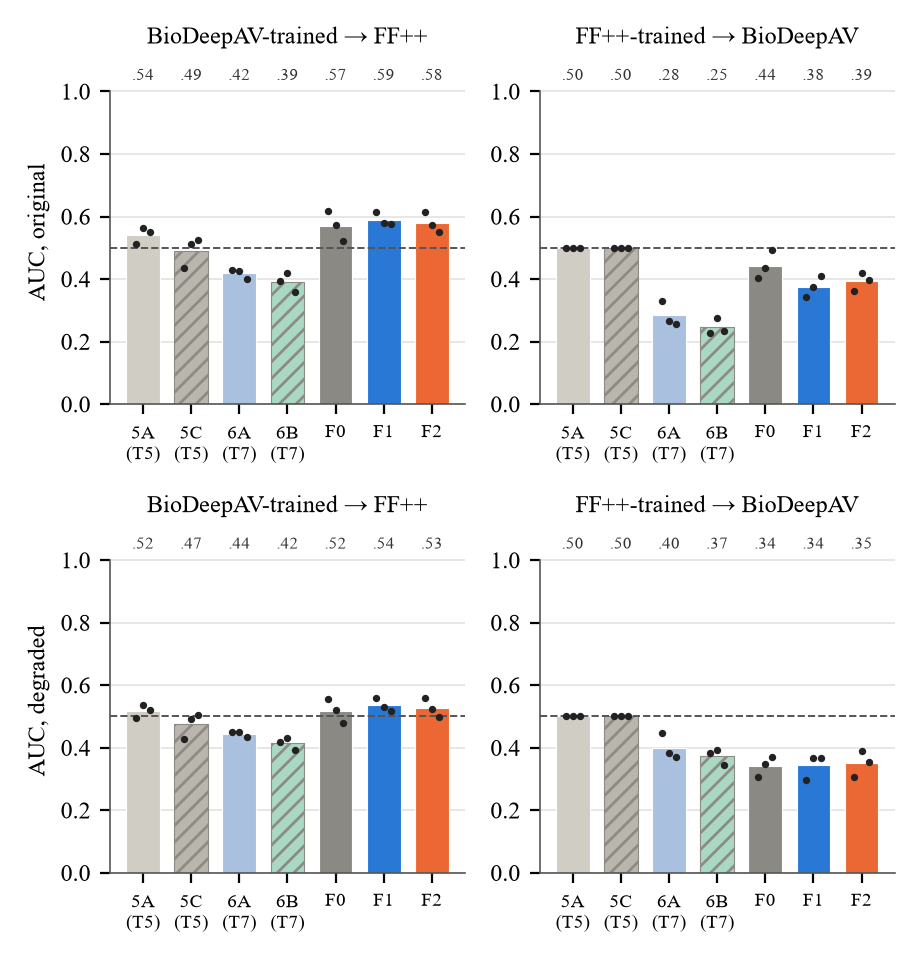
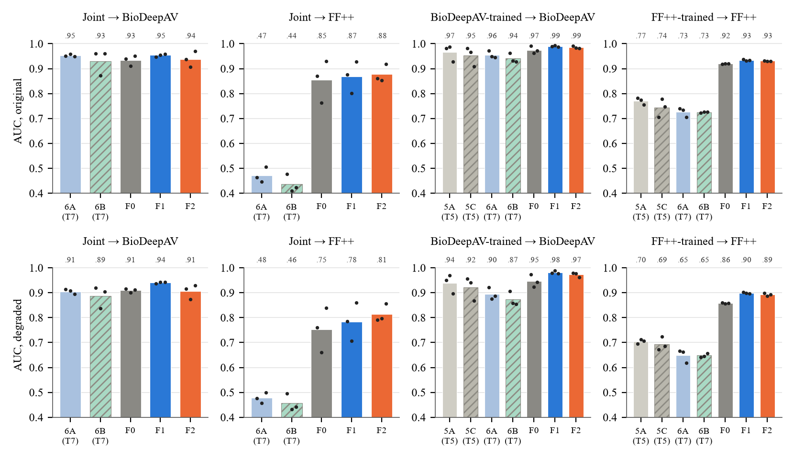
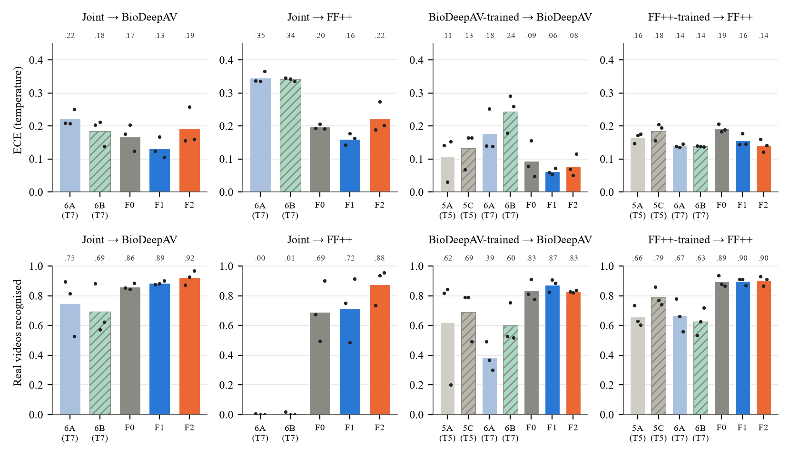
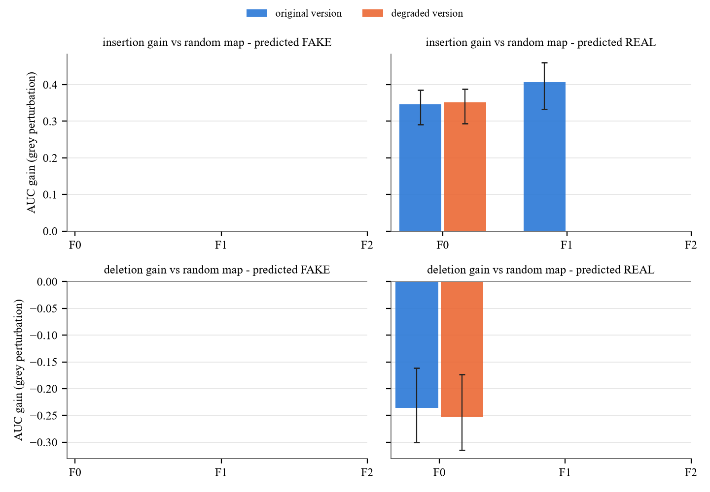
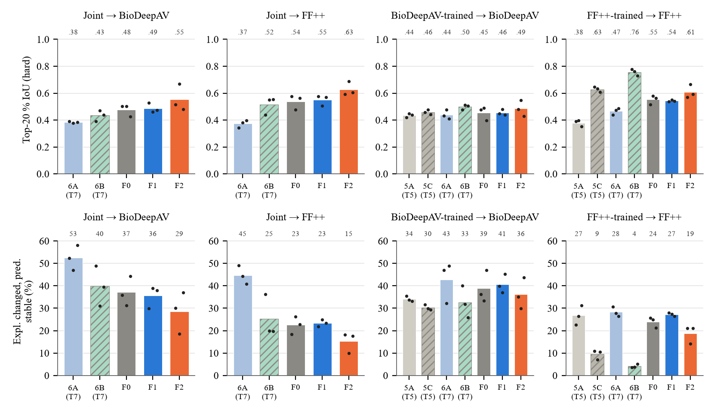
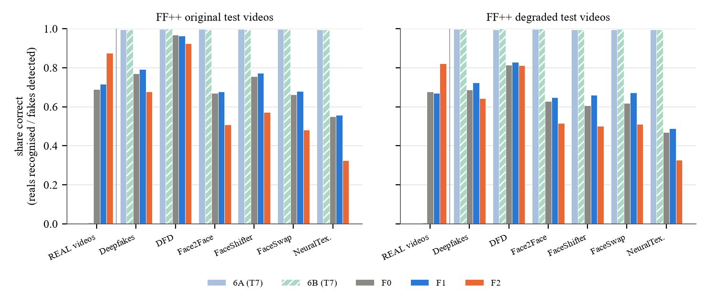
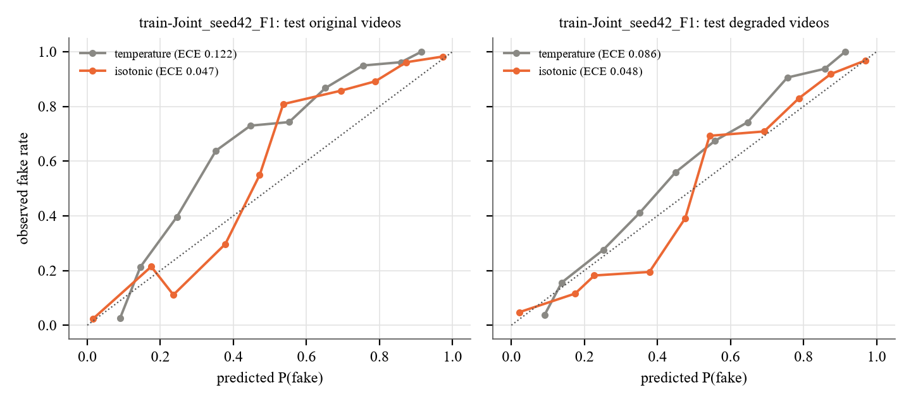
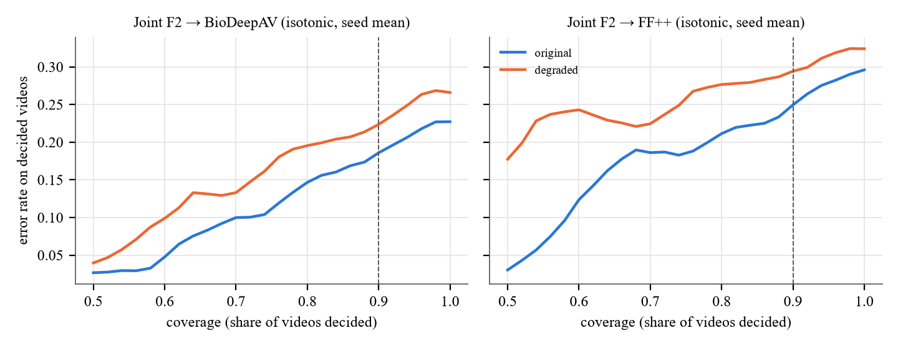
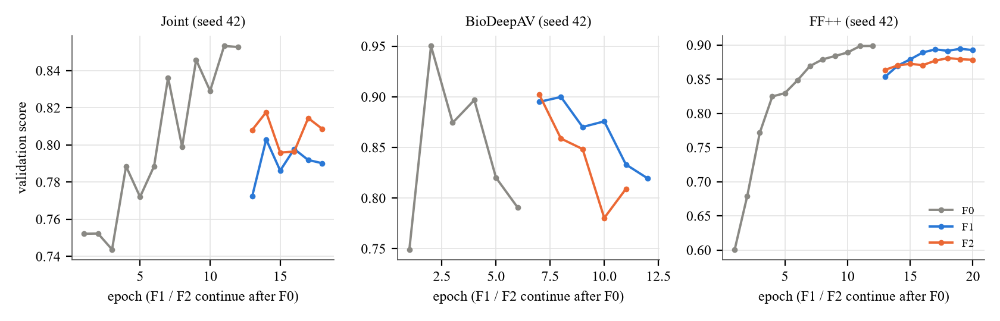
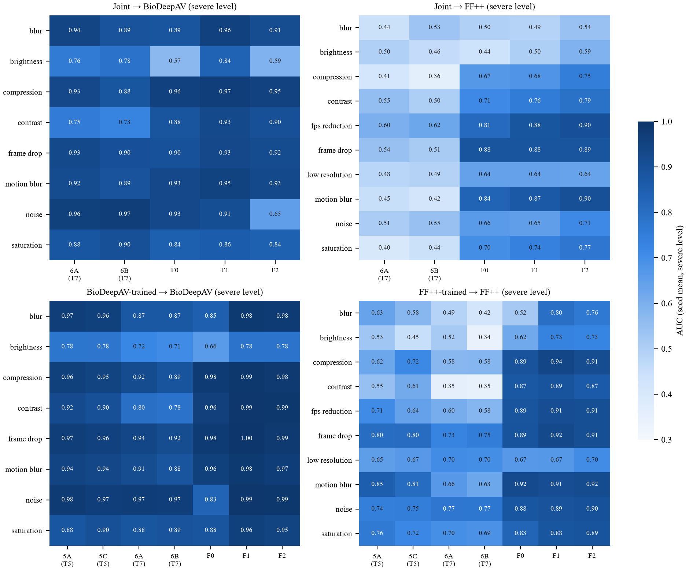
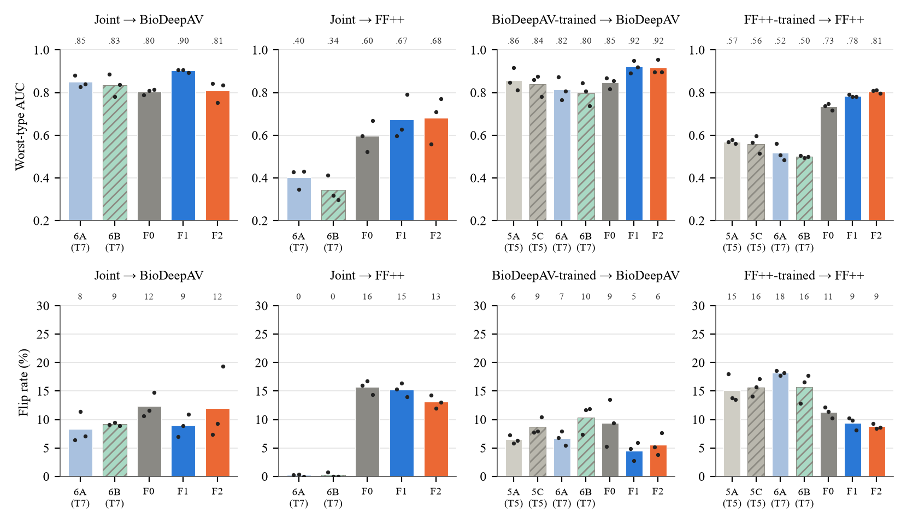
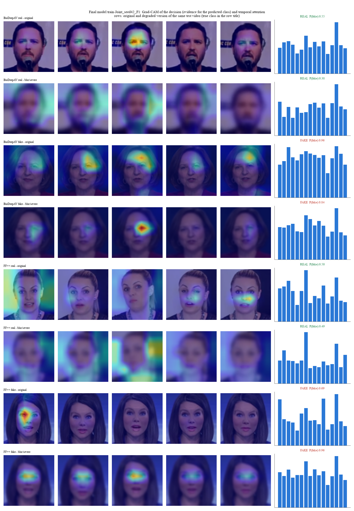

- `fig_cross_dataset.png`: Cross-dataset generalisation of the dataset-specific models (dashed = chance)
- `fig_detection_auc.png`: AUC on original (top) and degraded (bottom) test videos; dots = seeds; Test 5 / Test 7 baselines in grey / blue
- `fig_ece_real.png`: Calibration error (temperature) and share of real videos recognised
- `fig_faithfulness.png`: Grad-CAM faithfulness: insertion / deletion gain over a random map, original vs degraded version, per predicted class (95 % CI)
- `fig_gradcam_stability.png`: Grad-CAM top-20 % IoU on the hard degradation types (top) and explanations changed while the prediction stayed (bottom, %)
- `fig_per_manipulation.png`: FF++ fakes detected per manipulation method (Joint models)
- `fig_reliability_final.png`: Reliability of the final model: temperature vs isotonic calibration on test videos
- `fig_risk_coverage.png`: Risk-coverage of the Joint F2 models with isotonic calibration (dashed = 90 % deployment coverage)
- `fig_training_curves.png`: Validation score per epoch (first seed)
- `fig_type_heatmap.png`: AUC per degradation type at the severe level (seed mean)
- `fig_worst_flip.png`: Worst degradation type AUC (top) and prediction flips between original and degraded version (bottom, %)
- `../final_model/final_model_examples.png`: Final model: decisions and Grad-CAM on original / degraded test videos

## 13. Notes

- Test 5 / Test 7 numbers are read from their prediction and Grad-CAM files (normal audio condition) on the same test videos; no earlier checkpoint is loaded (guard() + logs/file_access_log.csv).
