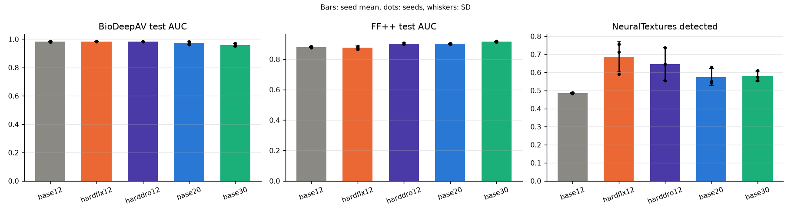
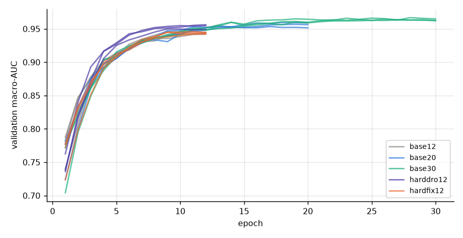
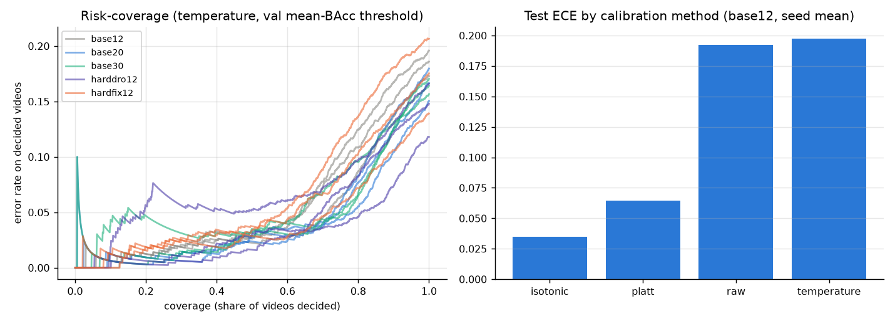
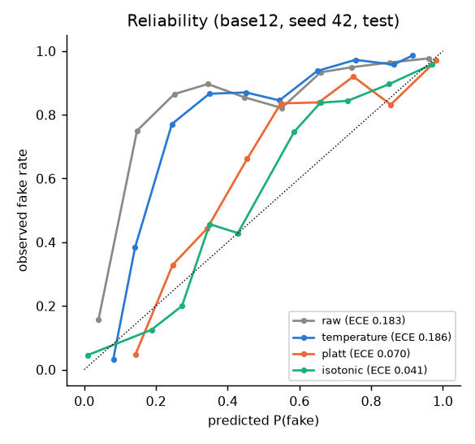
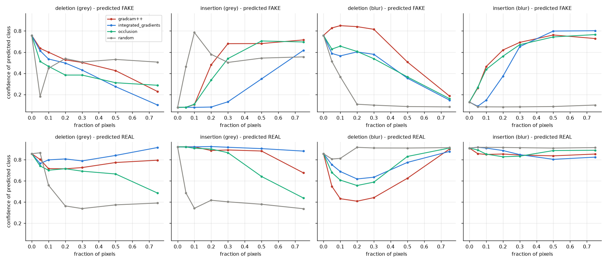

# 171026: Test 5.7 improvement suite (basic-retest follow-up)

_Generated 2026-10-17 21:19:28 | data: E:\Code\run_151026 (read-only) | base script 151026.py sha256 59396a24c8a77158…_

## Checklist

| experiment | status |
|---|---|
| E1 Baseline reproduction | done |
| E2 Three-seed evaluation | 3 / 3 seeds |
| E3 Hard-type sampling | 6 / 6 runs |
| E4 Longer training | 6 / 6 runs |
| E5 Threshold and calibration | done |
| E6 XAI faithfulness | done |

## E1 Baseline reproduction

| split_identical | groups_identical | split_sha256_151026 | split_sha256_rederived | best_epoch_151026 | best_epoch_rerun | same_best_epoch | max_abs_val_auc_diff_per_epoch | val_score_151026 | val_score_rerun | threshold_151026 | threshold_rerun | temperature_151026 | temperature_rerun | same_test_videos | prediction_agreement | p_fake_spearman | bitwise_identical_predictions | metrics_within_tolerance | reproduced |
|---|---|---|---|---|---|---|---|---|---|---|---|---|---|---|---|---|---|---|---|
| True | True | c0b494ad05426e2fd942ef9e0247bb1e89a52c459b91a9b49d2d0999c5e42d72 | c0b494ad05426e2fd942ef9e0247bb1e89a52c459b91a9b49d2d0999c5e42d72 | 11 | 11 | True | 0.007 | 0.945 | 0.946 | 0.380 | 0.360 | 1.454 | 1.491 | True | 0.919 | 0.963 | False | False | False |

| test_set | n_151026 | n_rerun | auc_151026 | accuracy_151026 | auc_rerun | accuracy_rerun | auc_diff | accuracy_diff | within_tolerance |
|---|---|---|---|---|---|---|---|---|---|
| ALL | 1602 | 1602 | 0.9266 | 0.8096 | 0.9394 | 0.8271 | 0.0128 | 0.0175 | False |
| BioDeepAV | 555 | 555 | 0.9787 | 0.8901 | 0.9855 | 0.9532 | 0.0068 | 0.0631 | False |
| FF++ | 1047 | 1047 | 0.8741 | 0.7670 | 0.8832 | 0.7603 | 0.0091 | -0.0067 | True |

## E2-E4 Test results per configuration (seed mean ± SD)

| config | test_set | n_seeds | auc | accuracy | balanced_accuracy | real_recognised | fake_detected | ece |
|---|---|---|---|---|---|---|---|---|
| base12 | ALL | 3 | 0.933 ± 0.006 | 0.815 ± 0.012 | 0.841 ± 0.008 | 0.902 ± 0.003 | 0.780 ± 0.017 | 0.197 ± 0.020 |
| base12 | BioDeepAV | 3 | 0.982 ± 0.004 | 0.933 ± 0.019 | 0.934 ± 0.021 | 0.921 ± 0.007 | 0.948 ± 0.040 | 0.102 ± 0.028 |
| base12 | FF++ | 3 | 0.880 ± 0.003 | 0.752 ± 0.008 | 0.799 ± 0.009 | 0.866 ± 0.022 | 0.731 ± 0.011 | 0.293 ± 0.012 |
| base20 | ALL | 3 | 0.942 ± 0.001 | 0.834 ± 0.015 | 0.852 ± 0.005 | 0.895 ± 0.020 | 0.810 ± 0.029 | 0.164 ± 0.006 |
| base20 | BioDeepAV | 3 | 0.974 ± 0.010 | 0.899 ± 0.020 | 0.897 ± 0.024 | 0.921 ± 0.022 | 0.873 ± 0.071 | 0.104 ± 0.010 |
| base20 | FF++ | 3 | 0.902 ± 0.002 | 0.800 ± 0.014 | 0.819 ± 0.008 | 0.846 ± 0.034 | 0.792 ± 0.023 | 0.229 ± 0.009 |
| base30 | ALL | 3 | 0.938 ± 0.004 | 0.836 ± 0.007 | 0.853 ± 0.010 | 0.893 ± 0.020 | 0.813 ± 0.004 | 0.124 ± 0.012 |
| base30 | BioDeepAV | 3 | 0.960 ± 0.010 | 0.886 ± 0.024 | 0.884 ± 0.024 | 0.905 ± 0.028 | 0.864 ± 0.033 | 0.083 ± 0.003 |
| base30 | FF++ | 3 | 0.916 ± 0.002 | 0.810 ± 0.011 | 0.835 ± 0.005 | 0.872 ± 0.006 | 0.798 ± 0.014 | 0.181 ± 0.016 |
| harddro12 | ALL | 3 | 0.948 ± 0.002 | 0.856 ± 0.024 | 0.871 ± 0.014 | 0.908 ± 0.010 | 0.835 ± 0.038 | 0.123 ± 0.020 |
| harddro12 | BioDeepAV | 3 | 0.983 ± 0.001 | 0.944 ± 0.009 | 0.944 ± 0.009 | 0.939 ± 0.005 | 0.949 ± 0.014 | 0.051 ± 0.016 |
| harddro12 | FF++ | 3 | 0.902 ± 0.004 | 0.810 ± 0.034 | 0.826 ± 0.009 | 0.850 ± 0.034 | 0.802 ± 0.046 | 0.186 ± 0.020 |
| hardfix12 | ALL | 3 | 0.931 ± 0.009 | 0.826 ± 0.034 | 0.846 ± 0.020 | 0.893 ± 0.025 | 0.799 ± 0.054 | 0.199 ± 0.011 |
| hardfix12 | BioDeepAV | 3 | 0.984 ± 0.002 | 0.943 ± 0.011 | 0.945 ± 0.011 | 0.921 ± 0.020 | 0.969 ± 0.026 | 0.088 ± 0.009 |
| hardfix12 | FF++ | 3 | 0.877 ± 0.010 | 0.764 ± 0.048 | 0.796 ± 0.017 | 0.841 ± 0.037 | 0.750 ± 0.063 | 0.295 ± 0.012 |

### Per folder (accuracy, seed mean)

| config | test_set | mean | std | count |
|---|---|---|---|---|
| base12 | BioDeepAV/fake | 0.948 | 0.040 | 3 |
| base12 | BioDeepAV/real | 0.921 | 0.007 | 3 |
| base12 | FF++/DeepFakeDetection | 1.000 | 0.000 | 3 |
| base12 | FF++/Deepfakes | 0.892 | 0.013 | 3 |
| base12 | FF++/Face2Face | 0.707 | 0.016 | 3 |
| base12 | FF++/FaceShifter | 0.756 | 0.016 | 3 |
| base12 | FF++/FaceSwap | 0.711 | 0.047 | 3 |
| base12 | FF++/NeuralTextures | 0.486 | 0.004 | 3 |
| base12 | FF++/original | 0.866 | 0.022 | 3 |
| base20 | BioDeepAV/fake | 0.873 | 0.071 | 3 |
| base20 | BioDeepAV/real | 0.921 | 0.022 | 3 |
| base20 | FF++/DeepFakeDetection | 1.000 | 0.000 | 3 |
| base20 | FF++/Deepfakes | 0.917 | 0.021 | 3 |
| base20 | FF++/Face2Face | 0.740 | 0.015 | 3 |
| base20 | FF++/FaceShifter | 0.850 | 0.025 | 3 |
| base20 | FF++/FaceSwap | 0.799 | 0.018 | 3 |
| base20 | FF++/NeuralTextures | 0.573 | 0.048 | 3 |
| base20 | FF++/original | 0.846 | 0.034 | 3 |
| base30 | BioDeepAV/fake | 0.864 | 0.033 | 3 |
| base30 | BioDeepAV/real | 0.905 | 0.028 | 3 |
| base30 | FF++/DeepFakeDetection | 1.000 | 0.000 | 3 |
| base30 | FF++/Deepfakes | 0.927 | 0.011 | 3 |
| base30 | FF++/Face2Face | 0.764 | 0.031 | 3 |
| base30 | FF++/FaceShifter | 0.833 | 0.020 | 3 |
| base30 | FF++/FaceSwap | 0.811 | 0.011 | 3 |
| base30 | FF++/NeuralTextures | 0.579 | 0.028 | 3 |
| base30 | FF++/original | 0.872 | 0.006 | 3 |
| harddro12 | BioDeepAV/fake | 0.949 | 0.014 | 3 |
| harddro12 | BioDeepAV/real | 0.939 | 0.005 | 3 |
| harddro12 | FF++/DeepFakeDetection | 1.000 | 0.000 | 3 |
| harddro12 | FF++/Deepfakes | 0.919 | 0.034 | 3 |
| harddro12 | FF++/Face2Face | 0.766 | 0.041 | 3 |
| harddro12 | FF++/FaceShifter | 0.841 | 0.028 | 3 |
| harddro12 | FF++/FaceSwap | 0.762 | 0.056 | 3 |
| harddro12 | FF++/NeuralTextures | 0.646 | 0.091 | 3 |
| harddro12 | FF++/original | 0.850 | 0.034 | 3 |
| hardfix12 | BioDeepAV/fake | 0.969 | 0.026 | 3 |
| hardfix12 | BioDeepAV/real | 0.921 | 0.020 | 3 |
| hardfix12 | FF++/DeepFakeDetection | 0.995 | 0.009 | 3 |
| hardfix12 | FF++/Deepfakes | 0.813 | 0.067 | 3 |
| hardfix12 | FF++/Face2Face | 0.722 | 0.074 | 3 |
| hardfix12 | FF++/FaceShifter | 0.787 | 0.048 | 3 |
| hardfix12 | FF++/FaceSwap | 0.648 | 0.067 | 3 |
| hardfix12 | FF++/NeuralTextures | 0.687 | 0.085 | 3 |
| hardfix12 | FF++/original | 0.841 | 0.037 | 3 |

### Paired comparisons with base12 (cluster bootstrap + seed sign agreement)

| test_set | comparison | metric | n_seeds | mean_diff | per_seed | ci95_low | ci95_high | verdict |
|---|---|---|---|---|---|---|---|---|
| ALL | hardfix12 - base12 | recall_NeuralTextures | 3 | 0.2012 | 42:+0.2683;123:+0.1098;2026:+0.2256 | 0.1504 | 0.2570 | supported improvement |
| ALL | hardfix12 - base12 | recall_FaceSwap | 3 | -0.0630 | 42:-0.0488;123:-0.1220;2026:-0.0183 | -0.1021 | -0.0187 | supported deterioration |
| ALL | harddro12 - base12 | auc | 3 | 0.0149 | 42:+0.0102;123:+0.0154;2026:+0.0192 | 0.0048 | 0.0306 | supported improvement |
| ALL | harddro12 - base12 | fake_detected | 3 | 0.0554 | 42:+0.0783;123:+0.0642;2026:+0.0237 | 0.0379 | 0.0731 | supported improvement |
| ALL | harddro12 - base12 | balanced_accuracy | 3 | 0.0306 | 42:+0.0381;123:+0.0364;2026:+0.0172 | 0.0183 | 0.0443 | supported improvement |
| ALL | harddro12 - base12 | recall_NeuralTextures | 3 | 0.1606 | 42:+0.2500;123:+0.1646;2026:+0.0671 | 0.1174 | 0.2042 | supported improvement |
| ALL | harddro12 - base12 | recall_Face2Face | 3 | 0.0589 | 42:+0.1098;123:+0.0610;2026:+0.0061 | 0.0229 | 0.0962 | supported improvement |
| ALL | harddro12 - base12 | recall_FaceShifter | 3 | 0.0854 | 42:+0.0976;123:+0.1098;2026:+0.0488 | 0.0525 | 0.1224 | supported improvement |
| ALL | harddro12 - base12 | recall_FaceSwap | 3 | 0.0508 | 42:+0.0610;123:+0.0488;2026:+0.0427 | 0.0150 | 0.0905 | supported improvement |
| ALL | base20 - base12 | recall_NeuralTextures | 3 | 0.0874 | 42:+0.0549;123:+0.0671;2026:+0.1402 | 0.0476 | 0.1311 | supported improvement |
| ALL | base20 - base12 | recall_Face2Face | 3 | 0.0325 | 42:+0.0366;123:+0.0305;2026:+0.0305 | 0.0018 | 0.0643 | supported improvement |
| ALL | base20 - base12 | recall_FaceShifter | 3 | 0.0935 | 42:+0.0732;123:+0.0915;2026:+0.1159 | 0.0589 | 0.1308 | supported improvement |
| ALL | base20 - base12 | recall_FaceSwap | 3 | 0.0874 | 42:+0.0183;123:+0.0976;2026:+0.1463 | 0.0587 | 0.1219 | supported improvement |
| ALL | base30 - base12 | recall_NeuralTextures | 3 | 0.0935 | 42:+0.0854;123:+0.1280;2026:+0.0671 | 0.0465 | 0.1389 | supported improvement |
| ALL | base30 - base12 | recall_Face2Face | 3 | 0.0569 | 42:+0.0915;123:+0.0732;2026:+0.0061 | 0.0221 | 0.0945 | supported improvement |
| ALL | base30 - base12 | recall_FaceShifter | 3 | 0.0772 | 42:+0.0732;123:+0.1098;2026:+0.0488 | 0.0320 | 0.1264 | supported improvement |
| ALL | base30 - base12 | recall_FaceSwap | 3 | 0.0996 | 42:+0.0549;123:+0.1159;2026:+0.1280 | 0.0655 | 0.1399 | supported improvement |
| FF++ | hardfix12 - base12 | recall_NeuralTextures | 3 | 0.2012 | 42:+0.2683;123:+0.1098;2026:+0.2256 | 0.1524 | 0.2561 | supported improvement |
| FF++ | hardfix12 - base12 | recall_FaceSwap | 3 | -0.0630 | 42:-0.0488;123:-0.1220;2026:-0.0183 | -0.1057 | -0.0183 | supported deterioration |
| FF++ | harddro12 - base12 | auc | 3 | 0.0222 | 42:+0.0181;123:+0.0214;2026:+0.0271 | 0.0118 | 0.0326 | supported improvement |
| FF++ | harddro12 - base12 | fake_detected | 3 | 0.0710 | 42:+0.1065;123:+0.0725;2026:+0.0340 | 0.0514 | 0.0933 | supported improvement |
| FF++ | harddro12 - base12 | balanced_accuracy | 3 | 0.0274 | 42:+0.0349;123:+0.0393;2026:+0.0078 | 0.0092 | 0.0446 | supported improvement |
| FF++ | harddro12 - base12 | recall_NeuralTextures | 3 | 0.1606 | 42:+0.2500;123:+0.1646;2026:+0.0671 | 0.1193 | 0.2058 | supported improvement |
| FF++ | harddro12 - base12 | recall_Face2Face | 3 | 0.0589 | 42:+0.1098;123:+0.0610;2026:+0.0061 | 0.0241 | 0.0935 | supported improvement |
| FF++ | harddro12 - base12 | recall_FaceShifter | 3 | 0.0854 | 42:+0.0976;123:+0.1098;2026:+0.0488 | 0.0467 | 0.1214 | supported improvement |
| FF++ | harddro12 - base12 | recall_FaceSwap | 3 | 0.0508 | 42:+0.0610;123:+0.0488;2026:+0.0427 | 0.0163 | 0.0863 | supported improvement |
| FF++ | base20 - base12 | auc | 3 | 0.0220 | 42:+0.0162;123:+0.0269;2026:+0.0229 | 0.0127 | 0.0304 | supported improvement |
| FF++ | base20 - base12 | fake_detected | 3 | 0.0604 | 42:+0.0328;123:+0.0566;2026:+0.0917 | 0.0446 | 0.0771 | supported improvement |
| FF++ | base20 - base12 | balanced_accuracy | 3 | 0.0200 | 42:+0.0317;123:+0.0222;2026:+0.0062 | 0.0041 | 0.0360 | supported improvement |
| FF++ | base20 - base12 | recall_NeuralTextures | 3 | 0.0874 | 42:+0.0549;123:+0.0671;2026:+0.1402 | 0.0488 | 0.1265 | supported improvement |
| FF++ | base20 - base12 | recall_FaceShifter | 3 | 0.0935 | 42:+0.0732;123:+0.0915;2026:+0.1159 | 0.0576 | 0.1321 | supported improvement |
| FF++ | base20 - base12 | recall_FaceSwap | 3 | 0.0874 | 42:+0.0183;123:+0.0976;2026:+0.1463 | 0.0535 | 0.1205 | supported improvement |
| FF++ | base30 - base12 | auc | 3 | 0.0361 | 42:+0.0314;123:+0.0419;2026:+0.0351 | 0.0239 | 0.0478 | supported improvement |
| FF++ | base30 - base12 | fake_detected | 3 | 0.0672 | 42:+0.0589;123:+0.0861;2026:+0.0566 | 0.0472 | 0.0904 | supported improvement |
| FF++ | base30 - base12 | balanced_accuracy | 3 | 0.0366 | 42:+0.0386;123:+0.0491;2026:+0.0222 | 0.0175 | 0.0564 | supported improvement |
| FF++ | base30 - base12 | recall_NeuralTextures | 3 | 0.0935 | 42:+0.0854;123:+0.1280;2026:+0.0671 | 0.0502 | 0.1423 | supported improvement |
| FF++ | base30 - base12 | recall_Face2Face | 3 | 0.0569 | 42:+0.0915;123:+0.0732;2026:+0.0061 | 0.0224 | 0.0905 | supported improvement |
| FF++ | base30 - base12 | recall_FaceShifter | 3 | 0.0772 | 42:+0.0732;123:+0.1098;2026:+0.0488 | 0.0309 | 0.1296 | supported improvement |
| FF++ | base30 - base12 | recall_FaceSwap | 3 | 0.0996 | 42:+0.0549;123:+0.1159;2026:+0.1280 | 0.0622 | 0.1366 | supported improvement |

_41 further comparisons inconclusive (E3_E4_statistics.csv)._

## E5 Threshold, calibration, coverage

| config | calibration | threshold_method | target_coverage | n_runs | test_coverage | ece | brier | mean_bacc | mean_bacc_sd | accuracy |
|---|---|---|---|---|---|---|---|---|---|---|
| base12 | isotonic | fixed_0.5 | 0.900 | 3 | 0.935 | 0.035 | 0.087 | 0.870 | 0.023 | 0.903 |
| base12 | isotonic | fixed_0.5 | 1.000 | 3 | 1.000 | 0.035 | 0.087 | 0.860 | 0.008 | 0.883 |
| base12 | isotonic | val_mean_bacc | 0.900 | 3 | 0.912 | 0.035 | 0.087 | 0.892 | 0.013 | 0.865 |
| base12 | isotonic | val_mean_bacc | 1.000 | 3 | 1.000 | 0.035 | 0.087 | 0.867 | 0.012 | 0.816 |
| base12 | isotonic | val_youden | 0.900 | 3 | 0.902 | 0.035 | 0.087 | 0.886 | 0.009 | 0.845 |
| base12 | isotonic | val_youden | 1.000 | 3 | 1.000 | 0.035 | 0.087 | 0.870 | 0.007 | 0.834 |
| base12 | platt | fixed_0.5 | 0.900 | 3 | 0.914 | 0.065 | 0.092 | 0.885 | 0.011 | 0.906 |
| base12 | platt | fixed_0.5 | 1.000 | 3 | 1.000 | 0.065 | 0.092 | 0.866 | 0.013 | 0.876 |
| base12 | platt | val_mean_bacc | 0.900 | 3 | 0.886 | 0.065 | 0.092 | 0.893 | 0.007 | 0.847 |
| base12 | platt | val_mean_bacc | 1.000 | 3 | 1.000 | 0.065 | 0.092 | 0.868 | 0.011 | 0.816 |
| base12 | platt | val_youden | 0.900 | 3 | 0.897 | 0.065 | 0.092 | 0.895 | 0.005 | 0.867 |
| base12 | platt | val_youden | 1.000 | 3 | 1.000 | 0.065 | 0.092 | 0.870 | 0.007 | 0.834 |
| base12 | raw | fixed_0.5 | 0.900 | 3 | 0.876 | 0.192 | 0.166 | 0.874 | 0.020 | 0.798 |
| base12 | raw | fixed_0.5 | 1.000 | 3 | 1.000 | 0.192 | 0.166 | 0.844 | 0.018 | 0.757 |
| base12 | raw | val_mean_bacc | 0.900 | 3 | 0.885 | 0.192 | 0.166 | 0.895 | 0.009 | 0.856 |
| base12 | raw | val_mean_bacc | 1.000 | 3 | 1.000 | 0.192 | 0.166 | 0.868 | 0.009 | 0.815 |
| base12 | raw | val_youden | 0.900 | 3 | 0.897 | 0.192 | 0.166 | 0.899 | 0.006 | 0.875 |
| base12 | raw | val_youden | 1.000 | 3 | 1.000 | 0.192 | 0.166 | 0.870 | 0.007 | 0.834 |
| base12 | temperature | fixed_0.5 | 0.900 | 3 | 0.876 | 0.197 | 0.153 | 0.874 | 0.020 | 0.798 |
| base12 | temperature | fixed_0.5 | 1.000 | 3 | 1.000 | 0.197 | 0.153 | 0.844 | 0.018 | 0.757 |
| base12 | temperature | val_mean_bacc | 0.900 | 3 | 0.887 | 0.197 | 0.153 | 0.894 | 0.008 | 0.854 |
| base12 | temperature | val_mean_bacc | 1.000 | 3 | 1.000 | 0.197 | 0.153 | 0.866 | 0.012 | 0.815 |
| base12 | temperature | val_youden | 0.900 | 3 | 0.900 | 0.197 | 0.153 | 0.897 | 0.007 | 0.872 |
| base12 | temperature | val_youden | 1.000 | 3 | 1.000 | 0.197 | 0.153 | 0.870 | 0.007 | 0.834 |
| base20 | isotonic | fixed_0.5 | 0.900 | 3 | 0.925 | 0.044 | 0.086 | 0.877 | 0.016 | 0.909 |
| base20 | isotonic | fixed_0.5 | 1.000 | 3 | 1.000 | 0.044 | 0.086 | 0.855 | 0.022 | 0.875 |
| base20 | isotonic | val_mean_bacc | 0.900 | 3 | 0.913 | 0.044 | 0.086 | 0.889 | 0.025 | 0.866 |
| base20 | isotonic | val_mean_bacc | 1.000 | 3 | 1.000 | 0.044 | 0.086 | 0.860 | 0.018 | 0.840 |
| base20 | isotonic | val_youden | 0.900 | 3 | 0.948 | 0.044 | 0.086 | 0.875 | 0.023 | 0.846 |
| base20 | isotonic | val_youden | 1.000 | 3 | 1.000 | 0.044 | 0.086 | 0.862 | 0.016 | 0.844 |
| base20 | platt | fixed_0.5 | 0.900 | 3 | 0.904 | 0.073 | 0.092 | 0.893 | 0.019 | 0.902 |
| base20 | platt | fixed_0.5 | 1.000 | 3 | 1.000 | 0.073 | 0.092 | 0.862 | 0.020 | 0.867 |
| base20 | platt | val_mean_bacc | 0.900 | 3 | 0.892 | 0.073 | 0.092 | 0.897 | 0.017 | 0.878 |
| base20 | platt | val_mean_bacc | 1.000 | 3 | 1.000 | 0.073 | 0.092 | 0.861 | 0.017 | 0.840 |
| base20 | platt | val_youden | 0.900 | 3 | 0.896 | 0.073 | 0.092 | 0.896 | 0.019 | 0.881 |
| base20 | platt | val_youden | 1.000 | 3 | 1.000 | 0.073 | 0.092 | 0.862 | 0.016 | 0.844 |
| base20 | raw | fixed_0.5 | 0.900 | 3 | 0.900 | 0.154 | 0.146 | 0.875 | 0.007 | 0.832 |
| base20 | raw | fixed_0.5 | 1.000 | 3 | 1.000 | 0.154 | 0.146 | 0.852 | 0.008 | 0.801 |
| base20 | raw | val_mean_bacc | 0.900 | 3 | 0.896 | 0.154 | 0.146 | 0.897 | 0.020 | 0.885 |
| base20 | raw | val_mean_bacc | 1.000 | 3 | 1.000 | 0.154 | 0.146 | 0.860 | 0.018 | 0.840 |
| base20 | raw | val_youden | 0.900 | 3 | 0.898 | 0.154 | 0.146 | 0.897 | 0.019 | 0.888 |
| base20 | raw | val_youden | 1.000 | 3 | 1.000 | 0.154 | 0.146 | 0.862 | 0.016 | 0.844 |
| base20 | temperature | fixed_0.5 | 0.900 | 3 | 0.900 | 0.164 | 0.136 | 0.875 | 0.007 | 0.832 |
| base20 | temperature | fixed_0.5 | 1.000 | 3 | 1.000 | 0.164 | 0.136 | 0.852 | 0.008 | 0.801 |
| base20 | temperature | val_mean_bacc | 0.900 | 3 | 0.898 | 0.164 | 0.136 | 0.895 | 0.019 | 0.879 |
| base20 | temperature | val_mean_bacc | 1.000 | 3 | 1.000 | 0.164 | 0.136 | 0.858 | 0.014 | 0.834 |
| base20 | temperature | val_youden | 0.900 | 3 | 0.898 | 0.164 | 0.136 | 0.897 | 0.019 | 0.886 |
| base20 | temperature | val_youden | 1.000 | 3 | 1.000 | 0.164 | 0.136 | 0.862 | 0.016 | 0.844 |
| base30 | isotonic | fixed_0.5 | 0.900 | 3 | 0.922 | 0.048 | 0.091 | 0.879 | 0.015 | 0.904 |
| base30 | isotonic | fixed_0.5 | 1.000 | 3 | 1.000 | 0.048 | 0.091 | 0.855 | 0.022 | 0.867 |
| base30 | isotonic | val_mean_bacc | 0.900 | 3 | 0.918 | 0.048 | 0.091 | 0.884 | 0.012 | 0.862 |
| base30 | isotonic | val_mean_bacc | 1.000 | 3 | 1.000 | 0.048 | 0.091 | 0.861 | 0.011 | 0.836 |
| base30 | isotonic | val_youden | 0.900 | 3 | 0.935 | 0.048 | 0.091 | 0.881 | 0.016 | 0.869 |
| base30 | isotonic | val_youden | 1.000 | 3 | 1.000 | 0.048 | 0.091 | 0.857 | 0.014 | 0.851 |
| base30 | platt | fixed_0.5 | 0.900 | 3 | 0.895 | 0.071 | 0.099 | 0.893 | 0.012 | 0.901 |
| base30 | platt | fixed_0.5 | 1.000 | 3 | 1.000 | 0.071 | 0.099 | 0.853 | 0.019 | 0.854 |
| base30 | platt | val_mean_bacc | 0.900 | 3 | 0.899 | 0.071 | 0.099 | 0.888 | 0.010 | 0.861 |
| base30 | platt | val_mean_bacc | 1.000 | 3 | 1.000 | 0.071 | 0.099 | 0.860 | 0.012 | 0.836 |
| base30 | platt | val_youden | 0.900 | 3 | 0.899 | 0.071 | 0.099 | 0.891 | 0.013 | 0.892 |
| base30 | platt | val_youden | 1.000 | 3 | 1.000 | 0.071 | 0.099 | 0.857 | 0.014 | 0.851 |
| base30 | raw | fixed_0.5 | 0.900 | 3 | 0.897 | 0.118 | 0.134 | 0.892 | 0.011 | 0.868 |
| base30 | raw | fixed_0.5 | 1.000 | 3 | 1.000 | 0.118 | 0.134 | 0.858 | 0.011 | 0.829 |
| base30 | raw | val_mean_bacc | 0.900 | 3 | 0.895 | 0.118 | 0.134 | 0.895 | 0.015 | 0.877 |
| base30 | raw | val_mean_bacc | 1.000 | 3 | 1.000 | 0.118 | 0.134 | 0.860 | 0.011 | 0.835 |
| base30 | raw | val_youden | 0.900 | 3 | 0.897 | 0.118 | 0.134 | 0.892 | 0.011 | 0.901 |
| base30 | raw | val_youden | 1.000 | 3 | 1.000 | 0.118 | 0.134 | 0.857 | 0.014 | 0.851 |
| base30 | temperature | fixed_0.5 | 0.900 | 3 | 0.897 | 0.124 | 0.125 | 0.892 | 0.011 | 0.868 |
| base30 | temperature | fixed_0.5 | 1.000 | 3 | 1.000 | 0.124 | 0.125 | 0.858 | 0.011 | 0.829 |
| base30 | temperature | val_mean_bacc | 0.900 | 3 | 0.896 | 0.124 | 0.125 | 0.894 | 0.016 | 0.877 |
| base30 | temperature | val_mean_bacc | 1.000 | 3 | 1.000 | 0.124 | 0.125 | 0.860 | 0.011 | 0.836 |
| base30 | temperature | val_youden | 0.900 | 3 | 0.896 | 0.124 | 0.125 | 0.892 | 0.012 | 0.899 |
| base30 | temperature | val_youden | 1.000 | 3 | 1.000 | 0.124 | 0.125 | 0.857 | 0.014 | 0.851 |
| harddro12 | isotonic | fixed_0.5 | 0.900 | 3 | 0.938 | 0.041 | 0.077 | 0.893 | 0.023 | 0.919 |
| harddro12 | isotonic | fixed_0.5 | 1.000 | 3 | 1.000 | 0.041 | 0.077 | 0.877 | 0.014 | 0.895 |
| harddro12 | isotonic | val_mean_bacc | 0.900 | 3 | 0.913 | 0.041 | 0.077 | 0.908 | 0.006 | 0.904 |
| harddro12 | isotonic | val_mean_bacc | 1.000 | 3 | 1.000 | 0.041 | 0.077 | 0.885 | 0.007 | 0.855 |
| harddro12 | isotonic | val_youden | 0.900 | 3 | 0.912 | 0.041 | 0.077 | 0.898 | 0.010 | 0.871 |
| harddro12 | isotonic | val_youden | 1.000 | 3 | 1.000 | 0.041 | 0.077 | 0.880 | 0.011 | 0.866 |
| harddro12 | platt | fixed_0.5 | 0.900 | 3 | 0.918 | 0.052 | 0.079 | 0.901 | 0.019 | 0.922 |
| harddro12 | platt | fixed_0.5 | 1.000 | 3 | 1.000 | 0.052 | 0.079 | 0.880 | 0.013 | 0.893 |

## E6 XAI faithfulness

| method | pred_class | n | deletion_auc_blur | deletion_auc_grey | insertion_auc_blur | insertion_auc_grey | drop20_grey | face_centre_energy | randomisation_spearman | seconds |
|---|---|---|---|---|---|---|---|---|---|---|
| gradcam++ | FAKE | 75 | 0.624 | 0.464 | 0.639 | 0.542 | 0.231 | 0.757 | 0.096 | 0.120 |
| gradcam++ | REAL | 85 | 0.589 | 0.759 | 0.848 | 0.858 | 0.143 | 0.850 | n/a | 0.258 |
| integrated_gradients | FAKE | 75 | 0.448 | 0.371 | 0.578 | 0.260 | 0.261 | 0.622 | 0.738 | 1.698 |
| integrated_gradients | REAL | 85 | 0.736 | 0.829 | 0.849 | 0.909 | 0.049 | 0.631 | 0.783 | 1.614 |
| occlusion | FAKE | 75 | 0.458 | 0.375 | 0.625 | 0.499 | 0.375 | 0.637 | n/a | 0.706 |
| occlusion | REAL | 85 | 0.727 | 0.662 | 0.866 | 0.742 | 0.142 | 0.704 | -0.021 | 0.828 |
| random | FAKE | 75 | 0.171 | 0.499 | 0.089 | 0.546 | 0.219 | 0.385 | n/a | 0.000 |
| random | REAL | 85 | 0.894 | 0.436 | 0.913 | 0.404 | 0.493 | 0.385 | n/a | 0.000 |

| method | pred_class | metric | n | mean | ci95_low | ci95_high | better_than_random_pct | verdict |
|---|---|---|---|---|---|---|---|---|
| gradcam++ | REAL | deletion_gain_vs_random | 85 | -0.323 | -0.373 | -0.271 | 11.765 | worse than random |
| gradcam++ | REAL | insertion_gain_vs_random | 85 | 0.455 | 0.426 | 0.484 | 100.000 | faithful (better than random) |
| gradcam++ | FAKE | deletion_gain_vs_random | 75 | 0.035 | -0.032 | 0.097 | 50.667 | not distinguishable from random |
| gradcam++ | FAKE | insertion_gain_vs_random | 75 | -0.003 | -0.062 | 0.055 | 57.333 | not distinguishable from random |
| integrated_gradients | REAL | deletion_gain_vs_random | 85 | -0.394 | -0.438 | -0.348 | 9.412 | worse than random |
| integrated_gradients | REAL | insertion_gain_vs_random | 85 | 0.506 | 0.479 | 0.535 | 100.000 | faithful (better than random) |
| integrated_gradients | FAKE | deletion_gain_vs_random | 75 | 0.128 | 0.069 | 0.182 | 74.667 | faithful (better than random) |
| integrated_gradients | FAKE | insertion_gain_vs_random | 75 | -0.285 | -0.328 | -0.242 | 4.000 | worse than random |
| occlusion | REAL | deletion_gain_vs_random | 85 | -0.226 | -0.261 | -0.193 | 10.588 | worse than random |
| occlusion | REAL | insertion_gain_vs_random | 85 | 0.338 | 0.309 | 0.369 | 97.647 | faithful (better than random) |
| occlusion | FAKE | deletion_gain_vs_random | 75 | 0.124 | 0.071 | 0.177 | 68.000 | faithful (better than random) |
| occlusion | FAKE | insertion_gain_vs_random | 75 | -0.047 | -0.092 | 0.002 | 49.333 | not distinguishable from random |

Deletion AUC: lower = removing the highlighted pixels destroys the evidence faster (more faithful). Insertion AUC: higher = restoring the highlighted pixels recovers the decision faster. Grey and blur perturbations are both reported because blur alone removes high-frequency texture everywhere. randomisation_spearman near 0 = the map depends on the learned weights (passes the sanity check).

## Selected model

best run base30_s42 (see model_selection.json)

Use: `python 171026.py --predict "video.mp4"` (adds an Integrated-Gradients panel to the 151026 explanation).