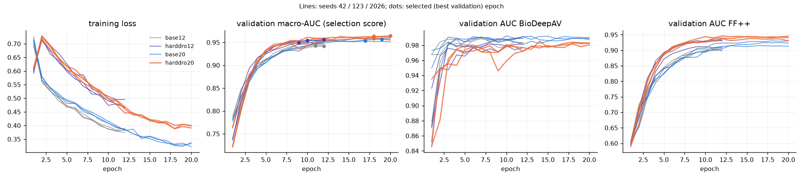
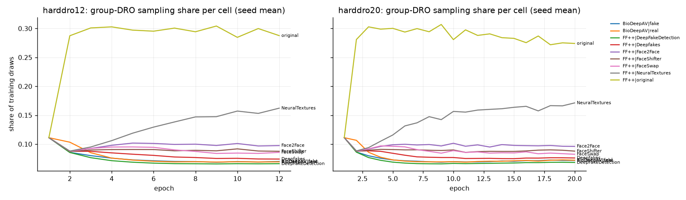
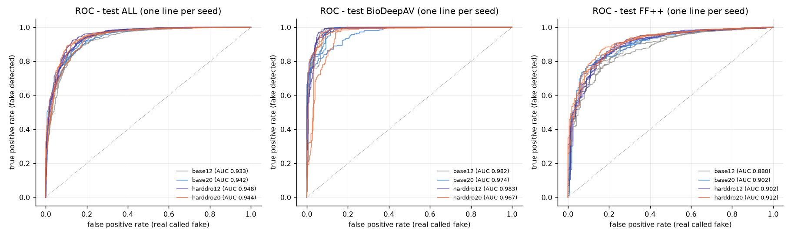
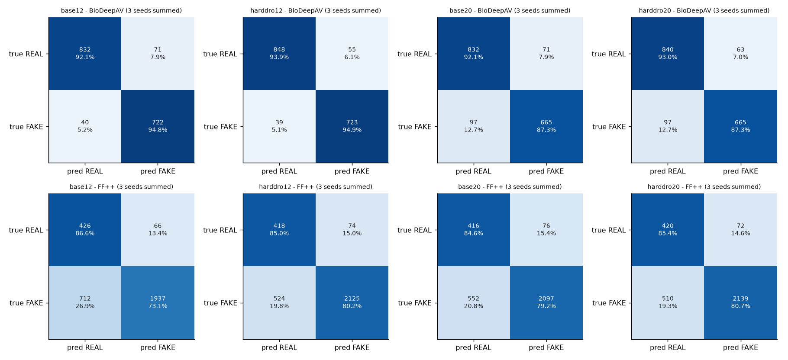
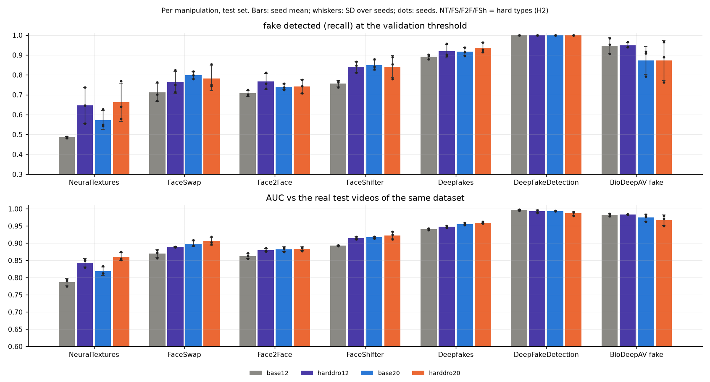
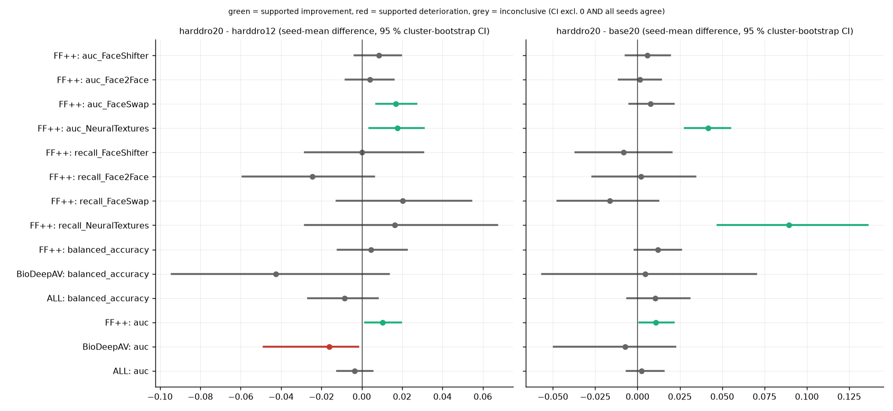
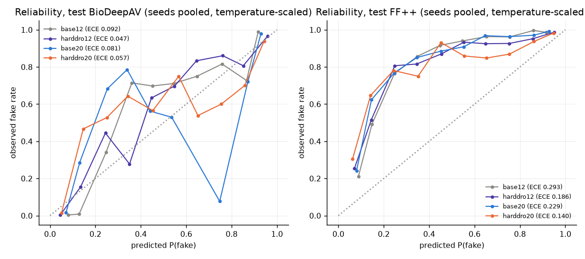
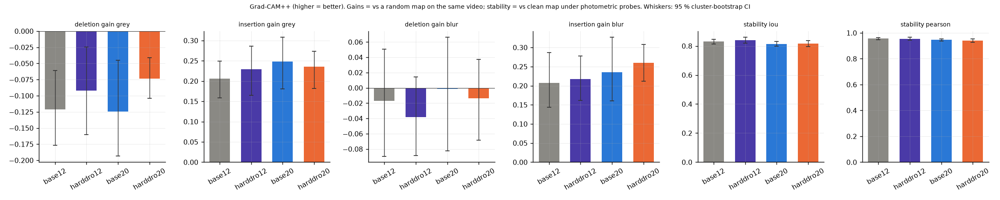

# Test 6 (201026): adaptive group-DRO + 20-epoch training (`harddro20`)

_Generated 2026-10-20 07:10:15 by 201026.py | existing runs: E:\Code\run_171026 (read-only) | data: E:\Code\run_151026 (read-only) | new runs: E:\Code\run_201026\runs_

**Provenance labels.** *Existing* = base12 / harddro12 / base20 checkpoints and predictions produced by 171026.py on 2026-10-17, re-scored here without retraining. *New* = harddro20, trained by this script. All XAI numbers are newly measured (171026 E6 had evaluated base12 seed 42 only).

## 1. Research objective

Does combining adaptive group-DRO sampling with a 20-epoch training schedule improve deepfake detection across BioDeepAV and FaceForensics++ C23 without sacrificing either dataset or Grad-CAM++ explanation reliability?

## 2. Hypotheses (evaluated independently; pre-specified decision rules)

- **H1** harddro20 improves overall test ROC-AUC vs harddro12 and vs base20. Rule: 'supported' = supported improvement vs both.
- **H2** harddro20 improves recall and AUC on NeuralTextures, FaceSwap, Face2Face, FaceShifter. Rule: count of supported improvements / deteriorations over 4 types x 2 metrics x 2 comparators.
- **H3** BioDeepAV AUC maintained (CI lower bound of the difference > -0.01 and no supported deterioration) while FF++ AUC improves (supported improvement), vs both comparators.
- **H4** Grad-CAM++ faithfulness (deletion / insertion gain over a random map, grey perturbation) and stability (top-20 % IoU, Pearson r under photometric probes) are non-inferior: CI lower bound of the difference > -0.05, vs both comparators.

'Supported improvement / deterioration' is the 171026 rule: 95 % paired cluster-bootstrap CI excludes 0 AND all seeds agree in sign. Holm-adjusted bootstrap p-values over the whole primary family are reported alongside.

## 3. Configurations

| config | source | sampler | max_epochs | patience | label |
|---|---|---|---|---|---|
| base12 | existing (171026) | baseline | 12 | 4 | Baseline (151026 settings), 12 epochs |
| harddro12 | existing (171026) | harddro | 12 | 4 | Group-DRO hard-type sampler, 12 epochs |
| base20 | existing (171026) | baseline | 20 | 5 | Baseline sampler, 20 epochs, patience 5 |
| harddro20 | new | harddro | 20 | 5 | Group-DRO hard-type sampler, 20 epochs, patience 5 (Test 6) |

Differences: harddro20 vs harddro12 = 20 instead of 12 epochs, early-stopping patience 5 instead of 4, cosine LR schedule stretched over 20 epochs (all three inherited from the verified base20 definition). harddro20 vs base20 = sampler only (group-DRO over the 9 dataset x folder cells instead of dataset x class balancing). Model, preprocessing, augmentation, losses, optimiser, EMA, batch, learning rates and checkpoint rule are identical (same imported code).

## 4. Experimental setup

- Seeds [42, 123, 2026]; held-out test set of the 151026 split (1602 videos).
- Checkpoint = EMA weights at the epoch with the best validation macro-AUC (mean of BioDeepAV and FF++ AUC, equal weight).
- Decision threshold and temperature are fitted on validation only (151026 rule: maximise mean balanced accuracy over datasets).
- Paired cluster bootstrap: 1000 replicates, identity/duplicate groups resampled (multinomial weights), the same replicate weights applied to every configuration and seed; seed-mean difference per replicate -> percentile 95 % CI. Bootstrap p = two-sided percentile p (+1/B); Holm correction over all primary rows (harddro20 - harddro12, harddro20 - base20; every test set and metric). Secondary comparisons (vs base12, and the existing harddro12 / base20 vs base12) are uncorrected context.
- Extension check: the bootstrap extension reproduces 171026.bootstrap_compare exactly on 100 shared rows (max |diff| 0.0e+00 mean, 0.0e+00 CI).

## 5. Dataset and leakage audit

| check | result |
|---|---|
| split.csv identical to the split used by 171026 (sha256) | PASS |
| split rows == inventory rows, same paths | PASS |
| face cache complete | PASS |
| no group in more than one partition | PASS |
| no identity token in more than one partition | PASS |
| no exact duplicate (file hash) in more than one partition | PASS |
| labels: real folders = 0, fake folders = 1 | PASS |
| datasets are exactly BioDeepAV + FF++ C23 | PASS |
| train / val / test disjoint | PASS |
| DRO epoch-1 weights: uniform over cells, sum 1, only training videos | PASS |
| split re-derived from scratch with the 151026 code is identical | PASS |
| re-derived groups identical | PASS |
| run base12_s42: same val/test videos, labels, config, calibration | PASS |
| run base12_s123: same val/test videos, labels, config, calibration | PASS |
| run base12_s2026: same val/test videos, labels, config, calibration | PASS |
| run harddro12_s42: same val/test videos, labels, config, calibration | PASS |
| run harddro12_s123: same val/test videos, labels, config, calibration | PASS |
| run harddro12_s2026: same val/test videos, labels, config, calibration | PASS |
| run base20_s42: same val/test videos, labels, config, calibration | PASS |
| run base20_s123: same val/test videos, labels, config, calibration | PASS |
| run base20_s2026: same val/test videos, labels, config, calibration | PASS |
| run harddro20_s42: same val/test videos, labels, config, calibration | PASS |
| run harddro20_s123: same val/test videos, labels, config, calibration | PASS |
| run harddro20_s2026: same val/test videos, labels, config, calibration | PASS |

split.csv sha256 `c0b494ad05426e2fd942ef9e0247bb1e89a52c459b91a9b49d2d0999c5e42d72`; inventory sha256 `a3becc2a7b081b542e9bb583c002c666b082e492fefd5317d699e4f756f331d4`; face cache `faces_n10703_T16_S192_F112_0b423f668cb4.npy`. Full record: reports/preflight_audit.json, reports/data_manifest.json.

## 6. Training configuration (harddro20)

```json
{
 "lr_backbone": 0.0001,
 "lr_head": 0.001,
 "weight_decay": 0.0001,
 "warmup_frac": 0.08,
 "label_smooth": 0.05,
 "frame_loss_w": 0.3,
 "ema_decay": 0.998,
 "n_frames": 16,
 "clip_frames": 8,
 "max_oversample": 4.0,
 "img": 192,
 "face_px": 112,
 "batch": 8,
 "accum": 2,
 "amp": true,
 "deterministic": false,
 "pretrained": true,
 "dro": {
  "eta": 2.0,
  "floor": 0.5,
  "momentum": 0.5,
  "cells": "dataset x folder"
 },
 "grad_clip": 5.0,
 "optimiser": "AdamW",
 "schedule": "linear warm-up + cosine over max_epochs x steps",
 "checkpoint_rule": "EMA weights at the epoch with the best validation macro-AUC (mean of BioDeepAV and FF++ AUC)"
}
```

| run | epochs_max | epochs_completed | early_stopped | best_epoch | val_macro_auc | val_auc_BioDeepAV | val_auc_FFpp | temperature | threshold |
|---|---|---|---|---|---|---|---|---|---|
| harddro20_s42 | 20 | 20 | False | 20 | 0.9642 | 0.9830 | 0.9454 | 1.1909 | 0.5500 |
| harddro20_s123 | 20 | 20 | False | 18 | 0.9633 | 0.9831 | 0.9436 | 1.1909 | 0.6700 |
| harddro20_s2026 | 20 | 20 | False | 18 | 0.9590 | 0.9816 | 0.9364 | 1.3160 | 0.6100 |




## 7. Results across seeds (all runs)

| run | source | epochs_max | epochs_completed | early_stopped | best_epoch | val_macro_auc | val_auc_BioDeepAV | val_auc_FFpp | threshold |
|---|---|---|---|---|---|---|---|---|---|
| base12_s42 | existing (run_171026) | 12 | 12 | False | 11 | 0.9464 | 0.9876 | 0.9052 | 0.3600 |
| base12_s123 | existing (run_171026) | 12 | 12 | False | 12 | 0.9420 | 0.9828 | 0.9011 | 0.3700 |
| base12_s2026 | existing (run_171026) | 12 | 12 | False | 11 | 0.9428 | 0.9841 | 0.9015 | 0.3900 |
| harddro12_s42 | existing (run_171026) | 12 | 12 | False | 10 | 0.9549 | 0.9793 | 0.9304 | 0.2800 |
| harddro12_s123 | existing (run_171026) | 12 | 12 | False | 9 | 0.9498 | 0.9878 | 0.9117 | 0.5000 |
| harddro12_s2026 | existing (run_171026) | 12 | 12 | False | 12 | 0.9561 | 0.9816 | 0.9306 | 0.5400 |
| base20_s42 | existing (run_171026) | 20 | 20 | False | 17 | 0.9533 | 0.9916 | 0.9151 | 0.3500 |
| base20_s123 | existing (run_171026) | 20 | 20 | False | 19 | 0.9567 | 0.9887 | 0.9248 | 0.3700 |
| base20_s2026 | existing (run_171026) | 20 | 20 | False | 18 | 0.9596 | 0.9890 | 0.9302 | 0.2800 |
| harddro20_s42 | new (201026) | 20 | 20 | False | 20 | 0.9642 | 0.9830 | 0.9454 | 0.5500 |
| harddro20_s123 | new (201026) | 20 | 20 | False | 18 | 0.9633 | 0.9831 | 0.9436 | 0.6700 |
| harddro20_s2026 | new (201026) | 20 | 20 | False | 18 | 0.9590 | 0.9816 | 0.9364 | 0.6100 |

## 8. Overall detection comparison (test, seed mean ± SD)

| config | source | seeds | epochs_completed | val_macro_auc | AUC_all | AUC_BioDeepAV | AUC_FFpp | BAcc_all | F1_all | ECE_all |
|---|---|---|---|---|---|---|---|---|---|---|
| base12 | existing | 3 | 12,12,12 | 0.944 ± 0.002 | 0.933 ± 0.006 | 0.982 ± 0.004 | 0.880 ± 0.003 | 0.841 ± 0.008 | 0.857 ± 0.010 | 0.197 ± 0.020 |
| harddro12 | existing | 3 | 12,12,12 | 0.954 ± 0.003 | 0.948 ± 0.002 | 0.983 ± 0.001 | 0.902 ± 0.004 | 0.871 ± 0.014 | 0.891 ± 0.021 | 0.123 ± 0.020 |
| base20 | existing | 3 | 20,20,20 | 0.957 ± 0.003 | 0.942 ± 0.001 | 0.974 ± 0.010 | 0.902 ± 0.002 | 0.852 ± 0.005 | 0.874 ± 0.014 | 0.164 ± 0.006 |
| harddro20 | new | 3 | 20,20,20 | 0.962 ± 0.003 | 0.944 ± 0.007 | 0.967 ± 0.015 | 0.912 ± 0.004 | 0.863 ± 0.026 | 0.882 ± 0.032 | 0.094 ± 0.025 |

**All metrics, pooled test set (seed means)**

| config | n_seeds | auc_mean | accuracy_mean | balanced_accuracy_mean | precision_mean | recall_mean | specificity_mean | f1_mean | ece_mean | brier_mean | tn_mean | fp_mean | fn_mean | tp_mean |
|---|---|---|---|---|---|---|---|---|---|---|---|---|---|---|
| base12 | 3 | 0.933 | 0.815 | 0.841 | 0.951 | 0.780 | 0.902 | 0.857 | 0.197 | 0.153 | 419.333 | 45.667 | 250.667 | 886.333 |
| base20 | 3 | 0.942 | 0.834 | 0.852 | 0.950 | 0.810 | 0.895 | 0.874 | 0.164 | 0.136 | 416.000 | 49.000 | 216.333 | 920.667 |
| harddro12 | 3 | 0.948 | 0.856 | 0.871 | 0.957 | 0.835 | 0.908 | 0.891 | 0.123 | 0.111 | 422.000 | 43.000 | 187.667 | 949.333 |
| harddro20 | 3 | 0.944 | 0.846 | 0.863 | 0.954 | 0.822 | 0.903 | 0.882 | 0.094 | 0.105 | 420.000 | 45.000 | 202.333 | 934.667 |





## 9. BioDeepAV results (test)

| config | auc | accuracy | balanced_accuracy | precision | recall | specificity | f1 | ece | brier | TN_TP | FP_FN |
|---|---|---|---|---|---|---|---|---|---|---|---|
| base12 | 0.982 ± 0.004 | 0.933 ± 0.019 | 0.934 ± 0.021 | 0.910 ± 0.008 | 0.948 ± 0.040 | 0.921 ± 0.007 | 0.928 ± 0.022 | 0.102 ± 0.028 | 0.058 ± 0.014 | 277 / 241 | 24 / 13 |
| base20 | 0.974 ± 0.010 | 0.899 ± 0.020 | 0.897 ± 0.024 | 0.905 ± 0.019 | 0.873 ± 0.071 | 0.921 ± 0.022 | 0.887 ± 0.029 | 0.104 ± 0.010 | 0.076 ± 0.016 | 277 / 222 | 24 / 32 |
| harddro12 | 0.983 ± 0.001 | 0.944 ± 0.009 | 0.944 ± 0.009 | 0.929 ± 0.006 | 0.949 ± 0.014 | 0.939 ± 0.005 | 0.939 ± 0.009 | 0.051 ± 0.016 | 0.049 ± 0.003 | 283 / 241 | 18 / 13 |
| harddro20 | 0.967 ± 0.015 | 0.904 ± 0.048 | 0.901 ± 0.052 | 0.913 ± 0.013 | 0.873 ± 0.101 | 0.930 ± 0.003 | 0.891 ± 0.060 | 0.069 ± 0.027 | 0.070 ± 0.027 | 280 / 222 | 21 / 32 |

**Paired comparisons (primary)**

| comparison | metric | mean_diff | per_seed | ci95_low | ci95_high | verdict | p_holm |
|---|---|---|---|---|---|---|---|
| harddro20 - harddro12 | auc | -0.0160 | 42:-0.0115;123:-0.0338;2026:-0.0028 | -0.0485 | -0.0016 | supported deterioration | 0.6630 |
| harddro20 - harddro12 | fake_detected | -0.0761 | 42:+0.0000;123:-0.1772;2026:-0.0512 | -0.1766 | 0.0314 | inconclusive | 1.0000 |
| harddro20 - harddro12 | real_recognised | -0.0089 | 42:-0.0133;123:-0.0066;2026:-0.0066 | -0.0327 | 0.0106 | inconclusive | 1.0000 |
| harddro20 - harddro12 | balanced_accuracy | -0.0425 | 42:-0.0066;123:-0.0919;2026:-0.0289 | -0.0941 | 0.0136 | inconclusive | 1.0000 |
| harddro20 - base20 | auc | -0.0072 | 42:-0.0117;123:-0.0123;2026:+0.0025 | -0.0495 | 0.0224 | inconclusive | 1.0000 |
| harddro20 - base20 | fake_detected | -0.0000 | 42:+0.0551;123:-0.0276;2026:-0.0276 | -0.1267 | 0.1260 | inconclusive | 1.0000 |
| harddro20 - base20 | real_recognised | 0.0089 | 42:+0.0199;123:-0.0199;2026:+0.0266 | -0.0115 | 0.0717 | inconclusive | 1.0000 |
| harddro20 - base20 | balanced_accuracy | 0.0044 | 42:+0.0375;123:-0.0237;2026:-0.0005 | -0.0563 | 0.0701 | inconclusive | 1.0000 |

## 10. FaceForensics++ C23 results (test)

| config | auc | accuracy | balanced_accuracy | precision | recall | specificity | f1 | ece | brier | TN_TP | FP_FN |
|---|---|---|---|---|---|---|---|---|---|---|---|
| base12 | 0.880 ± 0.003 | 0.752 ± 0.008 | 0.799 ± 0.009 | 0.967 ± 0.005 | 0.731 ± 0.011 | 0.866 ± 0.022 | 0.833 ± 0.006 | 0.293 ± 0.012 | 0.203 ± 0.008 | 142 / 646 | 22 / 237 |
| base20 | 0.902 ± 0.002 | 0.800 ± 0.014 | 0.819 ± 0.008 | 0.965 ± 0.006 | 0.792 ± 0.023 | 0.846 ± 0.034 | 0.870 ± 0.011 | 0.229 ± 0.009 | 0.167 ± 0.005 | 139 / 699 | 25 / 184 |
| harddro12 | 0.902 ± 0.004 | 0.810 ± 0.034 | 0.826 ± 0.009 | 0.967 ± 0.005 | 0.802 ± 0.046 | 0.850 ± 0.034 | 0.876 ± 0.025 | 0.186 ± 0.020 | 0.144 ± 0.013 | 139 / 708 | 25 / 175 |
| harddro20 | 0.912 ± 0.004 | 0.815 ± 0.037 | 0.831 ± 0.018 | 0.967 ± 0.001 | 0.807 ± 0.046 | 0.854 ± 0.012 | 0.880 ± 0.027 | 0.140 ± 0.024 | 0.123 ± 0.016 | 140 / 713 | 24 / 170 |

**Paired comparisons (primary)**

| comparison | metric | mean_diff | per_seed | ci95_low | ci95_high | verdict | p_holm |
|---|---|---|---|---|---|---|---|
| harddro20 - harddro12 | auc | 0.0104 | 42:+0.0157;123:+0.0135;2026:+0.0021 | 0.0016 | 0.0194 | supported improvement | 0.7500 |
| harddro20 - harddro12 | fake_detected | 0.0053 | 42:+0.0102;123:-0.0170;2026:+0.0227 | -0.0157 | 0.0272 | inconclusive | 1.0000 |
| harddro20 - harddro12 | real_recognised | 0.0041 | 42:+0.0305;123:+0.0000;2026:-0.0183 | -0.0221 | 0.0305 | inconclusive | 1.0000 |
| harddro20 - harddro12 | balanced_accuracy | 0.0047 | 42:+0.0203;123:-0.0085;2026:+0.0022 | -0.0118 | 0.0223 | inconclusive | 1.0000 |
| harddro20 - base20 | auc | 0.0106 | 42:+0.0176;123:+0.0080;2026:+0.0063 | 0.0010 | 0.0212 | supported improvement | 1.0000 |
| harddro20 - base20 | fake_detected | 0.0159 | 42:+0.0838;123:-0.0011;2026:-0.0351 | -0.0004 | 0.0342 | inconclusive | 1.0000 |
| harddro20 - base20 | real_recognised | 0.0081 | 42:-0.0366;123:+0.0183;2026:+0.0427 | -0.0169 | 0.0341 | inconclusive | 1.0000 |
| harddro20 - base20 | balanced_accuracy | 0.0120 | 42:+0.0236;123:+0.0086;2026:+0.0038 | -0.0016 | 0.0257 | inconclusive | 1.0000 |

## 11. Per-manipulation analysis (test)

Fake folders: recall at the validation threshold and AUC against the real test videos of the same dataset (FF++ originals or BioDeepAV reals). Real folders: specificity. n = test videos per seed. CI = 95 % cluster-bootstrap CI of the seed mean.

| config | folder | n | recall_or_specificity | recall_ci95 | auc_vs_real | auc_ci95 |
|---|---|---|---|---|---|---|
| base12 | BioDeepAV/fake | 254 | 0.948 ± 0.040 |  | 0.982 ± 0.004 |  |
| harddro12 | BioDeepAV/fake | 254 | 0.949 ± 0.014 |  | 0.983 ± 0.001 |  |
| base20 | BioDeepAV/fake | 254 | 0.873 ± 0.071 |  | 0.974 ± 0.010 |  |
| harddro20 | BioDeepAV/fake | 254 | 0.873 ± 0.101 |  | 0.967 ± 0.015 |  |
| base12 | BioDeepAV/real | 301 | 0.921 ± 0.007 |  |  |  |
| harddro12 | BioDeepAV/real | 301 | 0.939 ± 0.005 |  |  |  |
| base20 | BioDeepAV/real | 301 | 0.921 ± 0.022 |  |  |  |
| harddro20 | BioDeepAV/real | 301 | 0.930 ± 0.003 |  |  |  |
| base12 | FF++/DeepFakeDetection | 63 | 1.000 ± 0.000 | 0.000..1.000 | 0.996 ± 0.002 | 0.991..1.000 |
| harddro12 | FF++/DeepFakeDetection | 63 | 1.000 ± 0.000 | 0.000..1.000 | 0.993 ± 0.004 | 0.985..0.998 |
| base20 | FF++/DeepFakeDetection | 63 | 1.000 ± 0.000 | 0.000..1.000 | 0.993 ± 0.000 | 0.985..0.999 |
| harddro20 | FF++/DeepFakeDetection | 63 | 1.000 ± 0.000 | 0.000..1.000 | 0.987 ± 0.006 | 0.975..0.995 |
| base12 | FF++/Deepfakes | 164 | 0.892 ± 0.013 | 0.849..0.935 | 0.940 ± 0.002 | 0.920..0.960 |
| harddro12 | FF++/Deepfakes | 164 | 0.919 ± 0.034 | 0.883..0.950 | 0.947 ± 0.003 | 0.930..0.964 |
| base20 | FF++/Deepfakes | 164 | 0.917 ± 0.021 | 0.881..0.951 | 0.956 ± 0.003 | 0.938..0.971 |
| harddro20 | FF++/Deepfakes | 164 | 0.935 ± 0.025 | 0.904..0.965 | 0.959 ± 0.003 | 0.944..0.973 |
| base12 | FF++/Face2Face | 164 | 0.707 ± 0.016 | 0.645..0.767 | 0.863 ± 0.008 | 0.832..0.894 |
| harddro12 | FF++/Face2Face | 164 | 0.766 ± 0.041 | 0.709..0.819 | 0.880 ± 0.005 | 0.851..0.907 |
| base20 | FF++/Face2Face | 164 | 0.740 ± 0.015 | 0.679..0.803 | 0.882 ± 0.007 | 0.854..0.911 |
| harddro20 | FF++/Face2Face | 164 | 0.742 ± 0.034 | 0.679..0.800 | 0.884 ± 0.006 | 0.857..0.911 |
| base12 | FF++/FaceShifter | 164 | 0.756 ± 0.016 | 0.689..0.821 | 0.893 ± 0.001 | 0.868..0.920 |
| harddro12 | FF++/FaceShifter | 164 | 0.841 ± 0.028 | 0.786..0.892 | 0.914 ± 0.004 | 0.891..0.938 |
| base20 | FF++/FaceShifter | 164 | 0.850 ± 0.025 | 0.790..0.900 | 0.917 ± 0.003 | 0.893..0.944 |
| harddro20 | FF++/FaceShifter | 164 | 0.841 ± 0.056 | 0.785..0.895 | 0.923 ± 0.011 | 0.900..0.945 |
| base12 | FF++/FaceSwap | 164 | 0.711 ± 0.047 | 0.649..0.774 | 0.869 ± 0.012 | 0.842..0.895 |
| harddro12 | FF++/FaceSwap | 164 | 0.762 ± 0.056 | 0.701..0.821 | 0.889 ± 0.001 | 0.861..0.915 |
| base20 | FF++/FaceSwap | 164 | 0.799 ± 0.018 | 0.740..0.853 | 0.898 ± 0.009 | 0.873..0.922 |
| harddro20 | FF++/FaceSwap | 164 | 0.783 ± 0.062 | 0.719..0.839 | 0.906 ± 0.012 | 0.882..0.930 |
| base12 | FF++/NeuralTextures | 164 | 0.486 ± 0.004 | 0.414..0.560 | 0.787 ± 0.011 | 0.760..0.815 |
| harddro12 | FF++/NeuralTextures | 164 | 0.646 ± 0.091 | 0.584..0.706 | 0.843 ± 0.012 | 0.817..0.872 |
| base20 | FF++/NeuralTextures | 164 | 0.573 ± 0.048 | 0.504..0.642 | 0.819 ± 0.012 | 0.794..0.848 |
| harddro20 | FF++/NeuralTextures | 164 | 0.663 ± 0.096 | 0.602..0.722 | 0.861 ± 0.012 | 0.837..0.888 |
| base12 | FF++/original | 164 | 0.866 ± 0.022 |  |  |  |
| harddro12 | FF++/original | 164 | 0.850 ± 0.034 |  |  |  |
| base20 | FF++/original | 164 | 0.846 ± 0.034 |  |  |  |
| harddro20 | FF++/original | 164 | 0.854 ± 0.012 |  |  |  |

All FF++ manipulation folders of the split are present in the test partition (FaceShifter, DeepFakeDetection included); none had to be skipped.

**Paired per-manipulation comparisons (FF++, primary)**

| comparison | metric | mean_diff | per_seed | ci95_low | ci95_high | verdict | p_holm |
|---|---|---|---|---|---|---|---|
| harddro20 - harddro12 | recall_Deepfakes | 0.0163 | 42:+0.0061;123:+0.0244;2026:+0.0183 | -0.0041 | 0.0422 | inconclusive | 1.0000 |
| harddro20 - harddro12 | auc_Deepfakes | 0.0118 | 42:+0.0116;123:+0.0165;2026:+0.0073 | 0.0034 | 0.0209 | supported improvement | 0.5720 |
| harddro20 - harddro12 | recall_DeepFakeDetection | 0.0000 | 42:+0.0000;123:+0.0000;2026:+0.0000 | 0.0000 | 0.0000 | inconclusive | 1.0000 |
| harddro20 - harddro12 | auc_DeepFakeDetection | -0.0064 | 42:-0.0091;123:-0.0051;2026:-0.0050 | -0.0176 | 0.0025 | inconclusive | 1.0000 |
| harddro20 - harddro12 | recall_Face2Face | -0.0244 | 42:-0.0366;123:-0.0488;2026:+0.0122 | -0.0590 | 0.0062 | inconclusive | 1.0000 |
| harddro20 - harddro12 | auc_Face2Face | 0.0040 | 42:+0.0094;123:-0.0003;2026:+0.0028 | -0.0081 | 0.0157 | inconclusive | 1.0000 |
| harddro20 - harddro12 | recall_FaceShifter | 0.0000 | 42:+0.0244;123:+0.0061;2026:-0.0305 | -0.0281 | 0.0305 | inconclusive | 1.0000 |
| harddro20 - harddro12 | auc_FaceShifter | 0.0085 | 42:+0.0104;123:+0.0222;2026:-0.0072 | -0.0036 | 0.0196 | inconclusive | 1.0000 |
| harddro20 - harddro12 | recall_FaceSwap | 0.0203 | 42:+0.0305;123:-0.0061;2026:+0.0366 | -0.0125 | 0.0542 | inconclusive | 1.0000 |
| harddro20 - harddro12 | auc_FaceSwap | 0.0169 | 42:+0.0310;123:+0.0135;2026:+0.0062 | 0.0072 | 0.0270 | supported improvement | 0.0560 |
| harddro20 - harddro12 | recall_NeuralTextures | 0.0163 | 42:+0.0305;123:-0.0671;2026:+0.0854 | -0.0281 | 0.0671 | inconclusive | 1.0000 |
| harddro20 - harddro12 | auc_NeuralTextures | 0.0175 | 42:+0.0255;123:+0.0229;2026:+0.0042 | 0.0038 | 0.0308 | supported improvement | 0.7500 |
| harddro20 - base20 | recall_Deepfakes | 0.0183 | 42:+0.0671;123:+0.0122;2026:-0.0244 | -0.0041 | 0.0462 | inconclusive | 1.0000 |
| harddro20 - base20 | auc_Deepfakes | 0.0033 | 42:+0.0041;123:+0.0027;2026:+0.0032 | -0.0072 | 0.0164 | inconclusive | 1.0000 |
| harddro20 - base20 | recall_DeepFakeDetection | 0.0000 | 42:+0.0000;123:+0.0000;2026:+0.0000 | 0.0000 | 0.0000 | inconclusive | 1.0000 |
| harddro20 - base20 | auc_DeepFakeDetection | -0.0069 | 42:-0.0144;123:-0.0040;2026:-0.0024 | -0.0177 | 0.0025 | inconclusive | 1.0000 |
| harddro20 - base20 | recall_Face2Face | 0.0020 | 42:+0.0366;123:-0.0183;2026:-0.0122 | -0.0267 | 0.0341 | inconclusive | 1.0000 |
| harddro20 - base20 | auc_Face2Face | 0.0015 | 42:+0.0016;123:-0.0110;2026:+0.0138 | -0.0110 | 0.0140 | inconclusive | 1.0000 |
| harddro20 - base20 | recall_FaceShifter | -0.0081 | 42:+0.0488;123:+0.0244;2026:-0.0976 | -0.0366 | 0.0201 | inconclusive | 1.0000 |
| harddro20 - base20 | auc_FaceShifter | 0.0058 | 42:+0.0061;123:+0.0191;2026:-0.0079 | -0.0071 | 0.0191 | inconclusive | 1.0000 |
| harddro20 - base20 | recall_FaceSwap | -0.0163 | 42:+0.0732;123:-0.0549;2026:-0.0671 | -0.0473 | 0.0122 | inconclusive | 1.0000 |
| harddro20 - base20 | auc_FaceSwap | 0.0078 | 42:+0.0261;123:-0.0057;2026:+0.0030 | -0.0048 | 0.0215 | inconclusive | 1.0000 |
| harddro20 - base20 | recall_NeuralTextures | 0.0894 | 42:+0.2256;123:+0.0305;2026:+0.0122 | 0.0473 | 0.1358 | supported improvement | 0.0560 |
| harddro20 - base20 | auc_NeuralTextures | 0.0416 | 42:+0.0623;123:+0.0398;2026:+0.0227 | 0.0279 | 0.0549 | supported improvement | 0.0560 |




## 12. Original versus degraded performance

**Not evaluated.** The 171026 improvement-suite protocol uses original BioDeepAV and FF++ C23 videos only; the preflight found 0 degraded videos in the test manifest, so there are no paired degraded samples. As instructed, no new test degradations were created. Original-video AUC is reported in sections 8-10; degraded AUC, AUC change, prediction flip rate and per-degradation results cannot be reported for this experiment. (Section 14 uses mild photometric probes only to measure explanation stability; they are not a robustness test set.)

## 13. Calibration analysis

171026 E5 procedure: calibrators and thresholds fitted on validation, applied unchanged to test; threshold = validation mean-balanced-accuracy rule; 100 % coverage. 'raw' = sigmoid(logit); 'temperature' = the rule used by the stored predictions.

| config | calibration | n_runs | threshold | threshold_sd | ece | ece_sd | brier | brier_sd | mean_bacc | mean_bacc_sd | ece_BioDeepAV | ece_FF++ | bacc_BioDeepAV | bacc_FF++ |
|---|---|---|---|---|---|---|---|---|---|---|---|---|---|---|
| base12 | isotonic | 3 | 0.740 | 0.060 | 0.035 | 0.008 | 0.087 | 0.005 | 0.867 | 0.012 | 0.078 | 0.072 | 0.934 | 0.800 |
| base12 | platt | 3 | 0.730 | 0.020 | 0.065 | 0.010 | 0.092 | 0.004 | 0.868 | 0.011 | 0.120 | 0.086 | 0.935 | 0.801 |
| base12 | raw | 3 | 0.317 | 0.015 | 0.192 | 0.016 | 0.166 | 0.012 | 0.868 | 0.009 | 0.056 | 0.289 | 0.933 | 0.803 |
| base12 | temperature | 3 | 0.373 | 0.015 | 0.197 | 0.020 | 0.153 | 0.010 | 0.866 | 0.012 | 0.102 | 0.293 | 0.934 | 0.799 |
| base20 | isotonic | 3 | 0.743 | 0.084 | 0.044 | 0.010 | 0.086 | 0.007 | 0.860 | 0.018 | 0.060 | 0.073 | 0.901 | 0.819 |
| base20 | platt | 3 | 0.653 | 0.059 | 0.073 | 0.007 | 0.092 | 0.005 | 0.861 | 0.017 | 0.113 | 0.082 | 0.901 | 0.821 |
| base20 | raw | 3 | 0.270 | 0.072 | 0.154 | 0.005 | 0.146 | 0.003 | 0.860 | 0.018 | 0.076 | 0.219 | 0.900 | 0.821 |
| base20 | temperature | 3 | 0.333 | 0.047 | 0.164 | 0.006 | 0.136 | 0.004 | 0.858 | 0.014 | 0.104 | 0.229 | 0.897 | 0.819 |
| harddro12 | isotonic | 3 | 0.687 | 0.127 | 0.041 | 0.006 | 0.077 | 0.002 | 0.885 | 0.007 | 0.058 | 0.062 | 0.944 | 0.825 |
| harddro12 | platt | 3 | 0.727 | 0.129 | 0.052 | 0.008 | 0.079 | 0.003 | 0.885 | 0.008 | 0.079 | 0.070 | 0.945 | 0.825 |
| harddro12 | raw | 3 | 0.437 | 0.155 | 0.121 | 0.020 | 0.113 | 0.010 | 0.885 | 0.008 | 0.044 | 0.183 | 0.944 | 0.825 |
| harddro12 | temperature | 3 | 0.440 | 0.140 | 0.123 | 0.020 | 0.111 | 0.009 | 0.885 | 0.007 | 0.051 | 0.186 | 0.944 | 0.826 |
| harddro20 | isotonic | 3 | 0.683 | 0.064 | 0.048 | 0.018 | 0.082 | 0.010 | 0.867 | 0.033 | 0.061 | 0.075 | 0.902 | 0.831 |
| harddro20 | platt | 3 | 0.800 | 0.060 | 0.056 | 0.020 | 0.086 | 0.011 | 0.867 | 0.033 | 0.093 | 0.072 | 0.902 | 0.831 |
| harddro20 | raw | 3 | 0.633 | 0.070 | 0.091 | 0.025 | 0.110 | 0.020 | 0.866 | 0.033 | 0.061 | 0.130 | 0.901 | 0.831 |
| harddro20 | temperature | 3 | 0.610 | 0.060 | 0.094 | 0.025 | 0.105 | 0.018 | 0.866 | 0.033 | 0.069 | 0.140 | 0.901 | 0.831 |



## 14. Explainability analysis (Grad-CAM++)

Videos: the 171026 E6 sample (160 test videos, balanced over dataset x label), every run (3 seeds per configuration); per video the seed values are averaged, then identity groups are bootstrapped.

- **Faithfulness** (does the map point at pixels the model uses?): deletion / insertion curves of 171026 E6 with grey and blur fill; gain = Grad-CAM++ minus a random map on the same video (deletion: random AUC - Grad-CAM++ AUC; insertion: Grad-CAM++ - random). > 0 = better than random.
- **Stability** (does the map stay put under small input changes?): Grad-CAM++ for the same target class after each photometric probe (jpeg_q60, blur_s1.0, downscale_0.6, brightness_+0.10, contrast_1.15, saturation_0.80; the 151026 augmentation operators, applied alone) vs the clean map: top-20 % IoU and Pearson r, averaged over frames and probes. Stability is not faithfulness, and neither is correctness: no manipulation-region ground truth exists, so no claim is made that the maps localise the manipulated region.

| config | metric | n_videos | n_seeds | mean | ci95_low | ci95_high |
|---|---|---|---|---|---|---|
| base12 | deletion_gain_grey | 160 | 3 | -0.121 | -0.177 | -0.061 |
| base12 | insertion_gain_grey | 160 | 3 | 0.206 | 0.158 | 0.249 |
| base12 | deletion_gain_blur | 160 | 3 | -0.017 | -0.089 | 0.051 |
| base12 | insertion_gain_blur | 160 | 3 | 0.208 | 0.144 | 0.287 |
| base12 | stability_iou | 160 | 3 | 0.830 | 0.813 | 0.847 |
| base12 | stability_pearson | 160 | 3 | 0.956 | 0.948 | 0.964 |
| base12 | probe_flip_rate | 160 | 3 | 0.067 | 0.042 | 0.094 |
| base20 | deletion_gain_grey | 160 | 3 | -0.125 | -0.193 | -0.045 |
| base20 | insertion_gain_grey | 160 | 3 | 0.248 | 0.181 | 0.308 |
| base20 | deletion_gain_blur | 160 | 3 | -0.001 | -0.082 | 0.066 |
| base20 | insertion_gain_blur | 160 | 3 | 0.235 | 0.161 | 0.326 |
| base20 | stability_iou | 160 | 3 | 0.814 | 0.799 | 0.830 |
| base20 | stability_pearson | 160 | 3 | 0.946 | 0.937 | 0.954 |
| base20 | probe_flip_rate | 160 | 3 | 0.056 | 0.033 | 0.079 |
| harddro12 | deletion_gain_grey | 160 | 3 | -0.092 | -0.160 | -0.025 |
| harddro12 | insertion_gain_grey | 160 | 3 | 0.230 | 0.165 | 0.286 |
| harddro12 | deletion_gain_blur | 160 | 3 | -0.038 | -0.089 | 0.015 |
| harddro12 | insertion_gain_blur | 160 | 3 | 0.217 | 0.161 | 0.277 |
| harddro12 | stability_iou | 160 | 3 | 0.839 | 0.820 | 0.859 |
| harddro12 | stability_pearson | 160 | 3 | 0.955 | 0.945 | 0.966 |
| harddro12 | probe_flip_rate | 160 | 3 | 0.060 | 0.041 | 0.085 |
| harddro20 | deletion_gain_grey | 160 | 3 | -0.073 | -0.104 | -0.041 |
| harddro20 | insertion_gain_grey | 160 | 3 | 0.235 | 0.182 | 0.274 |
| harddro20 | deletion_gain_blur | 160 | 3 | -0.013 | -0.068 | 0.037 |
| harddro20 | insertion_gain_blur | 160 | 3 | 0.259 | 0.211 | 0.308 |
| harddro20 | stability_iou | 160 | 3 | 0.815 | 0.796 | 0.837 |
| harddro20 | stability_pearson | 160 | 3 | 0.939 | 0.927 | 0.952 |
| harddro20 | probe_flip_rate | 160 | 3 | 0.047 | 0.030 | 0.065 |

**Paired differences (95 % cluster-bootstrap CI; margin = H4 non-inferiority margin)**

| comparison | metric | mean_diff | ci95_low | ci95_high | p_boot | margin | verdict | primary |
|---|---|---|---|---|---|---|---|---|
| harddro20 - harddro12 | deletion_gain_grey | 0.0186 | -0.0395 | 0.0706 | 0.5970 | 0.0500 | non-inferior (CI lower bound > -margin) | True |
| harddro20 - harddro12 | insertion_gain_grey | 0.0054 | -0.0378 | 0.0530 | 0.7370 | 0.0500 | non-inferior (CI lower bound > -margin) | True |
| harddro20 - harddro12 | deletion_gain_blur | 0.0247 | -0.0157 | 0.0613 | 0.2410 | 0.0500 | non-inferior (CI lower bound > -margin) | True |
| harddro20 - harddro12 | insertion_gain_blur | 0.0423 | -0.0031 | 0.0873 | 0.0690 | 0.0500 | non-inferior (CI lower bound > -margin) | True |
| harddro20 - harddro12 | stability_iou | -0.0232 | -0.0301 | -0.0142 | 0.0010 | 0.0500 | non-inferior (CI lower bound > -margin) | True |
| harddro20 - harddro12 | stability_pearson | -0.0158 | -0.0209 | -0.0093 | 0.0010 | 0.0500 | non-inferior (CI lower bound > -margin) | True |
| harddro20 - base20 | deletion_gain_grey | 0.0514 | -0.0275 | 0.1129 | 0.2110 | 0.0500 | non-inferior (CI lower bound > -margin) | True |
| harddro20 - base20 | insertion_gain_grey | -0.0135 | -0.0784 | 0.0671 | 0.8210 | 0.0500 | inconclusive | True |
| harddro20 - base20 | deletion_gain_blur | -0.0121 | -0.0578 | 0.0390 | 0.6950 | 0.0500 | inconclusive | True |
| harddro20 - base20 | insertion_gain_blur | 0.0240 | -0.0531 | 0.0835 | 0.5290 | 0.0500 | inconclusive | True |
| harddro20 - base20 | stability_iou | 0.0013 | -0.0145 | 0.0179 | 0.8970 | 0.0500 | non-inferior (CI lower bound > -margin) | True |
| harddro20 - base20 | stability_pearson | -0.0065 | -0.0170 | 0.0045 | 0.2930 | 0.0500 | non-inferior (CI lower bound > -margin) | True |
| harddro20 - base12 | deletion_gain_grey | 0.0475 | -0.0017 | 0.0903 | 0.0610 | 0.0500 | non-inferior (CI lower bound > -margin) | False |
| harddro20 - base12 | insertion_gain_grey | 0.0294 | -0.0214 | 0.0865 | 0.2470 | 0.0500 | non-inferior (CI lower bound > -margin) | False |
| harddro20 - base12 | deletion_gain_blur | 0.0034 | -0.0489 | 0.0561 | 0.9230 | 0.0500 | non-inferior (CI lower bound > -margin) | False |
| harddro20 - base12 | insertion_gain_blur | 0.0517 | -0.0221 | 0.1115 | 0.1610 | 0.0500 | non-inferior (CI lower bound > -margin) | False |
| harddro20 - base12 | stability_iou | -0.0147 | -0.0316 | 0.0031 | 0.1210 | 0.0500 | non-inferior (CI lower bound > -margin) | False |
| harddro20 - base12 | stability_pearson | -0.0166 | -0.0277 | -0.0047 | 0.0030 | 0.0500 | non-inferior (CI lower bound > -margin) | False |
| harddro12 - base12 | deletion_gain_grey | 0.0289 | -0.0074 | 0.0704 | 0.1310 | 0.0500 | non-inferior (CI lower bound > -margin) | False |
| harddro12 - base12 | insertion_gain_grey | 0.0241 | -0.0194 | 0.0616 | 0.2550 | 0.0500 | non-inferior (CI lower bound > -margin) | False |
| harddro12 - base12 | deletion_gain_blur | -0.0214 | -0.0653 | 0.0204 | 0.3430 | 0.0500 | inconclusive | False |
| harddro12 - base12 | insertion_gain_blur | 0.0094 | -0.0412 | 0.0632 | 0.7290 | 0.0500 | non-inferior (CI lower bound > -margin) | False |
| harddro12 - base12 | stability_iou | 0.0085 | -0.0048 | 0.0216 | 0.1950 | 0.0500 | non-inferior (CI lower bound > -margin) | False |
| harddro12 - base12 | stability_pearson | -0.0008 | -0.0096 | 0.0069 | 0.9390 | 0.0500 | non-inferior (CI lower bound > -margin) | False |
| base20 - base12 | deletion_gain_grey | -0.0039 | -0.0452 | 0.0546 | 0.9130 | 0.0500 | non-inferior (CI lower bound > -margin) | False |
| base20 - base12 | insertion_gain_grey | 0.0429 | 0.0048 | 0.0713 | 0.0370 | 0.0500 | non-inferior (CI lower bound > -margin) | False |
| base20 - base12 | deletion_gain_blur | 0.0154 | -0.0325 | 0.0676 | 0.6490 | 0.0500 | non-inferior (CI lower bound > -margin) | False |
| base20 - base12 | insertion_gain_blur | 0.0277 | 0.0005 | 0.0591 | 0.0490 | 0.0500 | non-inferior (CI lower bound > -margin) | False |
| base20 - base12 | stability_iou | -0.0160 | -0.0245 | -0.0045 | 0.0050 | 0.0500 | non-inferior (CI lower bound > -margin) | False |
| base20 - base12 | stability_pearson | -0.0100 | -0.0148 | -0.0045 | 0.0030 | 0.0500 | non-inferior (CI lower bound > -margin) | False |

**By dataset and predicted class (seed-pooled means; classes are model-dependent, so these sets differ between configurations)**

| config | dataset | pred_class | n | deletion_gain_grey | insertion_gain_grey | deletion_gain_blur | insertion_gain_blur | stability_iou | stability_pearson | probe_flip_rate |
|---|---|---|---|---|---|---|---|---|---|---|
| base12 | BioDeepAV | FAKE | 122 | -0.124 | 0.154 | -0.456 | 0.564 | 0.752 | 0.917 | 0.044 |
| base12 | BioDeepAV | REAL | 118 | -0.307 | 0.331 | 0.159 | -0.018 | 0.807 | 0.953 | 0.054 |
| base12 | FF++ | FAKE | 95 | 0.071 | -0.025 | -0.432 | 0.466 | 0.870 | 0.971 | 0.053 |
| base12 | FF++ | REAL | 145 | -0.092 | 0.299 | 0.482 | -0.079 | 0.889 | 0.981 | 0.107 |
| base20 | BioDeepAV | FAKE | 111 | -0.025 | 0.098 | -0.477 | 0.646 | 0.730 | 0.897 | 0.020 |
| base20 | BioDeepAV | REAL | 129 | -0.370 | 0.446 | 0.206 | -0.028 | 0.787 | 0.939 | 0.054 |
| base20 | FF++ | FAKE | 99 | 0.220 | -0.060 | -0.430 | 0.545 | 0.858 | 0.967 | 0.032 |
| base20 | FF++ | REAL | 141 | -0.221 | 0.403 | 0.484 | -0.064 | 0.874 | 0.975 | 0.102 |
| harddro12 | BioDeepAV | FAKE | 122 | 0.033 | 0.080 | -0.325 | 0.389 | 0.800 | 0.933 | 0.026 |
| harddro12 | BioDeepAV | REAL | 118 | -0.329 | 0.428 | 0.041 | 0.100 | 0.781 | 0.929 | 0.031 |
| harddro12 | FF++ | FAKE | 104 | 0.135 | -0.042 | -0.252 | 0.289 | 0.885 | 0.979 | 0.064 |
| harddro12 | FF++ | REAL | 136 | -0.172 | 0.400 | 0.314 | 0.109 | 0.888 | 0.980 | 0.113 |
| harddro20 | BioDeepAV | FAKE | 113 | -0.137 | 0.180 | -0.331 | 0.331 | 0.789 | 0.923 | 0.024 |
| harddro20 | BioDeepAV | REAL | 127 | -0.108 | 0.272 | 0.169 | 0.176 | 0.746 | 0.900 | 0.056 |
| harddro20 | FF++ | FAKE | 117 | -0.037 | 0.182 | -0.304 | 0.328 | 0.866 | 0.969 | 0.047 |
| harddro20 | FF++ | REAL | 123 | -0.014 | 0.298 | 0.366 | 0.214 | 0.863 | 0.967 | 0.058 |



## 15. Statistical significance and confidence intervals

Primary family: 56 rows; Holm-significant at 0.05: 0. Rows with a 'supported' verdict (all comparisons):

| test_set | comparison | metric | n_seeds | mean_diff | per_seed | ci95_low | ci95_high | verdict | p_boot | p_holm |
|---|---|---|---|---|---|---|---|---|---|---|
| ALL | harddro20 - base20 | recall_NeuralTextures | 3 | 0.0894 | 42:+0.2256;123:+0.0305;2026:+0.0122 | 0.0456 | 0.1311 | supported improvement | 0.0010 | 0.0560 |
| ALL | harddro20 - base12 | auc | 3 | 0.0112 | 42:+0.0082;123:+0.0045;2026:+0.0210 | 0.0023 | 0.0268 | supported improvement | 0.0110 | n/a |
| ALL | harddro20 - base12 | fake_detected | 3 | 0.0425 | 42:+0.0862;123:+0.0114;2026:+0.0299 | 0.0125 | 0.0699 | supported improvement | 0.0130 | n/a |
| ALL | harddro20 - base12 | balanced_accuracy | 3 | 0.0220 | 42:+0.0431;123:+0.0079;2026:+0.0150 | 0.0052 | 0.0383 | supported improvement | 0.0150 | n/a |
| ALL | harddro20 - base12 | recall_NeuralTextures | 3 | 0.1768 | 42:+0.2805;123:+0.0976;2026:+0.1524 | 0.1245 | 0.2309 | supported improvement | 0.0010 | n/a |
| ALL | harddro20 - base12 | recall_FaceSwap | 3 | 0.0711 | 42:+0.0915;123:+0.0427;2026:+0.0793 | 0.0388 | 0.1059 | supported improvement | 0.0010 | n/a |
| ALL | harddro20 - base12 | recall_FaceShifter | 3 | 0.0854 | 42:+0.1220;123:+0.1159;2026:+0.0183 | 0.0479 | 0.1245 | supported improvement | 0.0010 | n/a |
| ALL | harddro12 - base12 | auc | 3 | 0.0149 | 42:+0.0102;123:+0.0154;2026:+0.0192 | 0.0048 | 0.0306 | supported improvement | 0.0010 | n/a |
| ALL | harddro12 - base12 | fake_detected | 3 | 0.0554 | 42:+0.0783;123:+0.0642;2026:+0.0237 | 0.0379 | 0.0731 | supported improvement | 0.0010 | n/a |
| ALL | harddro12 - base12 | balanced_accuracy | 3 | 0.0306 | 42:+0.0381;123:+0.0364;2026:+0.0172 | 0.0183 | 0.0443 | supported improvement | 0.0010 | n/a |
| ALL | harddro12 - base12 | recall_NeuralTextures | 3 | 0.1606 | 42:+0.2500;123:+0.1646;2026:+0.0671 | 0.1174 | 0.2042 | supported improvement | 0.0010 | n/a |
| ALL | harddro12 - base12 | recall_FaceSwap | 3 | 0.0508 | 42:+0.0610;123:+0.0488;2026:+0.0427 | 0.0150 | 0.0905 | supported improvement | 0.0110 | n/a |
| ALL | harddro12 - base12 | recall_Face2Face | 3 | 0.0589 | 42:+0.1098;123:+0.0610;2026:+0.0061 | 0.0229 | 0.0962 | supported improvement | 0.0010 | n/a |
| ALL | harddro12 - base12 | recall_FaceShifter | 3 | 0.0854 | 42:+0.0976;123:+0.1098;2026:+0.0488 | 0.0525 | 0.1224 | supported improvement | 0.0010 | n/a |
| ALL | base20 - base12 | recall_NeuralTextures | 3 | 0.0874 | 42:+0.0549;123:+0.0671;2026:+0.1402 | 0.0476 | 0.1311 | supported improvement | 0.0010 | n/a |
| ALL | base20 - base12 | recall_FaceSwap | 3 | 0.0874 | 42:+0.0183;123:+0.0976;2026:+0.1463 | 0.0587 | 0.1219 | supported improvement | 0.0010 | n/a |
| ALL | base20 - base12 | recall_Face2Face | 3 | 0.0325 | 42:+0.0366;123:+0.0305;2026:+0.0305 | 0.0018 | 0.0643 | supported improvement | 0.0470 | n/a |
| ALL | base20 - base12 | recall_FaceShifter | 3 | 0.0935 | 42:+0.0732;123:+0.0915;2026:+0.1159 | 0.0589 | 0.1308 | supported improvement | 0.0010 | n/a |
| BioDeepAV | harddro20 - harddro12 | auc | 3 | -0.0160 | 42:-0.0115;123:-0.0338;2026:-0.0028 | -0.0485 | -0.0016 | supported deterioration | 0.0130 | 0.6630 |
| BioDeepAV | harddro20 - base12 | auc | 3 | -0.0150 | 42:-0.0142;123:-0.0279;2026:-0.0028 | -0.0484 | -0.0014 | supported deterioration | 0.0250 | n/a |
| BioDeepAV | harddro20 - base12 | fake_detected | 3 | -0.0748 | 42:-0.0197;123:-0.1417;2026:-0.0630 | -0.1380 | -0.0145 | supported deterioration | 0.0010 | n/a |
| FF++ | harddro20 - harddro12 | auc | 3 | 0.0104 | 42:+0.0157;123:+0.0135;2026:+0.0021 | 0.0016 | 0.0194 | supported improvement | 0.0150 | 0.7500 |
| FF++ | harddro20 - harddro12 | auc_Deepfakes | 3 | 0.0118 | 42:+0.0116;123:+0.0165;2026:+0.0073 | 0.0034 | 0.0209 | supported improvement | 0.0110 | 0.5720 |
| FF++ | harddro20 - harddro12 | auc_FaceSwap | 3 | 0.0169 | 42:+0.0310;123:+0.0135;2026:+0.0062 | 0.0072 | 0.0270 | supported improvement | 0.0010 | 0.0560 |
| FF++ | harddro20 - harddro12 | auc_NeuralTextures | 3 | 0.0175 | 42:+0.0255;123:+0.0229;2026:+0.0042 | 0.0038 | 0.0308 | supported improvement | 0.0150 | 0.7500 |
| FF++ | harddro20 - base20 | auc | 3 | 0.0106 | 42:+0.0176;123:+0.0080;2026:+0.0063 | 0.0010 | 0.0212 | supported improvement | 0.0350 | 1.0000 |
| FF++ | harddro20 - base20 | recall_NeuralTextures | 3 | 0.0894 | 42:+0.2256;123:+0.0305;2026:+0.0122 | 0.0473 | 0.1358 | supported improvement | 0.0010 | 0.0560 |
| FF++ | harddro20 - base20 | auc_NeuralTextures | 3 | 0.0416 | 42:+0.0623;123:+0.0398;2026:+0.0227 | 0.0279 | 0.0549 | supported improvement | 0.0010 | 0.0560 |
| FF++ | harddro20 - base12 | auc | 3 | 0.0326 | 42:+0.0337;123:+0.0349;2026:+0.0292 | 0.0186 | 0.0461 | supported improvement | 0.0010 | n/a |
| FF++ | harddro20 - base12 | fake_detected | 3 | 0.0763 | 42:+0.1166;123:+0.0555;2026:+0.0566 | 0.0527 | 0.1036 | supported improvement | 0.0010 | n/a |
| FF++ | harddro20 - base12 | balanced_accuracy | 3 | 0.0320 | 42:+0.0553;123:+0.0308;2026:+0.0100 | 0.0120 | 0.0522 | supported improvement | 0.0030 | n/a |
| FF++ | harddro20 - base12 | recall_Deepfakes | 3 | 0.0427 | 42:+0.0610;123:+0.0305;2026:+0.0366 | 0.0163 | 0.0712 | supported improvement | 0.0010 | n/a |
| FF++ | harddro20 - base12 | auc_Deepfakes | 3 | 0.0187 | 42:+0.0165;123:+0.0197;2026:+0.0199 | 0.0065 | 0.0317 | supported improvement | 0.0030 | n/a |
| FF++ | harddro20 - base12 | auc_DeepFakeDetection | 3 | -0.0099 | 42:-0.0151;123:-0.0084;2026:-0.0063 | -0.0217 | -0.0012 | supported deterioration | 0.0174 | n/a |
| FF++ | harddro20 - base12 | auc_Face2Face | 3 | 0.0207 | 42:+0.0223;123:+0.0222;2026:+0.0178 | 0.0027 | 0.0387 | supported improvement | 0.0330 | n/a |
| FF++ | harddro20 - base12 | recall_FaceShifter | 3 | 0.0854 | 42:+0.1220;123:+0.1159;2026:+0.0183 | 0.0462 | 0.1260 | supported improvement | 0.0010 | n/a |
| FF++ | harddro20 - base12 | auc_FaceShifter | 3 | 0.0298 | 42:+0.0302;123:+0.0415;2026:+0.0178 | 0.0126 | 0.0467 | supported improvement | 0.0030 | n/a |
| FF++ | harddro20 - base12 | recall_FaceSwap | 3 | 0.0711 | 42:+0.0915;123:+0.0427;2026:+0.0793 | 0.0341 | 0.1057 | supported improvement | 0.0010 | n/a |
| FF++ | harddro20 - base12 | auc_FaceSwap | 3 | 0.0364 | 42:+0.0390;123:+0.0307;2026:+0.0396 | 0.0212 | 0.0530 | supported improvement | 0.0010 | n/a |
| FF++ | harddro20 - base12 | recall_NeuralTextures | 3 | 0.1768 | 42:+0.2805;123:+0.0976;2026:+0.1524 | 0.1275 | 0.2330 | supported improvement | 0.0010 | n/a |
| FF++ | harddro20 - base12 | auc_NeuralTextures | 3 | 0.0738 | 42:+0.0795;123:+0.0772;2026:+0.0648 | 0.0555 | 0.0912 | supported improvement | 0.0010 | n/a |
| FF++ | harddro12 - base12 | auc | 3 | 0.0222 | 42:+0.0181;123:+0.0214;2026:+0.0271 | 0.0118 | 0.0326 | supported improvement | 0.0010 | n/a |
| FF++ | harddro12 - base12 | fake_detected | 3 | 0.0710 | 42:+0.1065;123:+0.0725;2026:+0.0340 | 0.0514 | 0.0933 | supported improvement | 0.0010 | n/a |
| FF++ | harddro12 - base12 | balanced_accuracy | 3 | 0.0274 | 42:+0.0349;123:+0.0393;2026:+0.0078 | 0.0092 | 0.0446 | supported improvement | 0.0050 | n/a |
| FF++ | harddro12 - base12 | recall_Deepfakes | 3 | 0.0264 | 42:+0.0549;123:+0.0061;2026:+0.0183 | 0.0020 | 0.0508 | supported improvement | 0.0410 | n/a |
| FF++ | harddro12 - base12 | auc_DeepFakeDetection | 3 | -0.0035 | 42:-0.0060;123:-0.0033;2026:-0.0014 | -0.0067 | -0.0014 | supported deterioration | 0.0016 | n/a |
| FF++ | harddro12 - base12 | recall_Face2Face | 3 | 0.0589 | 42:+0.1098;123:+0.0610;2026:+0.0061 | 0.0241 | 0.0935 | supported improvement | 0.0010 | n/a |
| FF++ | harddro12 - base12 | auc_Face2Face | 3 | 0.0167 | 42:+0.0129;123:+0.0224;2026:+0.0149 | 0.0012 | 0.0310 | supported improvement | 0.0350 | n/a |
| FF++ | harddro12 - base12 | recall_FaceShifter | 3 | 0.0854 | 42:+0.0976;123:+0.1098;2026:+0.0488 | 0.0467 | 0.1214 | supported improvement | 0.0010 | n/a |
| FF++ | harddro12 - base12 | auc_FaceShifter | 3 | 0.0214 | 42:+0.0198;123:+0.0193;2026:+0.0250 | 0.0086 | 0.0343 | supported improvement | 0.0010 | n/a |
| FF++ | harddro12 - base12 | recall_FaceSwap | 3 | 0.0508 | 42:+0.0610;123:+0.0488;2026:+0.0427 | 0.0163 | 0.0863 | supported improvement | 0.0110 | n/a |
| FF++ | harddro12 - base12 | auc_FaceSwap | 3 | 0.0195 | 42:+0.0080;123:+0.0172;2026:+0.0334 | 0.0039 | 0.0340 | supported improvement | 0.0210 | n/a |
| FF++ | harddro12 - base12 | recall_NeuralTextures | 3 | 0.1606 | 42:+0.2500;123:+0.1646;2026:+0.0671 | 0.1193 | 0.2058 | supported improvement | 0.0010 | n/a |
| FF++ | harddro12 - base12 | auc_NeuralTextures | 3 | 0.0563 | 42:+0.0539;123:+0.0542;2026:+0.0607 | 0.0399 | 0.0716 | supported improvement | 0.0010 | n/a |
| FF++ | base20 - base12 | auc | 3 | 0.0220 | 42:+0.0162;123:+0.0269;2026:+0.0229 | 0.0127 | 0.0304 | supported improvement | 0.0010 | n/a |
| FF++ | base20 - base12 | fake_detected | 3 | 0.0604 | 42:+0.0328;123:+0.0566;2026:+0.0917 | 0.0446 | 0.0771 | supported improvement | 0.0010 | n/a |
| FF++ | base20 - base12 | balanced_accuracy | 3 | 0.0200 | 42:+0.0317;123:+0.0222;2026:+0.0062 | 0.0041 | 0.0360 | supported improvement | 0.0210 | n/a |
| FF++ | base20 - base12 | auc_Deepfakes | 3 | 0.0154 | 42:+0.0124;123:+0.0170;2026:+0.0167 | 0.0054 | 0.0244 | supported improvement | 0.0050 | n/a |
| FF++ | base20 - base12 | auc_Face2Face | 3 | 0.0193 | 42:+0.0207;123:+0.0332;2026:+0.0039 | 0.0064 | 0.0318 | supported improvement | 0.0030 | n/a |
| FF++ | base20 - base12 | recall_FaceShifter | 3 | 0.0935 | 42:+0.0732;123:+0.0915;2026:+0.1159 | 0.0576 | 0.1321 | supported improvement | 0.0010 | n/a |
| FF++ | base20 - base12 | auc_FaceShifter | 3 | 0.0240 | 42:+0.0241;123:+0.0224;2026:+0.0257 | 0.0113 | 0.0365 | supported improvement | 0.0010 | n/a |
| FF++ | base20 - base12 | recall_FaceSwap | 3 | 0.0874 | 42:+0.0183;123:+0.0976;2026:+0.1463 | 0.0535 | 0.1205 | supported improvement | 0.0010 | n/a |
| FF++ | base20 - base12 | auc_FaceSwap | 3 | 0.0286 | 42:+0.0128;123:+0.0364;2026:+0.0366 | 0.0170 | 0.0395 | supported improvement | 0.0010 | n/a |
| FF++ | base20 - base12 | recall_NeuralTextures | 3 | 0.0874 | 42:+0.0549;123:+0.0671;2026:+0.1402 | 0.0488 | 0.1265 | supported improvement | 0.0010 | n/a |
| FF++ | base20 - base12 | auc_NeuralTextures | 3 | 0.0322 | 42:+0.0172;123:+0.0374;2026:+0.0421 | 0.0191 | 0.0441 | supported improvement | 0.0010 | n/a |

_75 further comparisons inconclusive - full table: metrics/T6_bootstrap_comparisons.csv._

Seed-mean ± SD describes training-run variability; the cluster-bootstrap CI describes test-set sampling variability for these trained models. With three seeds, the sign-agreement requirement is a coarse check of training variability, not a test.

## 16. Limitations and threats to validity

- Three seeds; GPU training with cuDNN autotuning is not bitwise reproducible (171026 E1: a seed-42 re-run differed by up to 0.013 test AUC), so part of any small difference is run-to-run noise.
- harddro20 differs from harddro12 in epochs AND patience AND LR-schedule length (one 'longer training' factor, as in base20 vs base12); the effect of each cannot be separated.
- Group-DRO and the longer schedule both change how much each cell is trained; the 2x2 design (base12, harddro12, base20, harddro20) allows an interaction reading, but with three seeds the interaction itself is not tested formally.
- The existing runs were trained on 2026-10-17 and harddro20 later on the same machine and code; no environment change was detected (script hashes in summary.json), but driver / library state is not fully controlled.
- Test-set bootstrap treats the 1,602 test videos' identity groups as the sampling unit; it does not cover other datasets, compressions or real-world degradations (section 12).
- Per-manipulation results use 164 fakes per FF++ method (63 for DeepFakeDetection): differences of a few points are within noise.
- Grad-CAM++ evaluation uses 160 videos; per-class sets depend on each model's predictions. Faithfulness metrics depend on the perturbation (grey vs blur) - both are reported. No localisation ground truth.
- Thresholds are selected on validation; calibrated metrics on test are honest, but the validation set is also used for checkpoint selection (as in all 171026 runs).

## 17. Conclusions per hypothesis

- **H1 - NOT SUPPORTED (INCONCLUSIVE)**: harddro20 improves overall test ROC-AUC vs harddro12 and base20. Evidence: harddro12: inconclusive (-0.0036, CI -0.0122..+0.0055, Holm p 1.000), base20: inconclusive (+0.0023, CI -0.0063..+0.0154, Holm p 1.000)

- **H2 - PARTIALLY SUPPORTED**: harddro20 improves recall and AUC on NeuralTextures, FaceSwap, Face2Face, FaceShifter. Evidence: 4/16 (type x metric x comparator) supported improvements, 0 supported deteriorations; 0 survive Holm

- **H3 - CONTRADICTED**: harddro20 maintains BioDeepAV AUC (non-inferiority margin 0.01) while improving FF++ AUC, vs both. Evidence: BioDeepAV: harddro12: supported deterioration (-0.0160, CI -0.0485..-0.0016, Holm p 0.663), base20: inconclusive (-0.0072, CI -0.0495..+0.0224, Holm p 1.000) | non-inferior: False. FF++: harddro12: supported improvement (+0.0104, CI +0.0016..+0.0194, Holm p 0.750), base20: supported improvement (+0.0106, CI +0.0010..+0.0212, Holm p 1.000)

- **H4 - INCONCLUSIVE**: harddro20 does not materially reduce Grad-CAM++ faithfulness or stability (margin 0.05). Evidence: harddro20 - harddro12 deletion_gain_grey: +0.019 (CI -0.040..+0.071) non-inferior (CI lower bound > -margin); harddro20 - harddro12 insertion_gain_grey: +0.005 (CI -0.038..+0.053) non-inferior (CI lower bound > -margin); harddro20 - harddro12 stability_iou: -0.023 (CI -0.030..-0.014) non-inferior (CI lower bound > -margin); harddro20 - harddro12 stability_pearson: -0.016 (CI -0.021..-0.009) non-inferior (CI lower bound > -margin); harddro20 - base20 deletion_gain_grey: +0.051 (CI -0.027..+0.113) non-inferior (CI lower bound > -margin); harddro20 - base20 insertion_gain_grey: -0.013 (CI -0.078..+0.067) inconclusive; harddro20 - base20 stability_iou: +0.001 (CI -0.015..+0.018) non-inferior (CI lower bound > -margin); harddro20 - base20 stability_pearson: -0.007 (CI -0.017..+0.004) non-inferior (CI lower bound > -margin)


## 18. Recommended next experiment

The 20-epoch DRO schedule costs BioDeepAV performance. Next: keep 20 epochs but select the checkpoint per dataset or cap the DRO share of FF++ cells (one change only), and re-test H3. NeuralTextures remains the weakest type; a targeted, single-factor follow-up (e.g. a texture-sensitive input branch or higher face resolution) should be evaluated with the same split, seeds and statistics.

## 19. Suggested thesis-ready results paragraph

Combining online group-DRO sampling with a 20-epoch schedule (harddro20; three seeds, 20, 20, 20 epochs completed, best epochs 20, 18, 18) yielded a pooled test ROC-AUC of 0.944 ± 0.007 compared with 0.948 ± 0.002 for harddro12 and 0.942 ± 0.001 for base20 (mean ± SD over seeds). Paired cluster-bootstrap differences in pooled AUC were -0.004 (95 % CI -0.012 to +0.005; inconclusive) against harddro12 and +0.002 (95 % CI -0.006 to +0.015; inconclusive) against base20. On BioDeepAV the AUC was 0.967 ± 0.015 (difference -0.016 (95 % CI -0.049 to -0.002; supported deterioration) vs harddro12, -0.007 (95 % CI -0.049 to +0.022; inconclusive) vs base20), and on FaceForensics++ C23 it was 0.912 ± 0.004 (+0.010 (95 % CI +0.002 to +0.019; supported improvement) vs harddro12, +0.011 (95 % CI +0.001 to +0.021; supported improvement) vs base20). NeuralTextures recall changed by +0.016 (95 % CI -0.028 to +0.067; inconclusive) relative to harddro12 and +0.089 (95 % CI +0.047 to +0.136; supported improvement) relative to base20. Under the pre-specified decision rules, H1 was not supported (inconclusive), H2 partially supported, H3 contradicted and H4 inconclusive. An effect is called supported only when the 95 % CI excludes zero and all three seeds agree in sign; Holm-adjusted p-values over the primary comparison family are reported in the accompanying tables.

## 20. Reproduction commands and output locations

```
python 201026.py --phase selftest
python 201026.py --phase preflight
python 201026.py --phase train      # harddro20 x 3 seeds
python 201026.py --phase xai        # Grad-CAM++ faithfulness + stability, 12 runs
python 201026.py --phase evaluate   # metrics, statistics, figures, this report
```

- New runs (best.pt = selected EMA checkpoint, last.pt = final full training state, history.csv, sampler_shares.csv, dro_cell_losses.csv, predictions.csv, run_meta.json): `E:\Code\run_201026\runs`
- Metrics CSV: `E:\Code\run_201026\metrics` (T6_*.csv, E5_*.csv) | figures: `E:\Code\run_201026\figures` | XAI per run: `E:\Code\run_201026\xai`
- Machine-readable summary: `E:\Code\run_201026\reports\summary.json`; audit: `preflight_audit.json`, `data_manifest.json`; environment: `environment.json`, `pip_freeze.txt`; logs: `logs/`
- Script sha256: 201026.py `fc0c8a206f4452ce…`, 151026.py `cfd1ce5f99333a5a…`, 171026.py `90605e0adcb672b7…`
